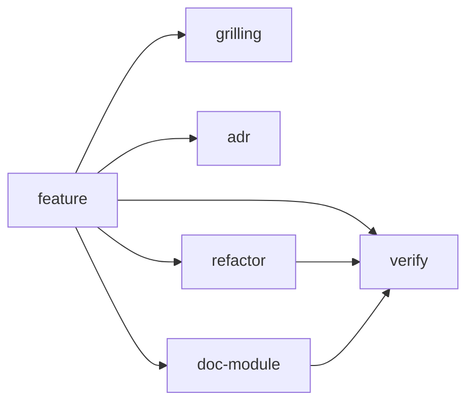

# Agent skills

Procedures that agents (Claude Code, Codex) load on demand. Each skill is a directory with a `SKILL.md` in the [Agent Skills](https://agentskills.io) format. Codex reads `.agents/skills/` and Claude Code reads `.claude/skills/`, which is a symlink to this directory. Kinetra-Lab links to the same directory, so both repositories use one set of skills.

## Table of contents

- [Skills](#skills)
- [How they fit the cycle](#how-they-fit-the-cycle)
- [Maintenance](#maintenance)

[Agent rules](../../AGENTS.md) · [Project overview](../../README.md) · [Documentation index](../../docs/README.md)

## Skills

| Skill | Use | Invoked |
| --- | --- | --- |
| [feature](feature/SKILL.md) | Run a change through the full development cycle, up to an open pull request | At the start of every change, or `/feature` |
| [grilling](grilling/SKILL.md) | Settle open decisions with the user in rounds of forms | On request, or from `feature` |
| [verify](verify/SKILL.md) | Choose and run the verification level for the diff | After changes, before committing |
| [doc-module](doc-module/SKILL.md) | Write a module README and `///` header summaries | On request, or from `feature` |
| [refactor](refactor/SKILL.md) | Behavior-preserving restructuring in tested steps | On request, or scheduled by a design document |
| [adr](adr/SKILL.md) | Record an architecture decision | When a decision qualifies |

The user's global skill set (book references such as refactoring, clean architecture and a philosophy of software design, plus `teach`, `grill-me` and `code-review`) is installed per machine and is not copied here.

## How they fit the cycle

`feature` drives the [workflow](../../docs/workflow.md); the other skills are steps it calls, but each can also be used on its own.

## Maintenance

- Skills follow the rules in [AGENTS.md](../../AGENTS.md) and link to the docs pages instead of copying them, so a rule changes in one place.
- Skill names must not collide with the global skills or with Claude Code built-ins (`code-review`, `simplify`, `init`, …).
- A skill that reaches outside the repository (push, PR, network) needs an explicit rule in AGENTS.md first.
