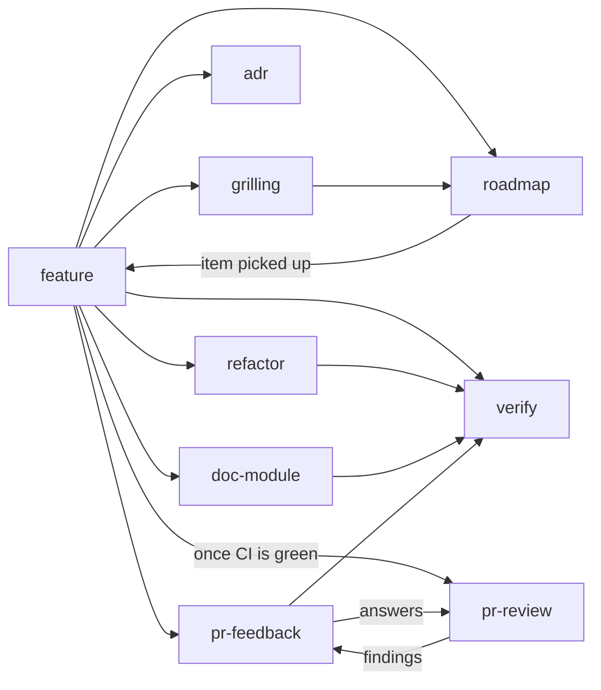

# Agent skills

Procedures that agents (Claude Code, Codex) load on demand. This page is the overview of all repository skills. Codex reads `.agents/skills/` and Claude Code reads `.claude/skills/`, which is a symlink to this directory. Kinetra-Lab links to the same directory, so both repositories use one set of skills.

Choose a skill below to see example requests and expected results. Each guide links to the agent's procedure in its sibling `SKILL.md`, which follows the [Agent Skills format](https://agentskills.io). [Skill README template](../../docs/documentation.md#skill-readme-template)

## Table of contents

- [Skills](#skills)
- [How they fit the cycle](#how-they-fit-the-cycle)
- [Maintenance](#maintenance)

[Agent rules](../../AGENTS.md) · [Project overview](../../README.md) · [Documentation index](../../docs/README.md)

## Skills

| Skill | Use | Invoked |
| --- | --- | --- |
| [feature](feature/README.md) | Run a change through the full development cycle, up to an open pull request or a stack of them | At the start of every change, or `/feature` |
| [grilling](grilling/README.md) | Settle open decisions with the user in rounds of forms | On request, or from `feature` |
| [verify](verify/README.md) | Choose and run the verification level for the diff | After changes, before committing |
| [doc-module](doc-module/README.md) | Write a module README and `///` header summaries | On request, or from `feature` |
| [refactor](refactor/README.md) | Behavior-preserving restructuring in tested steps | On request, or scheduled by a design document |
| [adr](adr/README.md) | Record an architecture decision | When a decision qualifies |
| [pr-feedback](pr-feedback/README.md) | Process review feedback: commits on the same branch, push, merged up the stack, a reply or argument per comment, lessons added, merge under the merge rule | In the author's session for every agent review; otherwise on request (`/pr-feedback`) |
| [pr-review](pr-review/README.md) | A second agent reviews a pull request or a stack: goals, the agent's code review and the repository checklist on the code, without running anything, inline comments and a conclusion, two discussion rounds, proposed lessons | By the author once a pull request's CI is green, for every pull request except a docs-only or pointer-only one, in a separate session; or by the user |
| [roadmap](roadmap/README.md) | Keep the backlog in `docs/roadmap.md`: ideas from a brainstorm, items to pick up, items closed on merge | On request (`/roadmap`, a brainstorm), or from `feature` and `grilling` |

The user's global skill set (book references such as refactoring, clean architecture and a philosophy of software design, plus `teach`, `grill-me` and `code-review`) is installed per machine and is not copied here.

## How they fit the cycle

`feature` drives the [workflow](../../docs/workflow.md); the other skills are steps it calls, but each can also be used on its own. `roadmap` sits on both sides of it: items are picked up from the backlog, and follow-ups go back into it. `feature` starts `pr-review` in a separate session once the pull request's CI is green; the author's session answers its findings with `pr-feedback`, and merges under the merge rule when nothing is open.

## Maintenance

- Skills follow the rules in [AGENTS.md](../../AGENTS.md) and link to the docs pages instead of copying them, so a rule changes in one place.
- Skill names must not collide with the global skills or with Claude Code built-ins (`code-review`, `simplify`, `init`, …).
- Skills stay agent-neutral, so Claude Code, Codex and other agents can follow them: they name no model, and a step that uses one agent's command or tool names it as an example next to a description of the action, or gives the equivalent for the others.
- A skill that reaches outside the repository (push, PR, network) needs an explicit rule in AGENTS.md first.
- A change that adds or changes a skill updates its `README.md` and the table on this page in the same commit.
