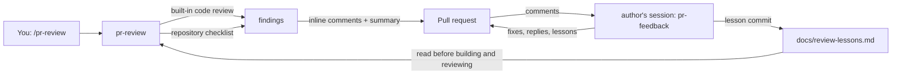

# pr-review

Lets a second agent review an open pull request, or a whole stack of them, on your request. When it finishes, every pull request has inline comments for its findings and one summary with a conclusion and points of attention, the agent that opened the pull request can process them, and lessons for other agents are proposed.

## Table of contents

- [Use cases](#use-cases)
- [When not to use it](#when-not-to-use-it)
- [How it works](#how-it-works)
- [Related skills](#related-skills)

[Skills overview](../README.md) · [Instructions for agents](SKILL.md) · [Project overview](../../../README.md) · [Documentation index](../../../docs/README.md)

## Use cases

| Situation | Example request | Result |
| --- | --- | --- |
| A pull request is ready and you want a second opinion before you read it | "/pr-review SMB-M87/Kinetra-Lab#70" | Inline comments per finding and a summary: *Ready to merge*, *Fix first* or *Questions* |
| A stack of pull requests waits for you | "/pr-review de bovenste PR van de stack" | Each pull request of the stack reviewed bottom-up, each finding on the pull request it belongs to |
| You want a deeper look at a risky change | "/pr-review Kinetra#25 high" | The same, with the built-in review at a higher level |

## When not to use it

- Your own review: the agent's review comes before yours, never instead of it. Merging stays your decision.
- Processing the comments: that is `pr-feedback`, in the session that opened the pull request.
- A change that is not a pull request yet: the `feature` skill reviews its own branch with `/code-review` in its review step.

## How it works

*Takeaway:* the reviewer only comments; the author changes the code and records the lessons, so they merge with the fix.

- It reads the rules, the review lessons and the design document before it judges the diff.
- It runs the built-in `/code-review` for correctness and checks every finding itself, then walks a checklist from the rules: design document, tests, verification level, docs, roadmap, conventions, description and merge order.
- Every comment starts with **Agent review**, so you and the author's session can tell it from your own comments. It never approves, requests changes, resolves threads or merges.
- A finding that shows a kind of mistake that can recur becomes a proposed lesson; a lesson that keeps coming back is proposed to you as a rule.

## Related skills

- `pr-feedback` processes the comments in the author's session and adds the lessons.
- `feature` reads the lessons page before building, and opens the pull requests that this skill reviews.
- The built-in `/code-review` (Claude Code) or the global `code-review` skill (Codex) does the correctness pass.
