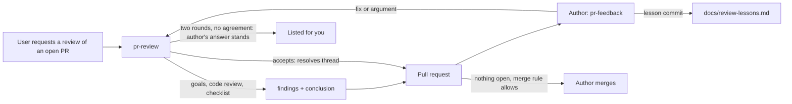

# pr-review

Use `pr-review` to request an independent review of an open pull request or stack. The reviewer reads the diff and checks the author’s scenario evidence and verification. It posts findings and a conclusion. The author handles the findings with `pr-feedback`.

## Table of contents

- [Use cases](#use-cases)
- [When not to use it](#when-not-to-use-it)
- [How it works](#how-it-works)
- [Related skills](#related-skills)

[Skills overview](../README.md) · [Instructions for agents](SKILL.md) · [Project overview](../../../README.md) · [Documentation index](../../../docs/README.md)

## Use cases

| Situation | Example request | Result |
| --- | --- | --- |
| You want a second opinion on a pull request | “review deze PR” | An independent check of goals, correctness and the evidence, with findings for the author. |
| A stack of pull requests waits | "review de stack met pr-review, vanaf de bovenste PR" | Each pull request of the stack reviewed bottom-up, each finding on the pull request it belongs to |
| You want a deeper look than the levels give | "pr-review op Kinetra#25, diepte high" | The same, with the code review at `high` even if the diff would get `low` or `medium` |

## When not to use it

- During ordinary feature delivery, use the author review in [`feature`](../feature/README.md).
- To process the comments: that is `pr-feedback`, in the session that opened the pull request.
- On a branch that is not a pull request yet: `feature` reviews its own diff with the agent's code review in its review step.

## How it works

*Takeaway:* the reviewer reviews and accepts; the author changes, argues and merges, rules, CI and releases included; what they cannot settle in two rounds goes the author's way and is listed for you to check after the merge.

- It needs write access to the repository of every pull request it reviews, both repositories for a change across Kinetra and Lab: posting a review writes through the GitHub API. In a Claude Code cloud session it attaches the other repository itself, because both repositories' `.claude/settings.json` allow that and the review tools without a prompt ([review access](../../../docs/workflow.md#review-access)); when you start it yourself for such a change, you can also select both repositories. Without write access it stops before reviewing and tells you, so that no pull request merges while its review sits unposted in a session.
- It reads the rules, the review lessons and the design document, and checks every goal of the roadmap item and the design document against the diff, with a test or recorded run as wide as the goal's wording; a docs-only pull request takes its goals from the description.
- It runs the agent's code review (Claude Code's `/code-review`, or a global `code-review` skill) for correctness and checks every finding itself. Then it walks a checklist from the rules: tests, verification level, docs, every copy of a changed rule or procedure, roadmap, conventions, description and merge order.
- Its depth follows the change: the reviewer's session runs on the most capable model at high reasoning effort, one level higher for a large pull request with much logic, and the code review at `low` for docs, `medium` for code in one module, `high` for public headers, simulation behavior, CMake, CI and releases ([levels](SKILL.md#levels)). It names no model or product, so it works with any agent.
- It builds, tests and runs nothing: CI runs every test on each push, graphics included, and the author adds what CI cannot, such as a screenshot of a changed scene and the refreshed captures it makes stale. The reviewer checks that they are there.
- Everything it posts on GitHub, the conclusion included, is in English and starts with **Agent review**. It reports to you in the chat in Dutch.
- Round 1 reviews the whole diff; a later round reviews only the commits since the last conclusion, at the depth they need, so it does not find new nits on lines an earlier round passed. Nits go only into the summary, and fixing them in Markdown-only commits that leave the agent rules alone keeps a *Ready to merge*. From round 3 on, a pull request gets only blocking findings; the rest is listed for you to check after the merge ([levels and rounds](SKILL.md#6-classify)).
- It resolves the threads it accepts and those that reached two rounds, and never approves, requests changes, pushes or merges.
- A finding that shows a kind of mistake that can recur becomes a proposed lesson. A lesson that keeps coming back is proposed to you as a rule.

## Related skills

- `pr-feedback` answers the findings in the author's session, adds the lessons, and leads to the merge under the merge rule.
- `feature` tests and reviews the change in the implementing session.
- The agent's code review (Claude Code's `/code-review`, or a global `code-review` skill, as in Codex) does the correctness pass.
