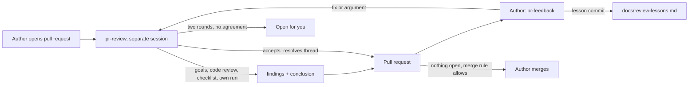

# pr-review

A second agent reviews every pull request, or a whole stack of them. The author starts it right after opening the pull request, and you can start it too. When it finishes, the pull request has inline comments for its findings and a summary with a conclusion. The author's session has answered each finding, the two agents have settled what they could, and the pull request is either merged by its author or waiting for you with the points that need your word.

## Table of contents

- [Use cases](#use-cases)
- [When not to use it](#when-not-to-use-it)
- [How it works](#how-it-works)
- [Related skills](#related-skills)

[Skills overview](../README.md) · [Instructions for agents](SKILL.md) · [Project overview](../../../README.md) · [Documentation index](../../../docs/README.md)

## Use cases

| Situation | Example request | Result |
| --- | --- | --- |
| An agent opened a pull request | Started by that agent, in a separate session | Goals, correctness and the checklist reviewed. Findings go to the author, two discussion rounds at most per point, then a merge by the author or a pull request waiting for you |
| A stack of pull requests waits | "/pr-review de bovenste PR van de stack" | Each pull request of the stack reviewed bottom-up, each finding on the pull request it belongs to |
| You want a deeper look at a risky change | "/pr-review Kinetra#25 high" | The same, with the built-in review at a higher level |

## When not to use it

- As a replacement for your decision on agent rules, skills, CI, releases or your own checks: those pull requests always wait for you ([merge rule](../../../AGENTS.md#git)).
- To process the comments: that is `pr-feedback`, in the session that opened the pull request.
- On a branch that is not a pull request yet: `feature` reviews its own diff with `/code-review` in its review step.

## How it works

*Takeaway:* the reviewer reviews and accepts; the author changes, argues and merges; anything they cannot settle, and every change to rules, CI or your own checks, stays for you.

- It reads the rules, the review lessons and the design document, and checks every goal of the roadmap item and the design document against the diff.
- It runs the built-in `/code-review` for correctness and checks every finding itself. Then it walks a checklist from the rules: tests, verification level, docs, roadmap, conventions, description and merge order.
- It builds and runs what CI does not cover: graphics tests and, in Lab, a screenshot of the changed scene.
- Everything it posts on GitHub, the conclusion included, is in English and starts with **Agent review**. It reports to you in the chat in Dutch.
- It resolves the threads it accepts, and never approves, requests changes, pushes or merges.
- A finding that shows a kind of mistake that can recur becomes a proposed lesson. A lesson that keeps coming back is proposed to you as a rule.

## Related skills

- `pr-feedback` answers the findings in the author's session, adds the lessons, and leads to the merge under the merge rule.
- `feature` starts this review after opening a pull request, and reads the lessons page before building.
- The built-in `/code-review` (Claude Code) or the global `code-review` skill (Codex) does the correctness pass.
