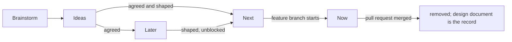

# roadmap

Keeps the backlog in `docs/roadmap.md` up to date: ideas from a brainstorm go in, items get shaped until they can be picked up, and finished items leave when their pull request merges. When it finishes, the roadmap says what is in progress, what comes next and which ideas are waiting.

## Table of contents

- [Use cases](#use-cases)
- [When not to use it](#when-not-to-use-it)
- [How it works](#how-it-works)
- [Related skills](#related-skills)

[Skills overview](../README.md) · [Instructions for agents](SKILL.md) · [Project overview](../../../README.md) · [Documentation index](../../../docs/README.md)

## Use cases

| Situation | Example request | Result |
| --- | --- | --- |
| You brainstorm about a future direction | "Ik wil ooit Kinetra-Lab op Android draaien" | An item under Ideas in Kinetra's and Lab's roadmap, with the facts it rests on and the open questions |
| You want to know what is left | "Wat staat er nog open?" | A short summary per section, in Dutch, with the first item of Next as a proposal |
| An idea is ready to be built | "Laten we de skill-READMEs oppakken" | Open questions settled, the item in Next, and on agreement a `feature` branch that moves it to Now |
| A design session leaves work for later | From `feature` or `grilling`: a branch of the design tree deferred | An item in Next or Later that links the design document |
| A pull request finishes an item | From `feature` step 8 | The item removed, and the follow-ups from the design document's open points added |

## When not to use it

- A change that is being built now: its scope, decisions and history belong in its design document.
- A known gap that nobody plans to act on: leave it under *Open points* on the page it concerns.
- Bugs found during a change: note them in that change's design document first; they reach the roadmap when they are planned.

## How it works

*Takeaway:* an item only moves up on the user's agreement, and it leaves the roadmap when its work is merged.

- It reads the roadmap and the [format](../../../docs/documentation.md#roadmap) first, so it extends existing items instead of adding duplicates.
- It looks up the facts an idea rests on, and asks the user only for goals and priorities.
- It edits the roadmap on a branch and never deletes an idea of the user without asking.

## Related skills

- Calls `grilling` to settle open questions while shaping an item, and `feature` to start one.
- Called by `feature` (follow-ups when a branch is designed and when it is finished) and by `grilling` (deferred branches of the design tree).
