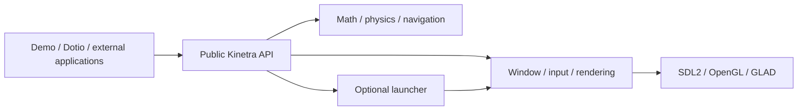

# Kinetra

A reusable C++20 2D simulation library and optional SDL2/OpenGL 3.3 runtime. Demo is the reference application; Dotio remains in-tree while its external-consumer boundary is verified.



Applications provide behavior; Kinetra provides reusable systems. Simulation has no graphics dependency.

## Table of contents

- [Features](#features)
- [Quick start](#quick-start)
- [Demo and Dotio](#demo-and-dotio)
- [Using Kinetra](#using-kinetra)
- [Documentation](#documentation)
- [Platform support](#platform-support)
- [License](#license)

## Features

| Area | Implemented |
| --- | --- |
| Simulation | Circles/oriented boxes, impulses, friction, gravity, spatial queries and grid collision |
| Navigation | Bounded eight-neighbor A*, swept clearance, endpoint projection, smoothing and local steering |
| Runtime | Resizable window, input transitions, camera transforms, batched colored primitives and bitmap text |
| Applications | Configurable fixed clocks, sessions, optional registered launcher and debug/help controls |

## Quick start

Requires a C++20 compiler and CMake 3.16+. Runtime builds require SDL2 development files and OpenGL 3.3. Tests also require Python 3.

```sh
cmake -S . -B build -DCMAKE_BUILD_TYPE=Release
cmake --build build --parallel
ctest --test-dir build --output-on-failure
./build/kinetra
```

`build/kinetra_sandbox` opens the same launcher. For a bounded direct run:

```sh
./build/kinetra --variant demo --frames 120
./build/kinetra --variant dotio --difficulty medium --frames 120
./build/kinetra_dotio --difficulty medium --frames 120
```

Headless build, without SDL/OpenGL:

```sh
cmake -S . -B build-headless -DKINETRA_BUILD_DEMO=OFF -DCMAKE_BUILD_TYPE=Release
cmake --build build-headless --parallel
ctest --test-dir build-headless --output-on-failure
```

Use a fresh build directory when changing between graphics and headless configurations; cached options retain their values. See [verification](docs/development.md) for graphics tests, dependencies and external-consumer checks.

## Demo and Dotio

| Application | Purpose | Guide |
| --- | --- | --- |
| Demo | Streamed terrain, navigation, wandering agents and mixed physics modes | [Demo](docs/demo/README.md) |
| Dotio | Survival game with local AI, difficulty, combat and procedural corridors | [Dotio](docs/dotio/README.md) |

Select with arrows/Enter or click. M returns to the menu, H toggles help, Backquote opens debug controls. Each selection creates a fresh session. Dotio adds a difficulty screen. Detailed bindings and gameplay belong in the guides.

## Using Kinetra

```cmake
set(KINETRA_BUILD_DEMO OFF CACHE BOOL "" FORCE)
set(BUILD_TESTING OFF CACHE BOOL "" FORCE)
add_subdirectory(external/Kinetra)
add_executable(my_simulation main.cpp)
target_link_libraries(my_simulation PRIVATE Kinetra::Simulation)
```

```cpp
#include <kinetra/physics.h>

int main() {
    kinetra::World world;
    world.add({});
    world.step(1.f / 120);
}
```

Set `KINETRA_BUILD_RUNTIME=ON` before `add_subdirectory()` to obtain `Kinetra::Runtime` independently of examples. Set `KINETRA_BUILD_LAUNCHER=ON` for `Kinetra::Launcher`, which requires Runtime. [Integration details](docs/engine/runtime.md#external-consumers) cover direct sessions and external Dotio. Checkout integration is supported; installed CMake packages are not provided.

## Documentation

Start at the [documentation index](docs/README.md) or [architecture map](docs/architecture.md). Subsystem pages cover [math/physics](docs/engine/math-physics.md), [navigation](docs/engine/navigation.md), [runtime/rendering](docs/engine/runtime.md) and [launcher/overlays](docs/engine/launcher-overlays.md). [AGENTS.md](AGENTS.md) contains permanent engineering rules; [decisions](docs/README.md#decisions) preserve design history.

## Platform support

Linux is the supported target, with Artix/Linux as the desktop target. Software-rendered checks do not establish desktop performance or input feel. Windows/macOS and 3D are unsupported.

Physics is discrete: no continuous rigid-body collision detection, joints or robust stacking manifold. Fast bodies can tunnel. Navigation uses a conservative circular envelope and does not guarantee arrival in moving crowds. Rendering supports colored primitives and bitmap text, without textures or pose interpolation. Cross-machine bitwise determinism is not promised.

## License

MIT; see [LICENSE](LICENSE). Generated GLAD retains embedded licenses. Dotio attribution and port limits are in its [provenance](docs/dotio/README.md#provenance).
