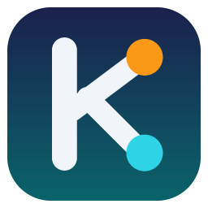

<p align="center">
  
</p>

# Kinetra

Reusable C++20 2D simulation library with an optional SDL2/OpenGL 3.3 runtime.
[Kinetra-Lab](https://github.com/SMB-M87/Kinetra-Lab) owns applications, the bundled launcher executable and experiments. Kinetra builds independently of Lab.

## Table of contents

- [Features](#features)
- [Modules](#modules)
- [Quick start](#quick-start)
- [Using Kinetra](#using-kinetra)
- [Working with Kinetra-Lab](#working-with-kinetra-lab)
- [Documentation](#documentation)
- [Platform support](#platform-support)
- [License](#license)

[Documentation index](docs/README.md)

Directory guides: [docs](docs/README.md), [tests](tests/README.md), [tools](tools/README.md).

## Features

- Headless geometry, collisions, physics, spatial queries, navigation and steering.
- Optional window, input, camera, colored primitives, bitmap text and direct sessions.
- Public C++ headers under `include/kinetra/`, grouped by layer in `simulation/`, `view/` and `runtime/`; CMake targets `Kinetra::Simulation`, optional `Kinetra::Runtime` and `Kinetra::Launcher`.
- Optional reusable launcher menu and session host in `<kinetra/runtime/launcher.h>`; application registration and gameplay remain in Lab.

## Modules

| Module | CMake target | Public headers in `include/kinetra/<layer>/` | Guide |
| --- | --- | --- | --- |
| Simulation: geometry, physics, spatial queries, navigation, steering, avoidance, traffic admission | `Kinetra::Simulation` | `simulation/`: `math.h`, `physics.h`, `spatial_grid.h`, `collision_grid.h`, `navigation.h`, `weighted_grid.h`, `steering.h`, `avoidance.h`, `traffic.h` | [Simulation](src/simulation/README.md) |
| View: camera, input and debug-menu rows, usable headless | header-only, with `Kinetra::Simulation` | `view/`: `camera.h`, `input.h`, `debug_menu.h` | [Runtime and launcher](src/runtime/README.md) |
| Runtime: window, drawing, sessions, overlays | `Kinetra::Runtime` (optional) | `runtime/`: `engine.h`, `session.h`, `settings_view.h`, and header-only `timing.h`, `bitmap_text.h`, `overlay_style.h`, `debug_view.h`, `help_view.h` | [Runtime and launcher](src/runtime/README.md) |
| Launcher: menu, session host and loop | `Kinetra::Launcher` (optional) | `runtime/launcher.h` | [Runtime and launcher](src/runtime/README.md) |
| Tests and the external consumer | | | [Core tests](tests/README.md) |

Include headers with their layer, as `<kinetra/simulation/physics.h>`; a headless consumer includes `simulation/` and `view/` only. The rule for both repositories is in [conventions](docs/conventions.md#directory-layout). `include/glad/` and `include/KHR/` hold the generated OpenGL loader; they are private to the runtime. The vendored test framework is described in [third_party/doctest](third_party/doctest/README.md).

## Quick start

Requires C++20, CMake 3.16+, a build tool. The default build is headless.

```sh
cmake --workflow --preset dev        # Debug, runtime, warnings; needs CMake 3.25+, Ninja, ccache
cmake --workflow --preset headless   # simulation only, no SDL2/OpenGL needed
```

Without presets: `cmake -S . -B build -DCMAKE_BUILD_TYPE=Release && cmake --build build --parallel && ctest --test-dir build`. Enable `-DKINETRA_BUILD_RUNTIME=ON` for SDL2/OpenGL (development packages required).
See [development](docs/development.md) for all presets, editor setup and graphics verification. Run applications from Kinetra-Lab.

## Using Kinetra

Source integration:

```cmake
set(BUILD_TESTING OFF CACHE BOOL "" FORCE)
add_subdirectory(external/Kinetra)
add_executable(my_simulation main.cpp)
target_link_libraries(my_simulation PRIVATE Kinetra::Simulation)
```

```cpp
#include <kinetra/simulation/physics.h>

int main() {
    kinetra::World world;
    world.add({});
    world.step(1.f / 120);
}
```

Runtime consumers enable `KINETRA_BUILD_RUNTIME` and link `Kinetra::Runtime`. Kinetra also supplies `Kinetra::Launcher` for the generic menu, session host and launcher loop. Integration uses source targets; there is no installed CMake package.

## Working with Kinetra-Lab

Kinetra-Lab includes Kinetra as a Git submodule at `external/Kinetra` and records one exact engine commit. An engine change is made, committed and published here first; Lab then moves its pointer to that commit and verifies the applications against it. Application-only changes belong in Lab. Lab's [external dependencies guide](https://github.com/SMB-M87/Kinetra-Lab/blob/main/external/README.md) has the steps and commands, including building Lab against an unpublished sibling checkout, and the [workflow](docs/workflow.md#changes-across-kinetra-and-lab) gives the merge order.

## Documentation

Start with the [documentation index](docs/README.md) and the [architecture](docs/architecture.md); each [module guide](#modules) explains its own code.

Contributors follow the [development workflow](docs/workflow.md): every change gets a [design document](docs/design/README.md), tests, a review and documentation, and is verified at the [level its impact requires](docs/testing.md#verification-levels). [AGENTS.md](AGENTS.md) records the rules for agents and developers; [conventions](docs/conventions.md) and the [documentation guide](docs/documentation.md) give the details.

## Platform support

Linux is supported: CI builds and tests on a pinned Arch toolchain, the reference, and on Ubuntu 24.04 LTS ([dependencies per distribution](docs/development.md#dependencies-and-options)); Artix/Linux is the desktop target. Windows/macOS and 3D are unsupported.
Continuous collision detection covers circles and nonrotating boxes and polygons; rotating boxes and polygons are checked discretely and can tunnel. Navigation does not guarantee arrival in moving crowds.
Rendering has no texture system or pose interpolation. Cross-machine bitwise determinism is not promised.

## License

MIT; see [LICENSE](LICENSE). Generated GLAD retains embedded licenses.
