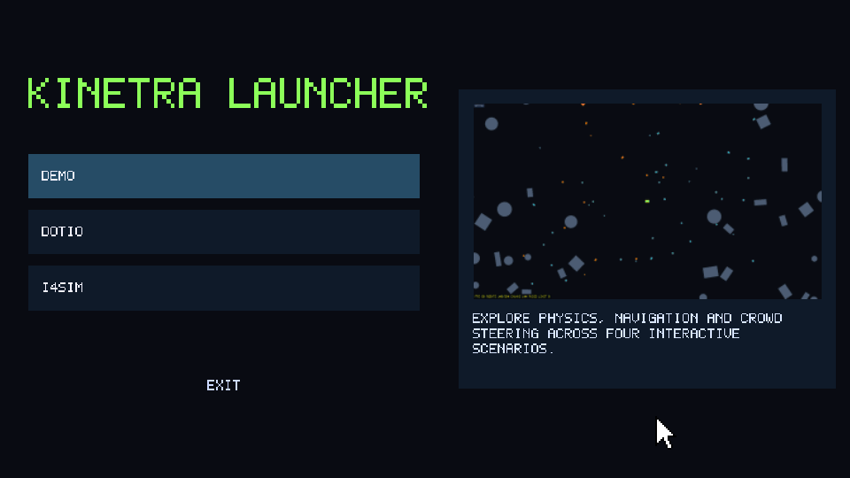
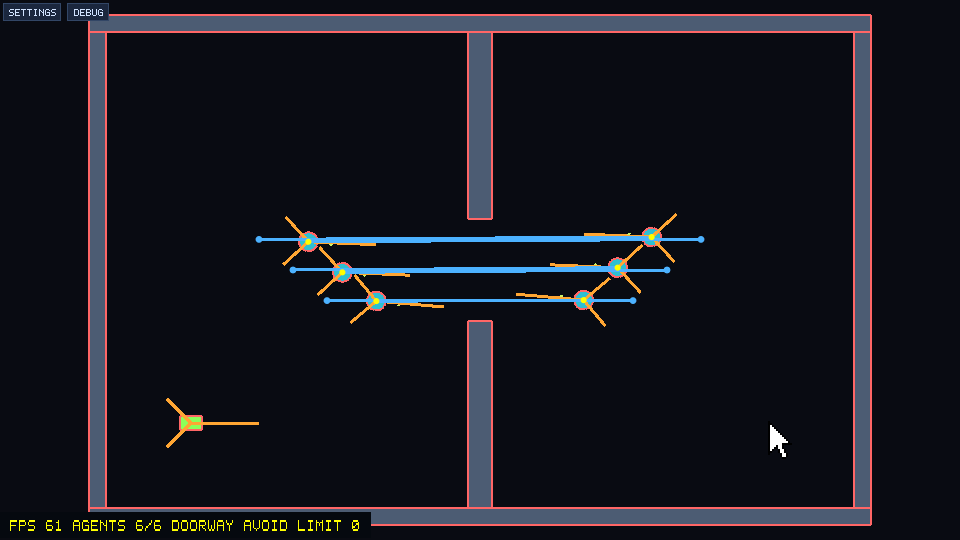
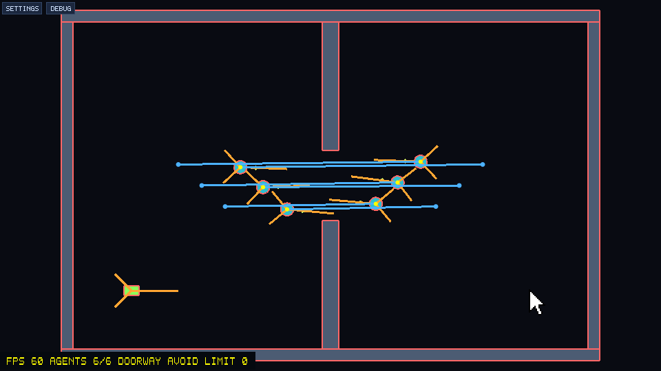
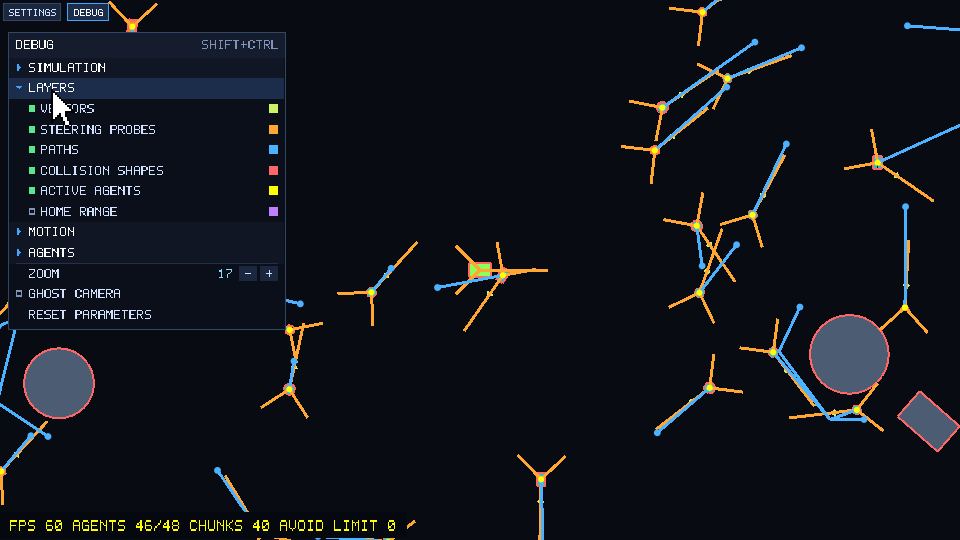

<p align="center">
  
</p>

# Kinetra

Reusable C++20 2D simulation library with an optional SDL2/OpenGL 3.3 runtime.
[Kinetra-Lab](https://github.com/SMB-M87/Kinetra-Lab) owns applications, the bundled launcher executable and experiments. Kinetra builds independently of Lab.

## Table of contents

- [Features](#features)
- [Shared UI](#shared-ui)
- [Modules](#modules)
- [Quick start](#quick-start)
- [Using Kinetra](#using-kinetra)
- [Working with Kinetra-Lab](#working-with-kinetra-lab)
- [Documentation](#documentation)
- [Platform support](#platform-support)
- [License](#license)

[Documentation index](docs/README.md)

Directory guides: [docs](docs/README.md), [media](docs/media/README.md), [tests](tests/README.md), [tools](tools/README.md).

## Features

- Headless geometry, collisions, physics, spatial queries, navigation and steering.
- Optional window, input, camera, colored primitives, RGBA image drawing, bitmap text and direct sessions.
- Public C++ headers under `include/kinetra/`, grouped by layer in `simulation/`, `view/` and `runtime/`; CMake targets `Kinetra::Simulation`, optional `Kinetra::Runtime` and `Kinetra::Launcher`.
- Optional reusable launcher menu and session host in `<kinetra/runtime/launcher.h>`; application registration and gameplay remain in Lab.

## Shared UI

Every Kinetra-Lab application runs in the same shell: the launcher menu and session host of `Kinetra::Launcher`, and the runtime's overlays. The applications supply rows, content and actions; Kinetra lays them out, draws them and captures their input ([contracts](docs/engine/launcher-overlays.md)). The GIFs show them in Kinetra-Lab's Demo, with the pointer and keys a person would use ([how they are made](docs/media/README.md)).

| Part | In use |
| --- | --- |
| **Launcher menu** (`LaunchMenu`, `SessionHost`) |  |
| **Settings panel** (`SettingsOverlay`) |  |
| **Debug menu** (`DebugMenu`) |  |
| **Agent inspector and frame times** (`InspectorView`, `draw_frame_times`) |  |
| **Debug layers** |  |

## Modules

| Module | CMake target | Public headers in `include/kinetra/<layer>/` | Guide |
| --- | --- | --- | --- |
| Simulation: geometry, physics, spatial queries, navigation, steering, avoidance, passing, traffic admission, the fixed clock | `Kinetra::Simulation` | `simulation/`: `math.h`, `physics.h`, `spatial_grid.h`, `collision_grid.h`, `navigation.h`, `weighted_grid.h`, `steering.h`, `avoidance.h`, `passing.h`, `passing_coordinator.h`, `traffic.h`, `clock.h` | [Simulation](src/simulation/README.md) |
| View: camera, input, debug-menu rows and frame statistics, usable headless | header-only, with `Kinetra::Simulation` | `view/`: `camera.h`, `input.h`, `debug_menu.h`, `inspector.h`, `timing.h` | [Runtime and launcher](src/runtime/README.md) |
| Runtime: window, drawing, sessions, overlays | `Kinetra::Runtime` (optional) | `runtime/`: `engine.h`, `session.h`, `settings_view.h`, `inspector_view.h`, and header-only `bitmap_text.h`, `overlay_style.h`, `debug_view.h`, `help_view.h` | [Runtime and launcher](src/runtime/README.md) |
| Launcher: menu, session host and loop | `Kinetra::Launcher` (optional) | `runtime/launcher.h` | [Runtime and launcher](src/runtime/README.md) |
| Tests and the external consumer | | | [Core tests](tests/README.md) |

Include headers with their layer, as `<kinetra/simulation/physics.h>`; a headless consumer includes `simulation/` and `view/` only. The rule for both repositories is in [conventions](docs/conventions.md#directory-layout). `include/glad/` and `include/KHR/` hold the generated OpenGL loader; they are private to the runtime. The vendored test framework is described in [third_party/doctest](third_party/doctest/README.md).

## Quick start

Requires C++20, CMake 3.16+, a build tool. The default build is headless.

```sh
cmake --workflow --preset dev        # Debug, runtime, warnings; needs CMake 3.25+, Ninja, ccache
cmake --workflow --preset headless   # simulation only, no SDL2/OpenGL needed
```

Without presets: `cmake -S . -B build -DCMAKE_BUILD_TYPE=Release && cmake --build build --parallel && ctest --test-dir build`. Enable `-DKINETRA_BUILD_RUNTIME=ON` for SDL2/OpenGL (development packages required).
See [development](docs/development.md) for all presets, editor setup and graphics verification. Run applications from Kinetra-Lab.

## Using Kinetra

Source integration:

```cmake
set(BUILD_TESTING OFF CACHE BOOL "" FORCE)
add_subdirectory(external/Kinetra)
add_executable(my_simulation main.cpp)
target_link_libraries(my_simulation PRIVATE Kinetra::Simulation)
```

```cpp
#include <kinetra/simulation/physics.h>

int main() {
    kinetra::World world;
    world.add({});
    world.step(1.f / 120);
}
```

Runtime consumers enable `KINETRA_BUILD_RUNTIME` and link `Kinetra::Runtime`. Kinetra also supplies `Kinetra::Launcher` for the generic menu, session host and launcher loop. Integration uses source targets; there is no installed CMake package.

## Working with Kinetra-Lab

Kinetra-Lab includes Kinetra as a Git submodule at `external/Kinetra` and records one exact engine commit. An engine change is made, committed and published here first; Lab then moves its pointer to that commit and verifies the applications against it. Application-only changes belong in Lab. Lab's [external dependencies guide](https://github.com/SMB-M87/Kinetra-Lab/blob/main/external/README.md) has the steps and commands, including building Lab against an unpublished sibling checkout, and the [workflow](docs/workflow.md#changes-across-kinetra-and-lab) gives the merge order.

## Documentation

Start with the [documentation index](docs/README.md) and the [architecture](docs/architecture.md); each [module guide](#modules) explains its own code.

Contributors follow the [development workflow](docs/workflow.md): every code change gets a [design document](docs/design/README.md), tests, an independent review and documentation, a change to documentation alone gets the author's own review, and each is verified at the [level its impact requires](docs/testing.md#verification-levels). [AGENTS.md](AGENTS.md) records the rules for agents and developers; [conventions](docs/conventions.md) and the [documentation guide](docs/documentation.md) give the details.

## Platform support

Kinetra is built from source on Linux. Ubuntu 24.04 LTS is the Linux reference for CI. See the [dependencies per distribution](docs/development.md#dependencies-and-options).
Continuous collision detection covers circles and nonrotating boxes and polygons; rotating boxes and polygons are checked discretely and can tunnel. Navigation does not guarantee arrival in moving crowds.
Rendering supports standalone RGBA images supplied by the caller. Applications own pose interpolation. Cross-machine bitwise determinism is not promised.

## License

MIT; see [LICENSE](LICENSE). Generated GLAD retains embedded licenses.
