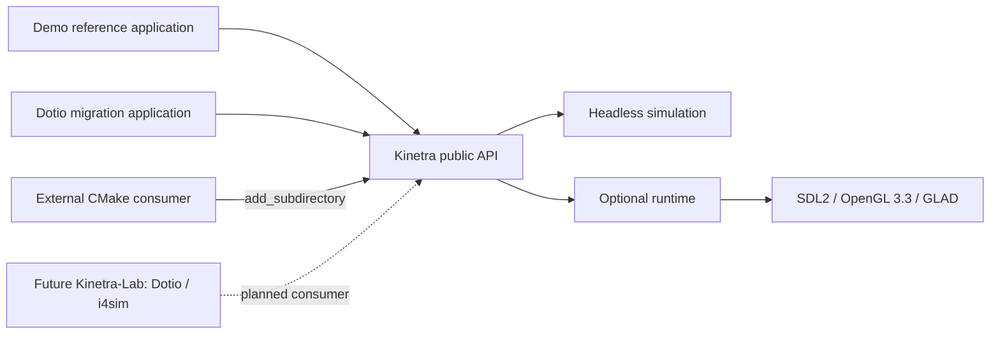
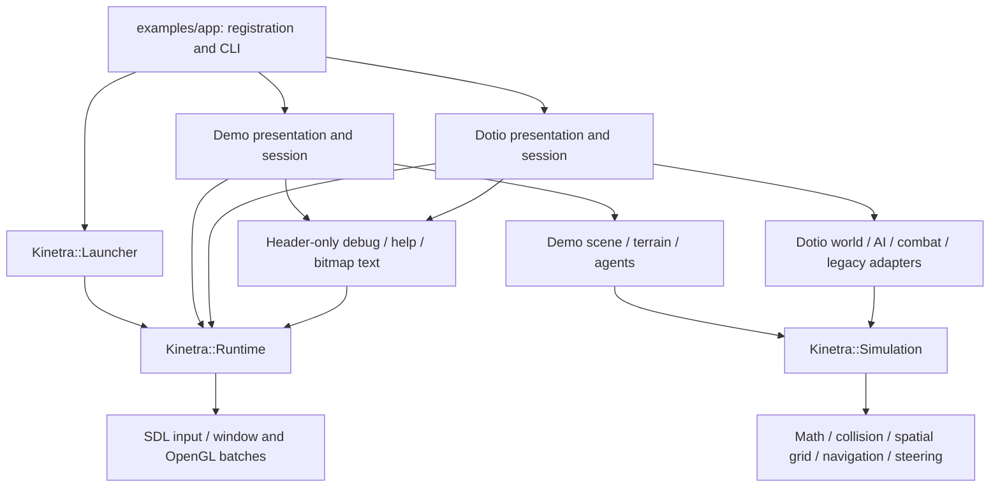
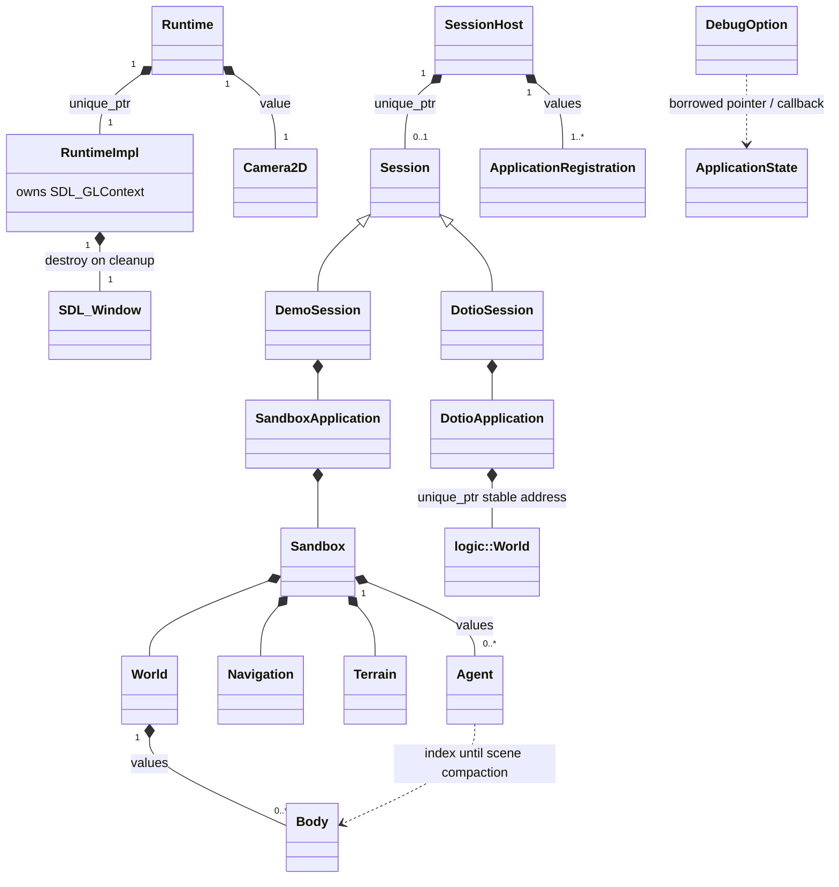
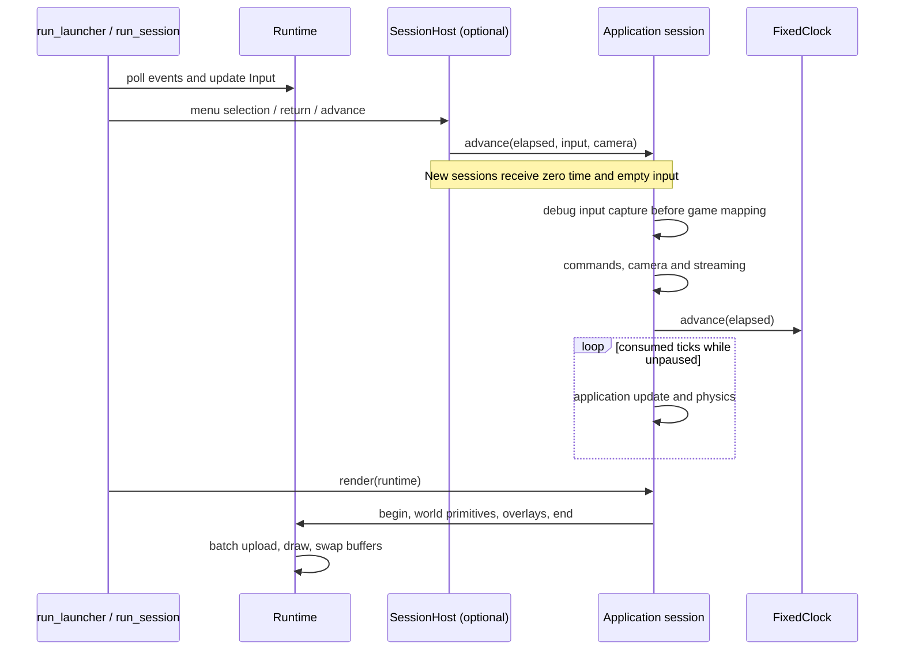

# Architecture

The public API is under `include/kinetra/`. Three CMake targets express linking boundaries; directories are not separate libraries.

## Table of contents

- [System context](#system-context)
- [Components and build dependencies](#components-and-build-dependencies)
- [Object ownership](#object-ownership)
- [Frame interaction](#frame-interaction)
- [Responsibility map](#responsibility-map)

## System context

Demo and Dotio are current applications. Kinetra-Lab is a future repository, not a current dependency. No sibling repository is needed.

## Components and build dependencies

Arrows denote consumption; UI headers call Runtime drawing methods rather than adding a linked module. Camera and FixedClock are pure header utilities. Runtime does not link Simulation, and engine source never includes application headers. [CMake](../CMakeLists.txt) is authoritative for target composition.

## Object ownership

Runtime outlives sessions; application factories receive a camera value to configure. Scene compaction remaps Demo body indices. Only `Session` uses inheritance here; body shape and motion are enums. Dotio's static raster limits it to one active world, despite the generic host supporting arbitrary factories.

## Frame interaction

The standard engine launcher loop supplies wall-clock time; direct consumers can use `run_session`. Applications own pause and fixed-update policies. Demo runs at 120 Hz; Dotio consumes 60 Hz movement ticks with 20 Hz AI. Paused time is consumed without replay on resume. Detailed flows: [runtime](engine/runtime.md), [physics](engine/math-physics.md), [navigation](engine/navigation.md).

## Responsibility map

| Engine mechanism | Application policy |
| --- | --- |
| Vector, shape, contact, impulse and grid query | Pixel/world conversion and damage/rewards |
| A*, swept clearance, path shortening and steering | Wander targets, combat paths, retries and timeouts |
| Runtime, input values, camera and fixed clock | Bindings, zoom bounds, pause and update frequencies |
| Registered menu, session ownership and shared overlay layout | Application factories, difficulty choices and debug values |
| Primitive drawing and bitmap text | Terrain appearance, health bars and AI visualizations |

[Decision 0008](decisions/0008-public-engine-and-consumers.md) records the public-boundary migration and compatibility costs.
