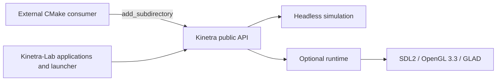
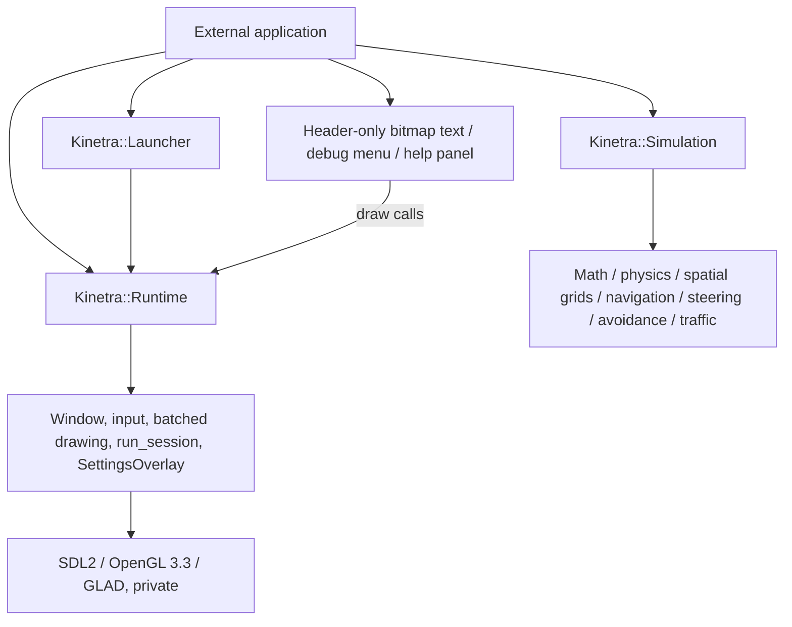
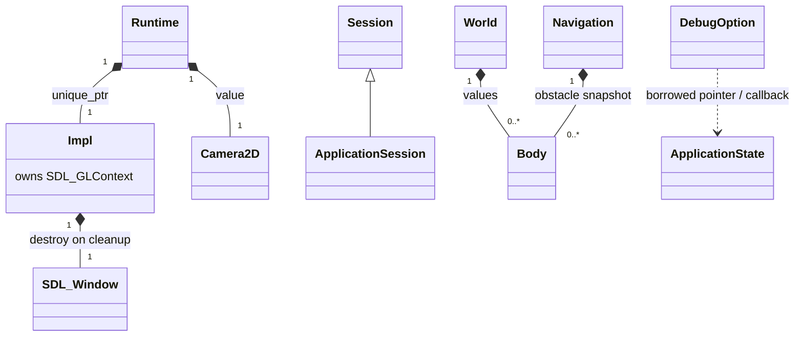
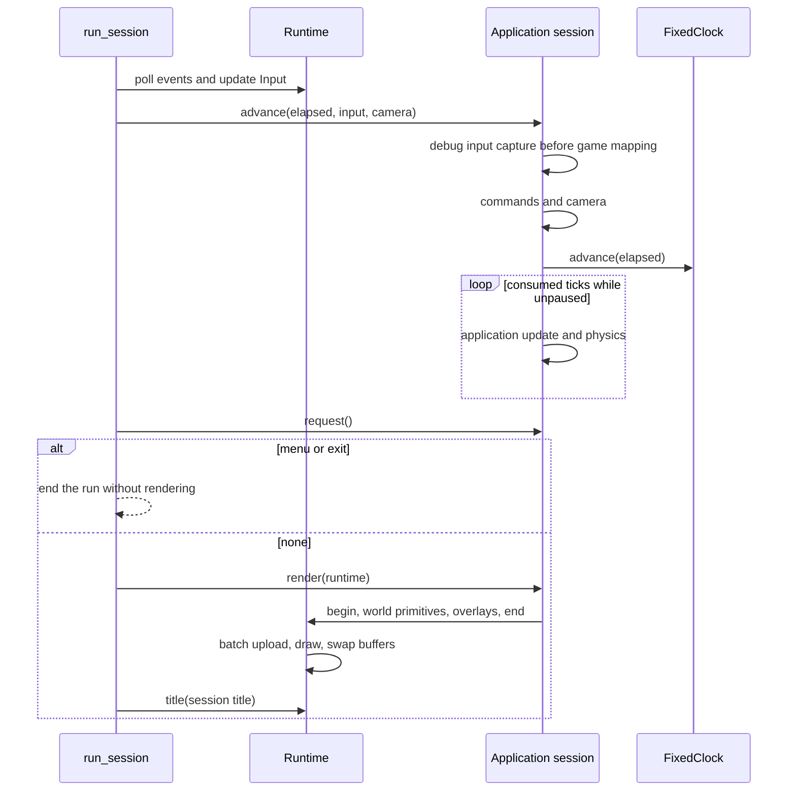

# Architecture

The public API is under `include/kinetra/`. Three core CMake targets express linking boundaries; directories are not separate libraries.

## Table of contents

- [System context](#system-context)
- [Components and build dependencies](#components-and-build-dependencies)
- [Object ownership](#object-ownership)
- [Frame interaction](#frame-interaction)
- [Responsibility map](#responsibility-map)

[Project overview](../README.md) · [Documentation index](README.md)

## System context

Applications and the bundled launcher executable live in Kinetra-Lab. Kinetra owns the generic `Kinetra::Launcher` menu, host and event loop. Core builds and tests need no sibling repository. Lab consumes the public source targets through `add_subdirectory`.

## Components and build dependencies

Arrows denote consumption; the header-only UI calls Runtime drawing methods rather than adding a linked module, while `SettingsOverlay` is compiled into Runtime. `Camera2D`, `FixedClock` and `RateCounter` are header-only utilities that need no runtime. Runtime does not link Simulation, and engine source never includes application headers. [CMake](../CMakeLists.txt) is authoritative for target composition.

## Object ownership

`Impl` is the private `Runtime::Impl`, which keeps SDL and OpenGL types out of the public header. The caller owns Runtime and the concrete Session and keeps both alive throughout `run_session`. World owns body values; Navigation copies obstacle geometry. Overlay callbacks and pointers borrow application state. Only Session uses inheritance here; body shape and motion are enums.

## Frame interaction

`run_session` supplies wall-clock elapsed time, polls input, reads the session's request after every advance and updates the window title after rendering. A session that asks to leave is never drawn again; `run_launcher` follows the same rule ([sessions and requests](engine/launcher-overlays.md#sessions-and-requests)). Applications own pause behavior and fixed-update policies, including rates and backlog consumption. Detailed contracts: [runtime](engine/runtime.md), [physics](engine/math-physics.md), [navigation](engine/navigation.md).

## Responsibility map

| Engine mechanism | Application policy |
| --- | --- |
| Vector, shape, contact, impulse and grid query | Pixel/world conversion and damage/rewards |
| A*, swept clearance, path shortening and steering | Wander targets, combat paths, retries and timeouts |
| Runtime, input values, camera and fixed clock | Bindings, zoom bounds, pause and update frequencies |
| Direct sessions, generic launcher and shared overlay layout | Lab application registration, factories, difficulty and debug values |
| Primitive drawing and bitmap text | Terrain appearance, health bars and AI visualizations |

[Decision 0008](decisions/0008-public-engine-and-consumers.md) records the public-boundary migration and compatibility costs.
