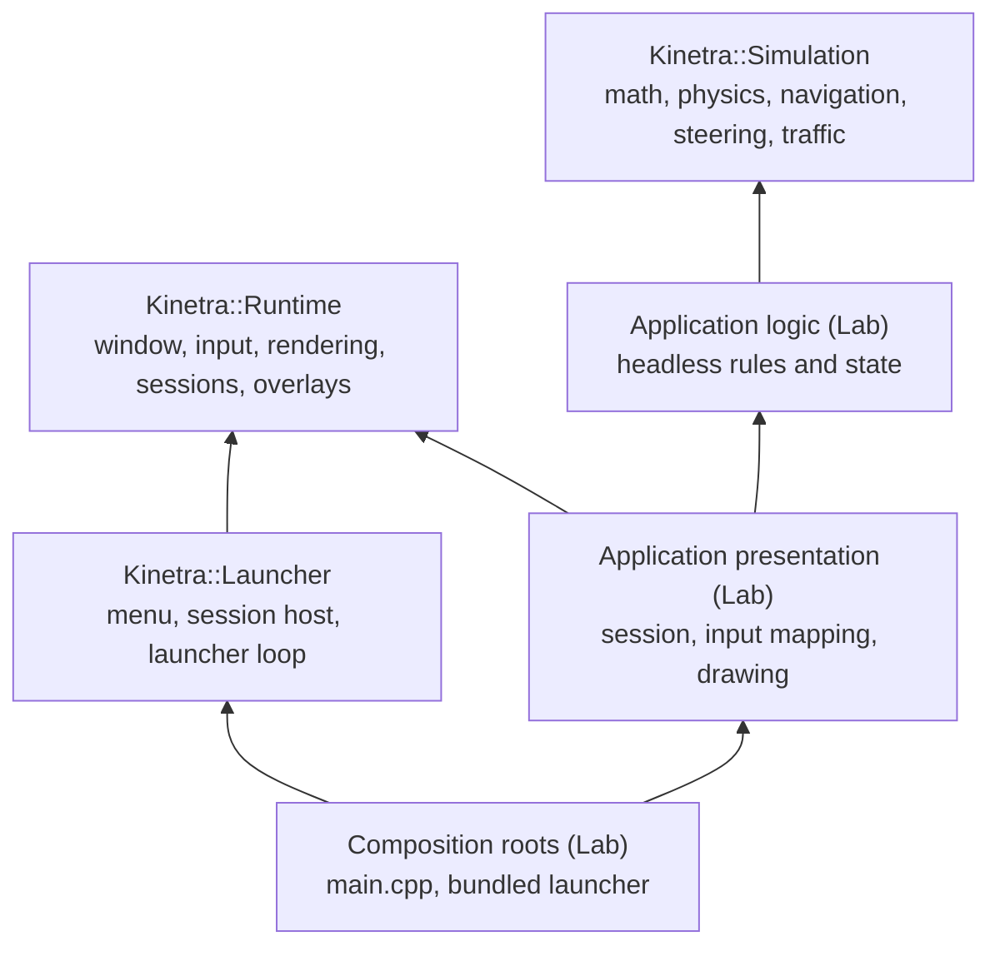

# C++ and CMake conventions

How code in Kinetra and Kinetra-Lab is written and structured. The rules apply to new and changed code. Existing code is brought in line when a change touches it, or through a planned refactor; there are no drive-by mass rewrites.

## Table of contents

- [Files and formatting](#files-and-formatting)
- [Naming](#naming)
- [Headers and includes](#headers-and-includes)
- [Ownership and lifetime](#ownership-and-lifetime)
- [State, units and determinism](#state-units-and-determinism)
- [Functions and classes](#functions-and-classes)
- [Errors](#errors)
- [Layers and dependencies](#layers-and-dependencies)
- [Design patterns](#design-patterns)
- [CMake](#cmake)
- [Open points](#open-points)

[Project overview](../README.md) · [Documentation index](README.md) · [Agent rules](../AGENTS.md)

## Files and formatting

- C++20, with headers in `.h` and implementations in `.cpp`. Generated and third-party sources stay untouched.
- Code compiles without warnings under `KINETRA_WARNINGS` (`-Wall -Wextra -Wpedantic -Wshadow -Wconversion`). CI enforces this for Kinetra with `-Werror`. Make conversions explicit (`static_cast<float>(count)`) instead of silencing the warning.
- `.clang-format` in the repository root is authoritative: LLVM-based, 4-space indent, 110 columns. Format the files you change (`clang-format -i <files>`). A repository-wide reformat is a separate `chore` commit.
- One main type or cohesive group of functions per header and `.cpp` pair; file names are `snake_case`.

## Naming

| Element | Style | Example |
| --- | --- | --- |
| Types, enums, concepts | `PascalCase` | `TrafficGate`, `SteeringProfile` |
| Functions, variables, members | `snake_case` | `plan_route`, `pixels_per_unit` |
| Private data members | `snake_case_` with trailing underscore | `queue_`, `admitted_` |
| Enumerators | `snake_case` | `ProductState::processing` |
| Constants | `snake_case`, `constexpr`, named for meaning and unit | `max_speed_mm_per_tick` |
| Namespaces | short lowercase | `kinetra`, `i4sim` |

Names say what something means in the domain, not how it is stored: `remaining_ticks`, not `counter2`. Avoid abbreviations except established ones (`id`, `aabb`, `rng`).

## Headers and includes

- Use `#pragma once`; no include guards in new code.
- Include order, in blocks separated by a blank line: the own header, project headers (`"..."`), Kinetra headers (`<kinetra/...>`), other third-party headers, then the standard library.
- Include what you use. Forward-declare in headers when that avoids a heavy include.
- No `using namespace` at namespace or global scope in headers.
- Prefer target include directories over `../../` relative includes across modules.
- Keep implementation detail out of public headers. Non-trivial function bodies belong in the `.cpp`, unless they are templates or trivial accessors.

## Ownership and lifetime

- Owning: values and `std::unique_ptr`. Use `std::shared_ptr` only for genuinely shared lifetime, and document why.
- Borrowing: references and raw pointers never own. When a borrowed object must outlive a call, the `///` contract names who keeps it alive.
- RAII for every resource: GL objects, windows, files.
- Const-correct interfaces; pass small value types by value and larger ones by `const&`. Use `std::span`/`std::string_view` for read-only sequences.

## State, units and determinism

- **Explicit state.** More than two related `bool` members that encode one lifecycle become an `enum class` state with documented transitions. `i4sim::Mover` is the motivating example.
- **Units.** Document the unit and coordinate space of every physical quantity at its declaration (`/// Speed in millimeters per tick.`). Do not mix units in one type without conversion functions.
- **No magic numbers.** Name tuning values as `constexpr` near their use, with the reason in the comment. Give a repeated expression (for example a braking distance) a function.
- **Determinism.** A simulation run is reproducible from its seed. Pass a seeded engine (for example `std::mt19937`) to whatever needs randomness. Never use `std::rand`, `std::random_device` or wall-clock time in simulation logic.
- **Global mutable state.** Not allowed. Static arrays and singletons become instance members owned by the session or world.

## Functions and classes

- A function does one thing at one level of abstraction. Signals to split it: commented sections, more than about 60 lines, deep nesting, or a name that needs "and".
- Replace `bool` parameters with an `enum class` or separate functions; beyond four parameters, introduce a parameter struct.
- Use a plain aggregate (`struct` with public members) only for data without invariants. As soon as members must stay consistent, make the data private and expose operations.
- A class that changes for several unrelated reasons (divergent change) is split by reason, for example route planning versus traffic coordination.
- Duplicate code across applications that is a reusable mechanism moves to Kinetra. Duplicate application policy moves to a shared Lab helper.

## Errors

- Validate untrusted input (files, CLI, JSON blueprints, public API arguments) at the boundary, and fail with an actionable message.
- Exceptions report failures that callers cannot prevent. Document the behavior on invalid arguments in the `///` contract (ignored, clamped, or throws).
- Never swallow exceptions. Catch only where you can add context or recover, for example a session factory failure that returns to the menu.

## Layers and dependencies

Dependencies point inward. Inner layers never include outer ones.

- Application logic is headless and testable without a window. Presentation translates input into commands and draws state; it contains no game rules.
- Composition roots wire things together and contain no logic worth testing.
- A violation (logic including a presentation header, a launcher depending on one application's enums) is a design problem. Fix the dependency direction; do not add a workaround include.

## Design patterns

Use a pattern when it names a structure the code already needs. These fit this codebase:

| Pattern | Use here |
| --- | --- |
| State | Agent and mover lifecycles instead of flag soup |
| Strategy | Interchangeable steering profiles and difficulty settings |
| Command | Input mapped to application commands before simulation, keeping logic headless |
| Factory | Session creation per application in the launcher |
| Parameter object | Settings and motion parameters that travel together |

Avoid Singleton, global registries and deep inheritance; prefer composition and value types.

## CMake

- Target-based only: `target_include_directories`, `target_link_libraries` and `target_compile_features(<t> PUBLIC cxx_std_20)` per target. No global `include_directories` or flags; option combinations belong in [CMakePresets.json](../CMakePresets.json).
- `PRIVATE` by default; `PUBLIC` only when consumers need it.
- A target is a linking boundary: headless logic, presentation, executable. Do not create one per directory.
- Tests register through `kinetra_add_doctest` from [KinetraTesting.cmake](../cmake/KinetraTesting.cmake), under a name that starts with the module (`kinetra_<module>…`), so `ctest -R` can select them.

## Open points

- **clang-tidy.** Naming and bug-prone checks are configured in [.clang-tidy](../.clang-tidy), but findings are not yet triaged or enforced.
- Existing code violates several rules above (relative includes, flags, magic numbers, global state in Dotio). The roadmap schedules these per module.
