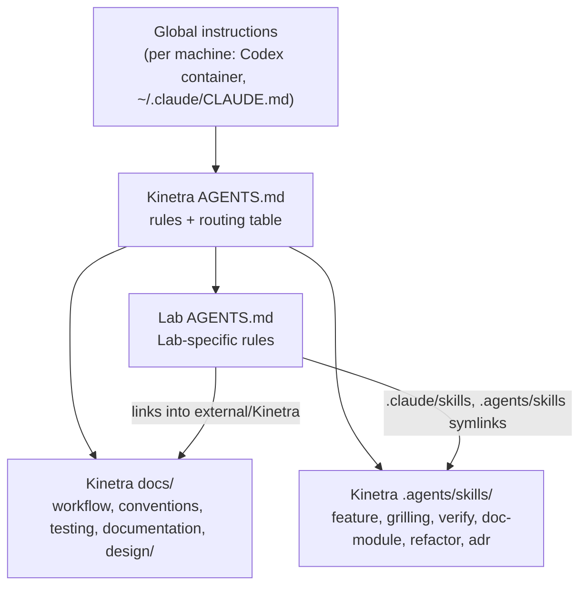

# Development process and agent rules

Status: implemented · Branch: `docs/development-process` · Related: Kinetra-Lab design document of the same date, and the Lab quality roadmap

This change replaces process-only agent rules with a complete development cycle: design documents, verification by impact, a code-documentation standard and repository skills. Kinetra becomes the single source of these rules for itself and Kinetra-Lab.

## Table of contents

- [Problem](#problem)
- [Goals and non-goals](#goals-and-non-goals)
- [Decisions](#decisions)
- [Design](#design)
- [Affected areas](#affected-areas)
- [Test plan](#test-plan)
- [Review](#review)
- [Verification](#verification)
- [Pull request](#pull-request)
- [Open points](#open-points)

[Directory guide](README.md) · [Project overview](../../README.md) · [Documentation index](../README.md)

## Problem

- **Rules about form, not content.** The agent rules covered page layout and README placement in detail, but said little about the content of documentation or code. Lab's `AGENTS.md` had 25 lines, mostly about navigation. Kinetra's documentation section was copied verbatim into Lab, so the two had started to drift.
- **Thin code documentation.** For example, `i4sim/src/simulation.cpp` has 41 comment lines in 1230. Public headers mostly lack contracts; `traffic.h` is a rare exception.
- **Wasted builds.** Every change, documentation included, required a full rebuild of the engine and Lab.
- **No design or review step.** Without one, reasons for changes were not recorded.
- **Unreachable reference.** The layout rule referred to an external project (`Artix/docs/networking.md`) that agents cannot read.

## Goals and non-goals

**Goals:**
- One authoritative set of rules for Kinetra and Lab, with a reason for each rule.
- A full cycle per change.
- Verification proportional to impact.
- A `///` contract standard.
- Module READMEs with real content.
- Skills that carry out the cycle.

**Non-goals here:**
- Code refactors, tooling (presets, warnings, doctest, CI) and module rewrites. These are scheduled in the Lab quality roadmap.

## Decisions

Settled with the user in a grilling session on 2026-11-18. ⚑ marks answers that differ from the agent's recommendation.

| Decision | Choice | Why |
| --- | --- | --- |
| Scope | Kinetra and Lab together ⚑ | Both repositories share the problems |
| Knowledge location | Short `AGENTS.md` with a routing table into `docs/` | Humans and agents read one source; little is loaded per session |
| Shared rules | Kinetra is the source; Lab links to it | Lab always has the submodule; one place to change a rule |
| Rule layers | Global instructions → Kinetra → Lab | Global covers hobby projects in general; repositories add to it |
| Language | English docs and comments; Dutch conversation | Public repositories; matches existing docs |
| Verification | Docs / Targeted / Full by impact | No builds for README edits, and no unverified code |
| Git | Agents commit freely on feature branches; no push, no pull requests ⚑ | The user publishes; local commits keep agent work reviewable |
| Cycle | Always full: design document, tests, review, docs ⚑ | The user wants a traceable software cycle |
| Comments | `///` contracts on public API, *why*-comments in `.cpp` | Understandable code, clangd hover, Doxygen-ready |
| READMEs | One README with content per module; subdirectories only with own content | Insight instead of navigation-only pages |
| Design documents | `docs/design/`, kept after merge | History with reasons |
| Tests | Vendored doctest (planned) | Named cases without a network dependency |
| CI | GitHub Actions per pull request (planned) | Catches what the targeted level skips |

## Design

Each layer adds rules on top of the previous one; the more specific layer wins. Agent rules stay short and route to the docs pages. Skills carry out the procedures and link to the pages instead of copying them.

## Affected areas

- `AGENTS.md`: rewritten.
- New docs pages: `docs/workflow.md`, `docs/conventions.md`, `docs/testing.md`, `docs/documentation.md`, and `docs/design/`.
- `docs/README.md` index, `README.md` documentation section, and the introduction of `docs/development.md`.
- `.agents/skills/` (six skills plus a README), and the `.claude/skills` symlink.
- `tools/check_docs.py` and `tools/README.md`: the Docs verification level.
- ADR 0011: repaired a dead link to the removed `I4SIM-LICENSE`.

## Test plan

Documentation only, so the **Docs** level applies:

- `python3 tools/check_docs.py` passes; it checks links and anchors.
- The symlink `.claude/skills` resolves.
- The checker detects real breakage. It already found the dead ADR link and the not-yet-written pages during development.

## Review

- **Self-review against the workflow checklist.** Rules no longer duplicate between Kinetra and Lab. Every rule names its reason. The layout rule now has a local example instead of a reference to an external project.
- **Constraint check.** No skill has the same name as a global skill or a Claude Code built-in. The `grilling` skill names both the Claude Code and the Codex question tool.

## Verification

| Command | Result |
| --- | --- |
| `python3 tools/check_docs.py` | passed |
| `ls .claude/skills/` | lists the six skills |
| Build | not run: documentation-only change (Docs level) |

## Pull request

**Title:** `docs: define development cycle, verification levels and agent skills`

**Description:**

> Replaces the process-only agent rules with a complete development cycle shared by Kinetra and Kinetra-Lab.
>
> - `AGENTS.md` rewritten: routing table, cycle, verification by impact (Docs / Targeted / Full), git rules, `///` code-documentation standard, module READMEs with content, and a reason for each rule.
> - New pages: workflow, C++/CMake conventions, testing and verification levels, documentation guide, and design documents (`docs/design/`).
> - Repository skills in `.agents/skills/` (`feature`, `grilling`, `verify`, `doc-module`, `refactor`, `adr`), exposed to Claude Code through `.claude/skills`.
> - `tools/check_docs.py` checks Markdown links and anchors (the Docs verification level).
> - Fixes a dead link in ADR 0011.
>
> Documentation only; verified with `python3 tools/check_docs.py`.

## Open points

- Existing READMEs still follow the old one-per-directory rule. They are folded into module READMEs per module, during the roadmap phases.
- Tooling, CI and doctest follow in the next phase of the roadmap.
