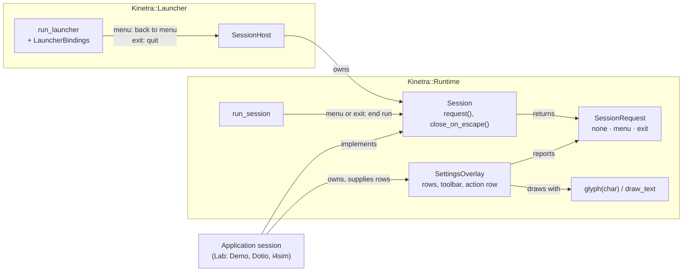
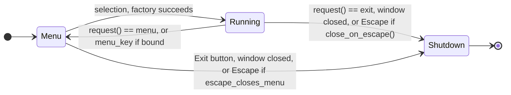

# Settings overlay, glyphs and session navigation

Status: accepted · Branch: `docs/overlay-glyphs-navigation` (design), implementation on a later branch · Related: [ADR 0013](../decisions/0013-settings-overlay-in-kinetra.md), [ADR 0014](../decisions/0014-session-navigation-requests.md), [Lab phase 3 design](https://github.com/SMB-M87/Kinetra-Lab/blob/main/docs/design/2026-11-18-safety-net-shared-presentation.md), [launcher and overlays](../engine/launcher-overlays.md)

This document covers the Kinetra half of Kinetra-Lab's quality roadmap, phase 3, steps 3, 4 and 6:
- a settings overlay that applications fill with their own rows;
- glyphs for the punctuation and lowercase letters that `draw_text` leaves blank today;
- a session request that lets a session ask for the menu or for exit.

It is written ahead of the code, so the decisions are settled before Lab's phase 2 (formatting, doctest, CI) lands. The implementation follows on its own branch after that, and fills in Review, Verification and Pull request below.

## Table of contents

- [Problem](#problem)
- [Goals and non-goals](#goals-and-non-goals)
- [Decisions](#decisions)
- [Design](#design)
- [Affected areas](#affected-areas)
- [Test plan](#test-plan)
- [Review](#review)
- [Verification](#verification)
- [Pull request](#pull-request)
- [Open points](#open-points)

[Directory guide](README.md) · [Project overview](../../README.md) · [Documentation index](../README.md)

## Problem

Surveyed on 2026-11-18, on Kinetra `main` at `13d7913` and Kinetra-Lab `main` at `157a02a`. Lab paths are relative to the Lab repository.

| Area | Evidence |
| --- | --- |
| Settings overlay outside the engine | Lab carries the modal settings panel twice: `lab::Settings` (`labs/settings.h:14-128`) and `i4sim::FactorySettings` (`labs/i4sim/include/factory_settings.h`). The copies differ only in namespace and help lines. The panel has no game rules: modal capture, layout shared by picking and drawing, a SETTINGS/DEBUG toolbar. By Lab's scope rule, such a mechanism belongs in Kinetra. |
| Flag argument and hand-kept height | `Settings::draw(..., bool dotio)` (`labs/settings.h:71`) switches three help lines. `sim_controls_height` must match the number of those lines by hand; Dotio overrides it to 28 (`labs/dotio/include/application.h:43`). |
| Blank glyphs | `draw_text` (`include/kinetra/bitmap_text.h:32-48`) draws `A`–`Z`, `0`–`9`, `/ + [ ] :` and leaves every other character blank. That hides `.` and `-` in `DebugOption::number` values (`std::to_string` in `include/kinetra/debug_view.h:64-65`), negative numbers, and lowercase text such as blueprint names (`Kuka`, `Staubli`) and exception messages passed as `LaunchMenu` status. |
| Glyph patch in i4sim | `factory_text` (`labs/i4sim/src/session.cpp:16-27`, 10 call sites) uppercases and draws `.`, `_` and `-` over `draw_text`. `,` and `*` stay blank even there: `"MOVER BUSY, BLOCKED"` (`:288`), `"GOAL x,y"` (`:475`), `"HEAT A*"` (`:79`). |
| No menu request | `Session` (`include/kinetra/session.h:6-14`) only has `exit_requested()`. Lab adds `lab::Session::return_to_menu()` (`labs/settings.h:6-11`) and runs its own loop (`launcher/src/session.cpp:21-61`) to honor it. |
| Fixed launcher bindings | `run_launcher` (`src/engine/launcher.cpp:180-223`) returns to the menu on M (`:196`) and closes on Escape (`runtime.poll()` at `:191`), ignoring `Session::close_on_escape()`. It never reads `exit_requested()`, so a session cannot end the program. Lab wants neither binding. |
| Dead LAUNCHER action | `run_session` (`src/engine/session.cpp:16`) checks only `exit_requested()`. The LAUNCHER button of standalone Demo and Dotio sets a flag that nobody reads. i4sim wraps its session to map the request to exit (`labs/i4sim/src/main.cpp:74-87`). |

## Goals and non-goals

Goals:

- One settings overlay in Kinetra. Applications supply rows; Kinetra owns layout, picking, drawing, capture and the action row. There is no flag argument and no hand-kept height.
- With Lab's rows, the overlay places every element at today's coordinates, so the Lab settings tests and screenshots stay valid.
- `draw_text` draws `.`, `_`, `-`, `,` and `*`, and draws lowercase letters with the uppercase glyphs. The glyph table has a pure lookup that a test can call without a window.
- A session asks for the menu or for exit through one value. `run_launcher` honors it, and its M and Escape bindings are configurable. `run_session` ends the run on a menu request, because it has no menu.
- After these changes, Lab can remove `lab::Session`, `lab::Settings`, `FactorySettings`, `factory_text`, its launcher loop and i4sim's standalone wrapper (Lab phase 3, steps 3, 4, 6 and 7).

Non-goals:

- The Lab changes themselves; they belong to Lab's phase 3 branch.
- Lab phase 3 step 5 (zoom stepping, direction mapping, pause-while-open, FPS window). This design only keeps the overlay's zoom factor reusable for it.
- A visual redesign of the settings panel, real lowercase glyphs, or full ASCII.
- Changes to `HelpOverlay`, `DebugMenu` or `LaunchMenu` behavior.

## Decisions

Settled with the user on 2026-11-18. All choices follow the agent's recommendation.

| Decision | Choice | Why |
| --- | --- | --- |
| Overlay shape | Row model. Applications supply zoom, toggle and help-section rows; Kinetra supplies the title, the SETTINGS/DEBUG toolbar, the action row and the layout ([ADR 0013](../decisions/0013-settings-overlay-in-kinetra.md)) | Applications differ only in rows and help text. Rows remove the flag argument and derive the height. Rejected: a fixed layout with application help text (not reusable beyond Lab); reusing `DebugOption` rows (visible layout change, every settings test rewritten) |
| Layout acceptance | Lab's rows produce today's coordinates | The ported settings tests then prove the move, and the screenshots stay current |
| Navigation request | `enum class SessionRequest { none, menu, exit }` and `virtual SessionRequest request() const` replace `exit_requested()` ([ADR 0014](../decisions/0014-session-navigation-requests.md)) | One state instead of two related flags. It breaks the API, but Lab is the only consumer and adapts in the same phase. Rejected: an extra `menu_requested()` beside `exit_requested()` |
| Menu request without a launcher | `run_session` ends the run on `menu`, as on `exit` | There is no menu to return to. This matches i4sim today and removes the wrappers (Lab step 7) |
| Launcher bindings | Trailing `LauncherBindings` parameter: `menu_key` (default M, `std::nullopt` disables it) and `escape_closes_menu` (default true). During a run, Escape follows `Session::close_on_escape()` | Existing callers keep their behavior; Lab passes `{std::nullopt, false}`. Honoring `close_on_escape()` fixes a contract that `run_launcher` ignores today. Rejected: removing M (changes behavior for other launchers) |
| Glyph set | Add `.`, `_`, `-`, `,` and `*`; draw `a`–`z` with the uppercase glyphs; expose `glyph(char)` | Covers every blank character in today's Lab text, so `factory_text` goes without visible loss |
| Overlay actions | The overlay reports its Launcher and Exit buttons as a `SessionRequest` | The overlay and the session use one vocabulary; a session returns the overlay's request |
| Placement | `include/kinetra/settings_view.h` and `src/engine/settings_view.cpp` in `Kinetra::Runtime`; `SessionRequest` in `session.h`; `glyph` in `bitmap_text.h` | Next to `debug_view.h` and `help_view.h`. Non-trivial bodies belong in the `.cpp` ([conventions](../conventions.md#headers-and-includes)) |
| Delivery | This branch carries only this document and the ADRs. The code follows on one Kinetra branch after phase 2 merges | The code would conflict with phase 2's formatting commit; the decisions do not |

## Design

The sketches below are the intended public API. Names may still change during implementation; the behavior may not without updating this document.



*Takeaway:* the overlay and the session share one request type, and each host decides what a menu request means.

### Session requests

```cpp
/// What a session asks its host to do after an advance.
enum class SessionRequest { none, menu, exit };

class Session {
  public:
    // advance, render and title as today
    /// Read after every advance and before render. menu: leave this session for
    /// the host's menu; exit: end the program. Defaults to none.
    virtual SessionRequest request() const { return SessionRequest::none; }
    virtual bool close_on_escape() const { return true; }
};
```

| Request | `run_session` | `run_launcher` |
| --- | --- | --- |
| `none` | Render and continue | Render and continue |
| `menu` | End the run without rendering (no menu exists) | Destroy the session; draw the menu in the same frame |
| `exit` | End the run without rendering | End the loop without rendering |

A request is state, not an event. The host acts on it once, and a menu request destroys the session, so sessions never reset it. `exit_requested()` is removed; an override marked `override` stops compiling, which makes the migration loud.

### Launcher bindings

```cpp
/// Keys the standard launcher loop handles itself; sessions receive all other input.
struct LauncherBindings {
    /// Returns from a running session to the menu. std::nullopt leaves this to SessionRequest::menu.
    std::optional<Key> menu_key = Key::m;
    /// Escape in the menu closes the window. During a run, Session::close_on_escape() decides.
    bool escape_closes_menu = true;
};

int run_launcher(Runtime &runtime, std::vector<ApplicationRegistration> applications,
                 std::optional<LaunchSelection> initial = std::nullopt, int frame_limit = 0,
                 LauncherBindings bindings = {});
```

The loop polls with `host.session() ? host.session()->close_on_escape() : bindings.escape_closes_menu`. After `SessionHost::advance`, it reads `request()`. On `menu` it calls `return_to_menu()` and draws the menu in the same frame; on `exit` it ends. Destroying before creating keeps Dotio's single-world rule. `SessionHost` itself is unchanged.



*Takeaway:* with Lab's bindings (`{std::nullopt, false}`), only the session's own request and the window's close button leave a run, which is today's Lab loop.

### Settings overlay

```cpp
/// Inclusive camera zoom range in pixels per world unit.
struct ZoomLimits { float minimum, maximum; };

/// ZOOM IN / ZOOM OUT pair; limits are read on each click (they may depend on Debug Mode).
struct ZoomRow { std::function<ZoomLimits()> limits; };
/// "[X] LABEL" check box over a borrowed flag that outlives update and draw.
struct ToggleRow { std::string label; bool *value; };
/// "SHOW/HIDE LABEL" toggle followed, when expanded, by read-only help lines.
struct HelpSection { std::string label; std::vector<std::string> lines; };

using SettingsRow = std::variant<ZoomRow, ToggleRow, HelpSection>;

/// Modal settings panel. Layout is shared by picking and drawing; while open it
/// captures all input, including the click that closes it.
class SettingsOverlay {
  public:
    /// debug_mode, if given, is borrowed and shows the DEBUG toolbar button while true.
    explicit SettingsOverlay(std::vector<SettingsRow> rows, const bool *debug_mode = nullptr);
    /// Opens/closes on Ctrl or the SETTINGS button, applies row clicks. True while input is captured.
    bool update(const Input &input, Camera2D &camera);
    /// The DEBUG toolbar button and DebugMenu placement, as lab::Settings::update_debug today.
    bool update_debug(const Input &input, Vec2 viewport, DebugMenu &menu, std::span<DebugOption> options) const;
    void draw(Runtime &runtime) const;
    bool visible() const;
    /// menu after LAUNCHER, exit after EXIT; none otherwise.
    SessionRequest request() const;
};
```

Kinetra owns the elements that are the same everywhere:
- the "SETTINGS" title;
- the closed-state toolbar (SETTINGS at `x 0–64`, DEBUG at `64–112`, `y 0–24`);
- the LAUNCHER / RESUME / EXIT row;
- the "CTRL  SETTINGS" hint.

Applications supply the rows in display order. Lab's Demo, for example, supplies:
- a zoom row with limits `debug ? 5 : 17` to `100`;
- toggles for STATISTICS and DEBUG MODE;
- the help sections SIM CONTROLS (four lines) and DEBUG CONTROLS (two lines).

**Layout rules.** These reproduce today's panel exactly. Units are logical panel pixels:

| Element | Position |
| --- | --- |
| Title | `y = 12`, centered in the 184-wide panel |
| Rows (zoom, toggles) | first at `y = 40`, then every 28 |
| Help sections | a 4-pixel gap before the first section toggle; toggles 28 apart when collapsed |
| Expanded help lines | every 14, starting 14 below their toggle; the next section toggle follows 14 below the last line |
| Action row | 28 below the last row or help line |
| Hint | 28 below the action row; panel height is the action row plus 50 |
| Scale | `min(2, viewport.x / 204, viewport.y / 418)`, unchanged, so expanding a section never rescales the panel |

The old `sim_controls_height` becomes `14 × (lines − 1)`: 42 for four lines and 28 for Dotio's three. The overlay derives it instead of storing it. Each help section starts collapsed and keeps its own expanded state. Zoom multiplies or divides `pixels_per_unit` by a named factor of 1.1 and clamps to the limits. Lab phase 3 step 5 can reuse that factor for wheel zoom.

**Lab after migration.** Each session owns one `SettingsOverlay` and returns `overlay.request()` from `request()`, combined with its own requests. i4sim's blueprint screen maps Escape and M to `menu`. `lab::Session`, `lab::Settings` and `FactorySettings` disappear. Pause-while-open stays in each session until Lab step 5.

### Glyphs

```cpp
/// Seven rows of five pixels; bit 4 is the left column.
using Glyph = std::array<unsigned char, 7>;
/// Bitmap for c. Lowercase letters use the uppercase glyph; unsupported characters are blank.
constexpr Glyph glyph(char c);
```

| Character | Rows (top to bottom) | Source |
| --- | --- | --- |
| `-` | `{0,0,0,31,0,0,0}` | Same pixels as `factory_text` |
| `_` | `{0,0,0,0,0,0,31}` | Same pixels as `factory_text` |
| `.` | `{0,0,0,0,0,0,4}` | Same pixels as `factory_text` |
| `,` | `{0,0,0,0,0,4,8}` | New |
| `*` | `{0,4,21,14,21,4,0}` | New |
| `a`–`z` | Glyph of `A`–`Z` | Replaces `factory_text`'s `toupper` |

`draw_text` draws `glyph(c)` for each character; the cell width stays 6 pixels. Visible effect: decimals, minus signs, underscores, commas, asterisks and lowercase text appear where they are blank today, in Lab's debug menus, statistics, launcher status and i4sim's HUD.

## Affected areas

**This branch:** this document, [ADR 0013](../decisions/0013-settings-overlay-in-kinetra.md), [ADR 0014](../decisions/0014-session-navigation-requests.md), the [design index](README.md#index) and the [decision index](../README.md#decisions).

**The implementation branch (Kinetra):**

- **Sessions.** `include/kinetra/session.h` and `src/engine/session.cpp`: `SessionRequest`, `request()`, and `run_session`'s handling of it.
- **Launcher.** `include/kinetra/launcher.h` and `src/engine/launcher.cpp`: `LauncherBindings`, plus `run_launcher`'s request and Escape handling.
- **Overlay.** `include/kinetra/settings_view.h` and `src/engine/settings_view.cpp` (both new), and the Runtime sources in `CMakeLists.txt`.
- **Glyphs.** `include/kinetra/bitmap_text.h`: `glyph(char)`, the five characters and lowercase.
- **Tests.** A new overlay and glyph test, `tests/launcher_tests.cpp`, `tests/runtime_tests.cpp` and `tests/consumer/main.cpp`.
- **Docs.** `docs/engine/launcher-overlays.md`, `docs/engine/runtime.md`, `docs/architecture.md`, and `src/engine/README.md` (its loop diagram reads `exit_requested`).

**Lab (its phase 3 branch):** `labs/settings.h`, `labs/i4sim/include/factory_settings.h`, the three sessions, Dotio `application.h` and `presentation.cpp`, `launcher/`, `labs/i4sim/src/main.cpp`, the settings and menu tests, and `docs/launcher-overlays.md`.

## Test plan

Tests are doctest cases on phase 2's `kinetra_add_doctest`. None needs a window unless marked graphics.

| Behavior | Test | Level |
| --- | --- | --- |
| `glyph` returns the table above, maps lowercase, blanks unknown characters | Overlay and glyph cases, one per character class | Full |
| Overlay layout reproduces today's coordinates for Lab's rows, at four viewports and both section states | Overlay cases ported from Lab's `settings_tests.cpp` (11 doctest cases after Lab's phase 2), using a Demo-like and a Dotio-like row set | Full |
| Rows: zoom clamps to the limits read at click time, toggles flip the borrowed flag, sections expand and shift later rows | One case per row kind | Full |
| Capture: open panel swallows all input, including the closing click; Ctrl and the toolbar button open it | Ported capture cases | Full |
| Actions: LAUNCHER gives `menu`, EXIT gives `exit`, RESUME closes | Action-row case | Full |
| `run_session` ends on `menu` and `exit` without rendering that frame | `tests/runtime_tests.cpp` (graphics) | Full with graphics |
| `run_launcher`: `menu` returns to the menu, `exit` ends; `menu_key` and `escape_closes_menu` honored; Escape follows `close_on_escape()` during a run | `tests/runtime_tests.cpp` (graphics), scripted input | Full with graphics |
| Public API links from an external consumer | `tests/consumer/main.cpp` takes `SessionRequest`, `SettingsOverlay` and the new `run_launcher` | Full |

The implementing branch ends at the Full level in Kinetra, with the graphics configuration. The Lab branch that bumps the pointer runs Lab's Full level with graphics. Its golden characterization values must stay unchanged.

## Review

This branch had a self-review of the diff. Every `path:line` in [Problem](#problem) was checked against the surveyed commits, and the layout table was checked against `labs/settings.h`. Findings:
- The `factory_text` call-site count was 11; it is 10 calls plus the definition. Corrected.
- The test plan referred to 11 settings cases, which exist only on Lab's unmerged phase 2 branch. Now stated.

The implementation branch records its own findings here.

## Verification

This branch is docs-only:
- `python3 tools/check_docs.py`: all links resolve in 49 Markdown files.
- The Mermaid diagrams were reviewed by hand; no Mermaid renderer is installed locally.

The implementation branch records its commands and results here.

## Pull request

**Title:** `docs(design): plan the settings overlay, glyphs and session navigation`

**Summary.** The Kinetra design for Kinetra-Lab's quality roadmap phase 3, steps 3, 4 and 6, with two ADRs. No code changes. The decisions were settled with the user, so the code can start as soon as phase 2 is merged.

**Changes.**
- **Design document:** `docs/design/2026-11-18-overlay-glyphs-navigation.md`. It covers the problem with evidence, the decisions, the API sketches, the layout rules, the affected areas and the test plan.
- **ADR 0013:** the settings overlay moves into Kinetra as a row model.
- **ADR 0014:** `SessionRequest` replaces `exit_requested()`, and the launcher bindings become configurable.
- **Indexes:** the design and decision indexes.

**Verification.** `python3 tools/check_docs.py`.

**Review notes.**
- `SessionRequest` breaks the API: `exit_requested()` is removed.
- `run_launcher` will honor `close_on_escape()` during a run. Today it ignores that flag.
- The overlay layout table must reproduce today's Lab coordinates.

**Dependencies and merge order.** Independent of phase 2 (Kinetra `build/tooling-ci`). Both branches add a row to the design index, at different positions, so they merge cleanly in either order. The implementation follows after phase 2.

**Follow-up.** The Kinetra implementation branch, then Lab phase 3 steps 2–7.

## Open points

- **Step 5 mechanisms.** Zoom stepping, direction mapping, pause-while-open and the FPS window get their own design when Lab step 5 starts. The overlay's zoom factor is the first shared piece.
- **Standalone LAUNCHER label.** With `run_session`, LAUNCHER ends the program, as i4sim does today. Hiding or renaming the button when there is no launcher is a possible later refinement, not part of this change.
- **Decision index.** ADRs 0011 and 0012 are listed below the table in the [documentation index](../README.md#decisions) instead of in it. This branch adds 0013 and 0014 to the table and leaves that layout alone.
