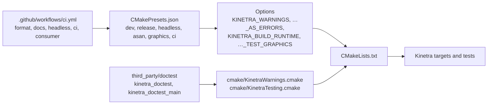

# Tooling and CI

Status: implemented · Branch: `build/tooling-ci` · Related: Kinetra-Lab quality roadmap (phase 2), Kinetra-Lab design document of the same date

Adds the tooling the [workflow](../workflow.md) relies on:
- CMake presets;
- a warning policy that CI enforces;
- vendored doctest with per-case CTest entries;
- clangd and clang-tidy configuration;
- a repository-wide formatting pass;
- a pinned GitHub Actions pipeline.

## Table of contents

- [Problem](#problem)
- [Goals and non-goals](#goals-and-non-goals)
- [Decisions](#decisions)
- [Design](#design)
- [Affected areas](#affected-areas)
- [Test plan](#test-plan)
- [Review](#review)
- [Verification](#verification)
- [Pull request](#pull-request)
- [Open points](#open-points)

[Directory guide](README.md) · [Project overview](../../README.md) · [Documentation index](../README.md)

## Problem

- **No warnings.** No warning flags were set. With `-Wall -Wextra -Wpedantic -Wshadow -Wconversion`, Kinetra produced 45 warnings: 40 in the engine and headers, 5 in tests.
- **Repetitive builds.** Every configuration was a hand-typed `-D` list. There was no `compile_commands.json` for clangd and no sanitizer build.
- **Unhelpful test failures.** Tests were single `main()` programs; a failure reported one message and stopped.
- **No CI.** The Targeted verification level skips code that CI would catch.
- **Unformatted code.** 257 `.clang-format` deviations.

## Goals and non-goals

**Goals:**
- One command per configuration.
- Kinetra warning-free, enforced by CI.
- A doctest pattern that Lab can reuse.
- A reproducible CI that matches the development environment.

**Non-goals:**
- Converting all test suites (roadmap phase 3).
- Enforcing clang-tidy.
- Running graphics tests in CI.

## Decisions

| Decision | Choice | Why |
| --- | --- | --- |
| Warning policy | Kinetra clean now with `-Werror` in CI; Lab per module phase | The user's choice: no fixes in Lab code that is about to be rewritten |
| Test framework | doctest v2.5.3, vendored | Named cases, per-case CTest entries, no network or system package |
| Local tools | Ninja + ccache (installed) | Rebuilds in seconds; presets assume them |
| CI environment | `archlinux:base-devel-20261108.0.623074` plus the Arch Linux Archive snapshot of 2026-11-17 | Same gcc 16.2.1, clang-format 23.1.5 and CMake 4.5.0 as the development machine. With `-Werror` and `--Werror`, an unpinned rolling image could turn `main` red without a code change (peer-review point) |
| CI configurations | Headless *and* full runtime (graphics compiled, not run) | Headless catches SDL/GL leaking into `Kinetra::Simulation`; full compiles everything |
| Warning helpers | `kinetra_target_warnings` and `kinetra_directory_warnings` in `cmake/` | Lab applies the same policy with its own options and can enable `-Werror` per module |
| Base branch | Stacked on `docs/development-process` | That branch also carries the `pr-feedback` skill commit, which reaches `main` through this PR |

## Design

The presets are the only place where option combinations live. CI uses the same `ci` and `headless` workflow presets that developers run locally, so a green local `cmake --workflow --preset ci` predicts a green CI.

## Affected areas

**Build**
- `CMakeLists.txt`: new options, helpers, and test registration without repetition.
- `CMakePresets.json`, `cmake/`, `third_party/doctest/`.

**Tools**
- `.clangd`, `.clang-tidy`, `.git-blame-ignore-revs`, `.github/workflows/ci.yml`.

**Code**
- Explicit integer-to-float conversions in `include/kinetra/{bitmap_text,debug_view,help_view}.h`, `src/runtime/{launcher,runtime}.cpp`, `src/simulation/{collision_grid,navigation,priority_steering,weighted_grid}.cpp` and five test files.
- One renamed shadowing local in `steering.cpp`.

**Tests**
- `tests/traffic_tests.cpp` is converted to doctest: 12 named cases.

**Formatting**
- All first-party sources, in one formatting-only commit.

**Docs**
- `development.md`, `testing.md`, `conventions.md`, `workflow.md`, `AGENTS.md`, `README.md`, `docs/README.md` and `tests/README.md`.
- The `verify` skill and this design document.

## Test plan

- **Conversion fixes.** All converted values are small integers, exactly representable as `float`. The existing suites must pass unchanged.
- **Traffic suite.** It must keep every assertion of the former `main()`. Each case replays the same admission history prefix, so the state per assertion is identical.
- **Verification level: Full.** Covers CMake, a public header and runtime sources: the `ci`, `headless`, `asan` and `graphics` workflows, plus the external consumer.

## Review

- **Behavior.** No numeric behavior changed: every edit is an explicit cast of a small integer, or a rename of a shadowing local.
- **Discovered test names.** CMake strips trailing whitespace from the test prefix, so names read `kinetra_traffic:<case>`. The helper comment and docs say so.
- **Peer review of the CI design** (by the parallel "CI/CD pipeline setup" session). Adopted:
  - pinning the toolchain;
  - adding a headless configuration;
  - updating checkout to the current major (`actions/checkout@v7`);
  - keeping the workflow name `CI` and the job id `checks` stable for branch protection.
- **Warning helper scope.** Integrating Lab showed that the warning flags lived in a directory-scoped variable, which is empty in an embedding project. The flags now live inside `kinetra_target_warnings`, and Lab reports its 119 warnings as measured.
- **Graphics test.** `kinetra_engine_graphics` fails locally with "Mouse input lost". The unchanged code fails the same way, in a separate worktree, with both SDL offscreen and the WSLg display. This is pre-existing in this WSL2 environment, not a regression; see *Open points*.

## Verification

| Command | Result |
| --- | --- |
| `cmake --workflow --preset ci` | passed: 0 warnings with `-Werror`, 21/21 non-graphics tests |
| `cmake --workflow --preset headless` | passed: 20/20 |
| `cmake --workflow --preset asan` | passed: 20/20, no sanitizer reports |
| `cmake --workflow --preset dev` | passed: 21/21 (includes the launcher test) |
| `cmake --workflow --preset graphics` | 21/22: `kinetra_engine_graphics` fails, the same as unchanged code (see Review) |
| External consumer with `CONSUMER_GRAPHICS=ON` | passed |
| `clang-format --dry-run --Werror` on first-party sources | passed |
| `clang-tidy --verify-config` | passed |
| `python3 tools/check_docs.py` | passed |
| GitHub Actions `CI / checks` | see the pull request |

## Pull request

**Title:** `build: add presets, warning policy, doctest and CI`

The description is published with the pull request. It covers:
- the presets;
- the warning policy, and the fixes it required;
- doctest and the traffic conversion;
- the editor tools and the formatting commit;
- the pinned CI;
- the stacked `pr-feedback` commit;
- the pre-existing graphics-test failure;
- the merge order with Kinetra-Lab.

## Open points

- **`kinetra_engine_graphics` under WSL2.** Its mouse-input check fails under WSL2 (offscreen and WSLg). It needs a run on a native Linux desktop, and probably a fix in how the test injects SDL events with `sdl2-compat`.
- **clang-tidy.** Findings are not triaged, and nothing is enforced in CI.
- **Toolchain bumps.** CI is pinned to the Arch Linux Archive snapshot of 2026-11-17. Bump it deliberately when the development machine upgrades gcc or clang.
