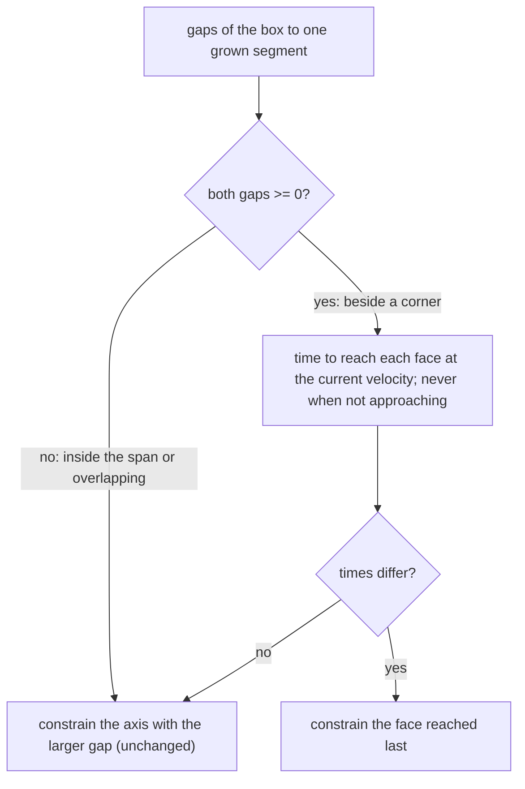

# Border corner slide

Status: accepted · Branch: `fix/border-corner-slide` · Related: [Lab design](https://github.com/SMB-M87/Kinetra-Lab/blob/feat/i4sim-h-crossing-motion/docs/design/2026-11-19-i4sim-h-crossing-motion.md), [navigation](../engine/navigation.md#weighted-grids-and-priority-steering)

`constrain_borders` stops a box that slides flush along one wall when its corner meets the end of another wall at a convex corner. The box then stands still for good. Kinetra-Lab's i4sim needs movers that steer straight at their goal without a route ("path planning off"), and in its H-shaped hall every such mover stuck on a convex corner of the middle bar. This change picks the constrained face beside a segment's end the way a swept-box test does.

## Table of contents

- [Problem](#problem)
- [Goals and non-goals](#goals-and-non-goals)
- [Decisions](#decisions)
- [Design](#design)
- [Affected areas](#affected-areas)
- [Test plan](#test-plan)
- [Review](#review)
- [Verification](#verification)
- [Pull request](#pull-request)
- [Open points](#open-points)

[Directory guide](README.md) · [Project overview](../../README.md) · [Documentation index](../README.md)

## Problem

- For each border segment, `constrain_borders` ([priority_steering.cpp](../../src/simulation/priority_steering.cpp)) grows the segment by the box's half extents and measures the gap to that box per axis. It constrains the axis with the larger gap: `x_axis = gap.x >= gap.y`.
- A box sliding flush along a floor has `gap.y == 0` to every wall that starts at the floor's level. Approaching the end of the floor where a wall drops away (a step, or the corner of a bar in a hall), `gap.x > gap.y`, so the drop's x face is constrained: the box brakes as if that wall stood in its way, and stops with both gaps at zero. The floor constrains y and the drop constrains x, so the box can never move again, although moving on along the floor would touch nothing.
- Measured in Lab: in the i4sim H-shaped hall with route planning switched off, all four movers stopped for good at the four inner corners of the middle bar, at (1143.5, 663.5) and its mirror images, within 1000 ticks.

## Goals and non-goals

- Goal: a box that slides flush along one wall passes the convex corner where another wall begins.
- Goal: no change inside a segment's span (one gap negative) or in an overlap (both gaps negative); braking toward a wall ahead stays as it is.
- Goal: no public API change.
- Non-goal: rotated bodies, circles, or a full continuous collision test; `constrain_borders` stays a one-step velocity constraint per segment.

## Decisions

| Decision | Choice | Why |
| --- | --- | --- |
| Where to fix | In Kinetra, not by a workaround in Lab | User's choice. The trap is in the reusable border constraint, and any consumer sliding along walls can hit it. A Lab workaround (route recovery after a stall) leaves movers standing at every corner first |
| Rule beside a corner | The face the box would reach last at its current velocity, as in a swept-box test; a face it does not approach counts as never reached; on a tie the larger gap, as before | A box only hits a face once its projection overlaps the segment on the other axis as well. A flush slide never makes that overlap, so the face it slides along is the one that matters. The tie rule keeps the old choice for a box at rest or on an exact diagonal |
| Velocity used | The current velocity, not the requested acceleration | The requested acceleration usually points into the floor as well (toward a goal below the step); judged by it, the y projection would start overlapping at once and the trap would remain. The floor's own constraint removes that component |

## Design

The takeaway: only the corner region changes. A box sliding flush along the floor never reaches the drop's x face (its y projection never overlaps the drop), so the drop constrains y, where the box does not move, and the slide continues.

## Affected areas

- `src/simulation/priority_steering.cpp`: the axis choice in `constrain_borders`.
- `include/kinetra/steering.h`: the contract of `constrain_borders` names the corner rule.
- `docs/engine/navigation.md`, `tests/README.md`.
- `tests/weighted_navigation_tests.cpp`: one new case.
- Consumers: only Kinetra-Lab's i4sim calls `priority_steer` and `constrain_borders`.

## Test plan

| Behavior | Test | Level |
| --- | --- | --- |
| One unit before the corner, the slide keeps its full tangential acceleration and does not push into the floor | `kinetra_weighted_navigation`: a body sliding along a wall passes the convex corner where the wall ends | Targeted |
| Driven toward a goal below the step, the box passes the corner without cutting it and arrives | Same case, 200 integration steps | Targeted |
| Braking toward walls, corner approaches and parking convergence stay as they are | Existing `kinetra_weighted_navigation` cases | Targeted |
| i4sim behavior, including golden and pressure summaries, stays the same | Lab's full test suite against this commit | Full (Lab) |

The new case failed before the fix: the near-corner acceleration was -0.6 instead of 0.2, and the box stopped 57 units from its goal. A public header changes (a comment), so the branch ends at the Full level.

## Review

To be filled in after the review.

## Verification

To be filled in after verification.

## Pull request

To be filled in.

## Open points

- None known.
