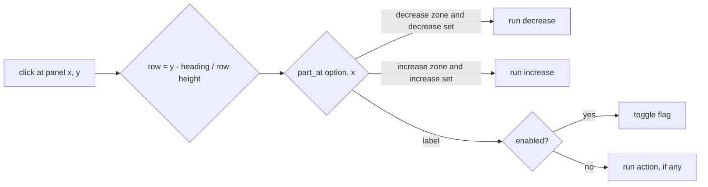

# Debug menu steppers

Status: accepted · Branch: `feat/debug-menu-steppers` · Related: [Lab design](https://github.com/SMB-M87/Kinetra-Lab/blob/feat/i4sim-debug-menu/docs/design/2026-11-19-i4sim-debug-menu.md), [launcher and overlays](../engine/launcher-overlays.md)

A `DebugMenu` row can only be clicked as a whole, so an application that wants to raise and lower a number needs two rows per number ("SPEED +" and "SPEED -"), and the value itself is not on either of them. i4sim's debug menu has eight such rows. The user asked for a friendlier debug menu in i4sim. This document covers the engine half: a row can carry `[-]` and `[+]` buttons next to its value.

## Table of contents

- [Problem](#problem)
- [Goals and non-goals](#goals-and-non-goals)
- [Decisions](#decisions)
- [Design](#design)
- [Affected areas](#affected-areas)
- [Test plan](#test-plan)
- [Review](#review)
- [Verification](#verification)
- [Pull request](#pull-request)
- [Open points](#open-points)

[Directory guide](README.md) · [Project overview](../../README.md) · [Documentation index](../README.md)

## Problem

- `DebugMenu::update` maps a click to a row index and then toggles `enabled` or runs `action` ([debug_view.h](../../include/kinetra/debug_view.h)). The x position inside the row is ignored, so one row has exactly one command.
- A number that goes up and down therefore takes two rows. i4sim has `SPEED +`, `SPEED -`, `FORCE +`, `FORCE -`, `HORIZON +`, `HORIZON -`, `UPS +` and `UPS -`, and none of these rows shows the value: the operator reads it from the HUD, which can be turned off.
- The layout numbers 182, 22 and 16 (panel width, heading height, row height in panel pixels) and the 4-pixel text margin are repeated in `update` and `draw`. A second hit zone would repeat them again.

## Goals and non-goals

- Goal: a row can show `[-]` and `[+]` buttons at its right edge. A click on a button runs that button's function; the rest of the row behaves as today.
- Goal: the buttons light up under the pointer like a clickable row does, so the operator sees which one a click hits.
- Goal: rows without buttons behave exactly as today, across the full panel width.
- Goal: the layout numbers are named once and used by both `update` and `draw`.
- Non-goal: sections, nesting or indentation in the engine. Applications build them from plain rows, as Dotio does for its PATHS sub-rows.
- Non-goal: sliders, text input, a wider panel, or scrolling.

## Decisions

| Decision | Choice | Why |
| --- | --- | --- |
| Where | Kinetra `DebugMenu`, not a Lab workaround | The user chose `[-] [+]` buttons on the row (the alternative was two extra rows that open under the value). Only the engine knows where a click lands inside a row |
| Shape | Two optional functions `decrease` and `increase` on `DebugOption` | The smallest change that matches the existing `action`, `text` and `number` style. Either one can be set alone |
| Placement | Right-aligned, `[-]` then `[+]`, each three glyph cells wide | The label and value stay where they are. The right edge is free on every Lab row |
| Hit zones | The gap between the two buttons is split between them, and the `[+]` zone runs to the panel edge | No dead strip between two small targets; a near miss still does what it looks like |
| Layout constants | Public `static constexpr` members of `DebugMenu` | Applications that draw next to a row through `visualization` (a swatch at the right edge) and tests that click a row need the same numbers |

## Design

*Takeaway:* the buttons are checked first, only on rows that have them. Everything else falls through to the existing row behavior.

- `DebugOption` gains `std::function<void()> decrease{}, increase{}`. The text of the row is unchanged: `[X] LABEL TEXT NUMBER`. The caller keeps it short enough to end before the `[-]` button (21 characters on a row with buttons).
- `DebugMenu` gains the layout constants `panel_width = 182`, `heading_height = 22`, `row_height = 16`, `text_margin = 4`, `stepper_width = 18` and the left edges `decrease_left = 136` and `increase_left = 160`, all in panel pixels. `update` and `draw` use them instead of literals.
- A private `part_at(option, x)` returns `label`, `decrease` or `increase`. The `[-]` zone runs from `decrease_left - 3` to `increase_left - 3`, the `[+]` zone from there to the panel edge. A row without the button keeps the zone as part of its label.
- `draw` paints a hovered button in the highlight color and the row label only when the pointer is on the label part of a clickable row.

The first commit names the layout constants without changing behavior. The second adds the buttons.

## Affected areas

- [debug_view.h](../../include/kinetra/debug_view.h): `DebugOption::decrease`, `DebugOption::increase`, the `DebugMenu` layout constants and `part_at`.
- [launcher_tests.cpp](../../tests/launcher_tests.cpp): the new cases.
- [launcher and overlays](../engine/launcher-overlays.md): the `DebugMenu` paragraph.
- Public header change: Full level. No other engine file uses the new fields; Lab adopts them in the i4sim debug menu.

## Test plan

| Behavior | Test | Level |
| --- | --- | --- |
| A click on `[-]` or `[+]` runs that function and not the row's action | `kinetra_launcher`: "a debug menu stepper runs the button under the click" | Full (public header) |
| A click on the label part of a stepper row still toggles or runs the row | Same suite: "a click beside the stepper buttons still runs the row" | Full |
| A row without buttons takes a click at the right edge as before | Same suite: "a row without stepper buttons takes clicks across its full width" | Full |
| The refactor keeps the existing click and capture behavior | The existing `kinetra_launcher` and `kinetra_settings_view` cases, unchanged | Targeted, then Full |
| The buttons draw and light up | Lab graphics suite and the i4sim smoke run, where i4sim uses the buttons | Full with graphics (Lab) |

## Review

Filled in after the review.

## Verification

Filled in after verification.

## Pull request

Filled in when the branch is complete.

## Open points

- Rows still have no indentation field. Lab builds nested rows with leading spaces in the label, which works for buttons and labels but puts a check box's `[X]` before the indentation (Dotio's `[X]   WANDER`).
