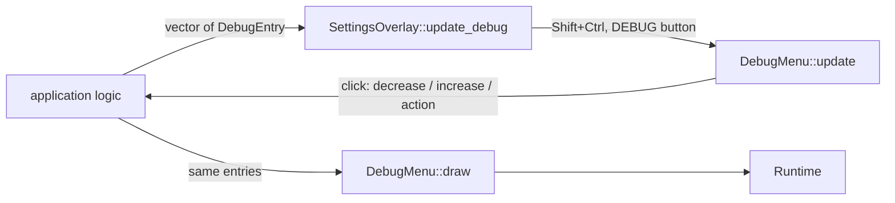
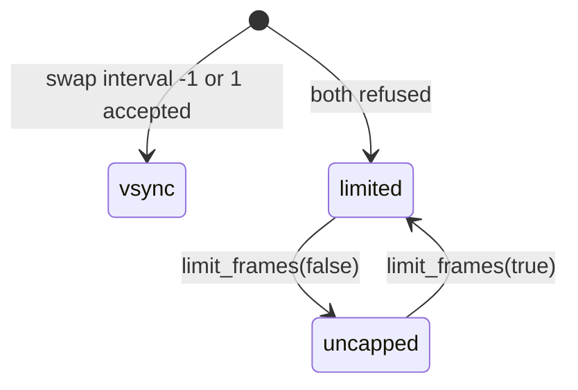

# Debug workbench: tree menu, restyled overlays, Shift+Ctrl and frame pacing

Status: accepted · Branch: `feat/debug-workbench` · Related: [Lab design](https://github.com/SMB-M87/Kinetra-Lab/blob/feat/debug-workbench/docs/design/2026-11-19-debug-workbench.md), [launcher and overlays](../engine/launcher-overlays.md), [runtime guide](../engine/runtime.md), [debug menu steppers](2026-11-19-debug-menu-steppers.md)

The user wants every Lab application to offer what i4sim's debug menu offers: sections, lists, numbers with buttons and a color legend, so settings can be changed while a scene runs. The structure of that menu lives in i4sim today, as strings handed to a flat engine menu. This change moves the structure into the engine as plain data, redraws the debug menu and the settings panel, replaces Backquote by Shift+Ctrl, and paces frames when the platform has no VSync.

## Table of contents

- [Problem](#problem)
- [Goals and non-goals](#goals-and-non-goals)
- [Decisions](#decisions)
- [Design](#design)
- [Affected areas](#affected-areas)
- [Test plan](#test-plan)
- [Review](#review)
- [Verification](#verification)
- [Pull request](#pull-request)
- [Open points](#open-points)

[Directory guide](README.md) · [Project overview](../../README.md) · [Documentation index](../README.md)

## Problem

- **The menu's structure is application text.** `DebugMenu` draws one string per row ([debug_view.h](../../include/kinetra/debug_view.h)). i4sim builds sections, nesting and state marks into that string (`row_text` in Lab's `labs/i4sim/src/session.cpp`: two spaces per level, then `[X]`, `[*]`, `+` or `-`) and draws its color swatch through the `visualization` hook. Dotio indents its PATHS filters with spaces in the label. Demo and Dotio are about to get sections and numbers too, and would have to copy i4sim's adapter.
- **The panels look like a text dump.** No border, no title bar, no highlighted row, state marks made of bracket glyphs, and values that start wherever the label ends. The settings panel centers every row, so check boxes do not line up.
- **Backquote is a poor shortcut.** It is a dead key on several keyboard layouts, and it only works after Debug Mode was switched on in the settings panel.
- **No frame pacing without VSync.** `Runtime` asks for a swap interval and only logs when that fails ([runtime.cpp](../../src/engine/runtime.cpp)); `run_session` and `run_launcher` then loop as fast as they can. Measured in WSLg, where SDL reports `VSync unavailable`: 5.7 ms per frame for Dotio, 8.3 ms for Demo and 6.0 ms for i4sim (600 frames each, release build), while the WSLg compositor presents at 60 Hz. The compositor shows whichever frame is newest, so the age of the shown frame varies by up to a whole frame, and the application competes with the compositor for the processor. The user sees uneven motion there and smooth motion in the native Windows build, which has VSync.
- **The window icon is missing from the WSLg title bar.** This is not an engine defect: WSLg's compositor draws that title bar and never passes an application icon to it (`frame_create(..., NULL)` in `xwayland/window-manager.c` of microsoft/weston-mirror, commit `2318fec`). It does forward `_NET_WM_ICON` to the Windows taskbar, where the icon shows. Only the documentation changes.

## Goals and non-goals

- Goal: a debug-menu row is data: label, kind, state, value, buttons, nesting depth and swatch. The engine draws marks, indentation and values; applications supply no formatting.
- Goal: a headless model, so an application's logic layer can build and test its menu without a window.
- Goal: the debug menu and the settings panel share one drawn style: bordered panel, title bar, highlighted row under the pointer, drawn check boxes, radio marks and arrows, right-aligned values.
- Goal: Shift+Ctrl opens and closes the debug menu and switches the debug mode on when it was off. Ctrl alone still opens the settings panel.
- Goal: when the swap interval cannot be set, `Runtime` paces frames to the display's refresh rate. Applications can switch that off to compare.
- Non-goal: scrolling, tabs, sliders or text input in the debug menu.
- Non-goal: a different window icon mechanism for WSLg.
- Non-goal: changing presentation where VSync works.

## Decisions

| Decision | Choice | Why |
| --- | --- | --- |
| Where the menu structure lives | In the engine, as `DebugEntry` in a header without `Runtime` | Three applications need it and it holds no application rules ([AGENTS.md](../../AGENTS.md#architecture-boundaries): overlays own layout and drawing). A header without drawing lets logic layers build entries headless, as i4sim's controller already does |
| Menu shape | A tree: sections open one at a time, parts indented | User's choice (the alternatives were tabs and a full-height side bar) |
| Old `DebugOption` API | Removed, not kept beside the new one | Lab is the only consumer and moves in the same change; two row types would double the tests |
| Shortcut | Shift+Ctrl toggles the debug menu and switches the debug mode on when it was off; Backquote is no longer bound | User's choice. The debug mode goes off through the settings panel, as before |
| Ctrl alone | Opens settings when Ctrl is released without Shift having been down | With a trigger on the press, Ctrl-then-Shift would open the settings panel first. A press without a held key (scripted input) still acts at once |
| Who switches the debug mode on | `SettingsOverlay::update_debug`, through the flag it borrows | The overlay already owns the DEBUG button and the Ctrl binding; three sessions would otherwise repeat the rule |
| `ZoomRow` | Kept and restyled | Lab stops using it (zoom moves to the debug menu), but it is a tested public row type; removing it is not needed for this change |
| Frame pacing | A limiter in `Runtime::end()` at the display's refresh rate, only when no swap interval could be set, on by default | Measured: without it WSLg runs two to three frames per refresh. The user accepted this as an assumption, with a switch to compare |
| Wait method | Sleep until 1.5 ms before the deadline, then yield until it | A plain sleep overshoots by the timer slack; a busy wait for the whole interval would keep a core occupied, which is the load the limiter removes |
| Menu taller than the window | The scale shrinks to fit, down to 1; below that the menu is cut off | The Lab menus fit a 1280 × 800 window at full scale. Scrolling is an open point |

## Design

### Debug entries (headless)

[`kinetra/debug_menu.h`](../../include/kinetra/debug_menu.h) holds what a menu shows, without `Runtime`:

| Type | Role |
| --- | --- |
| `DebugEntryKind` | `button` (a command), `check` (on/off), `choice` (one value of a list), `group` (a heading that opens and closes rows) |
| `DebugEntry` | One row: `label`, `action`, `kind`, `active`, `value`, `decrease`, `increase`, `depth`, `swatch`, `rule_above` |
| `DebugFolds` | Remembers the open section and the open list, and makes their heading rows: one section at a time, a list closes when its section does |
| `debug_check`, `debug_number` | Rows over a borrowed `bool` or `float`; a number steps by a factor or an amount within limits |
| `debug_number_text` | A float in three significant digits, short enough to end before the buttons |

Entries are rebuilt for every update and every draw, because which rows exist depends on what is open. The functions in an entry borrow the object that made them.

### Debug menu (drawing and picking)

*Takeaway:* the application owns the state, the engine owns where a click lands and how a row looks.

`DebugMenu` keeps its role and its public layout constants, with new values for the wider panel:

- **Panel.** 216 panel pixels wide, a 20-pixel title bar ("DEBUG" and the `SHIFT+CTRL` hint), rows of 16. A one-pixel border, a translucent body.
- **Row.** Indented 10 pixels per `depth`; then the mark of its kind: an arrow for a group (right when closed, down when open), a box for a check (filled when active), a ring for a choice (with a dot when active), nothing for a button. The value is right-aligned before the buttons or the swatch. `rule_above` draws a line across the panel above the row.
- **Pointer.** The row under the pointer gets a band when a click would do something; a stepper button lights up alone, as before.
- **Clicks.** Unchanged in meaning: a button zone runs `decrease` or `increase`, the rest of the row runs `action`.
- **Scale.** `scale(viewport, rows)`: as before at most 1.5, and smaller when `rows` rows would not fit below the origin, down to 1.

### Settings overlay

- **Style.** The same panel, title bar and row band. Toggle rows are a check box and a label in one left-aligned column; help sections are group rows with their lines indented below; LAUNCHER, RESUME and EXIT are outlined buttons. The layout constants change; `row_y()`, `actions_y()`, `half_extent()` and `expanded()` keep their meaning, and the button centers become public constants, so callers that click by layout keep working after the next restyle.
- **Ctrl.** `update()` opens or closes the panel when Ctrl is released, unless Shift was down while Ctrl was held.
- **Shift+Ctrl.** `debug_chord(input)` is true on the frame the second of the two keys goes down. `update_debug()` then shows the menu and sets the borrowed debug flag, or hides the menu when it was showing. The overlay's flag pointer becomes non-const.
- **Gating.** `update_debug()` hides the menu and returns false while the panel is open or the debug mode is off, so a session calls it every frame without conditions.

### Frame pacing

*Takeaway:* the limiter exists only where the platform offers no VSync, and the application can switch it off.

- `Runtime::pacing()` returns `FramePacing::vsync`, `limited` or `uncapped`; `Runtime::limit_frames(bool)` chooses between the last two and does nothing under VSync.
- The interval is one over the refresh rate of the window's display, 60 Hz when SDL does not know it.
- `end()` waits after the swap until the next deadline. Deadlines advance by one interval; a frame that is more than one interval late starts a new series, so a stall is not followed by a burst.
- The wait is part of the recorded frame time. `draw_frame_times` adds the pacing to its caption: `VSYNC`, `LIMIT 60` or `UNCAPPED`.

## Affected areas

- New: [`include/kinetra/debug_menu.h`](../../include/kinetra/debug_menu.h).
- [`include/kinetra/debug_view.h`](../../include/kinetra/debug_view.h): `DebugMenu` draws `DebugEntry`; `DebugOption` removed; `debug_chord`; pacing caption.
- [`include/kinetra/bitmap_text.h`](../../include/kinetra/bitmap_text.h): screen-space rectangle and text-width helpers shared by the overlays.
- [`include/kinetra/settings_view.h`](../../include/kinetra/settings_view.h), [`src/engine/settings_view.cpp`](../../src/engine/settings_view.cpp): style, Ctrl on release, chord, gating.
- [`include/kinetra/engine.h`](../../include/kinetra/engine.h), [`src/engine/runtime.cpp`](../../src/engine/runtime.cpp): `FramePacing`, `pacing()`, `limit_frames()`, the limiter.
- Tests: [launcher](../../tests/launcher_tests.cpp), [settings view](../../tests/settings_view_tests.cpp), [presentation](../../tests/presentation_tests.cpp), [runtime](../../tests/runtime_tests.cpp), the [consumer](../../tests/consumer/).
- Docs: [launcher and overlays](../engine/launcher-overlays.md), [runtime guide](../engine/runtime.md), [engine README](../../src/engine/README.md).

## Test plan

| Behavior | Test | Level |
| --- | --- | --- |
| `DebugFolds`: one section open, a second click closes it, a list closes with its section | `kinetra_presentation`: debug folds cases | Targeted |
| `debug_check` and `debug_number`: flag flips; a number steps by factor or amount and stops at its limits; value text has three significant digits | `kinetra_presentation`: debug row cases | Targeted |
| Clicks: row action, `[-]`, `[+]`, the split gap, a row without buttons across its full width, a row without action captures but does nothing | `kinetra_launcher`: debug menu cases (rewritten for `DebugEntry`) | Targeted |
| The scale shrinks for a tall menu and never below 1 | `kinetra_launcher` | Targeted |
| Ctrl opens settings on release; Ctrl with Shift does not; a press without a held key acts at once | `kinetra_settings_view` | Targeted |
| Shift+Ctrl in either order shows the menu and sets the debug flag; again hides it; nothing happens while the panel is open | `kinetra_settings_view` | Targeted |
| `update_debug` hides the menu and captures nothing while the debug mode is off | `kinetra_settings_view` | Targeted |
| New settings layout: rows, sections, action row, buttons by their public centers | `kinetra_settings_view` (layout cases rewritten) | Targeted |
| The limiter's deadlines: steady frames, a late frame, a stall | `kinetra_presentation`: `FrameLimiter` cases with injected times | Targeted |
| A window without VSync presents at about the refresh rate with the limiter and faster without | `kinetra_engine_graphics`, skipped when the platform has VSync | Graphics |
| The menu and the panel draw | `kinetra_engine_graphics` draw cases; Lab's captures | Graphics |

Public headers, runtime behavior and several modules change: Full level, with graphics and the Lab integration build.

## Review

Filled in after the review.

## Verification

Filled in after verification.

## Pull request

Filled in when the branch is complete.

## Open points

- A menu taller than the window at scale 1 is cut off; scrolling with the wheel would solve it.
- The limiter cannot lock to the compositor's phase. A frame is occasionally shown twice or skipped when the two clocks drift past each other; only real VSync avoids that.
