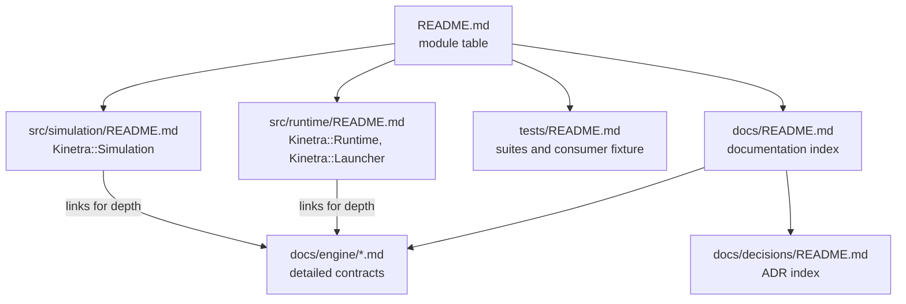

# Documentation cleanup

Status: implemented · Branch: `docs/cleanup` · Related: [Lab quality roadmap: documentation cleanup](https://github.com/SMB-M87/Kinetra-Lab/blob/main/docs/design/2026-11-18-quality-roadmap.md#documentation-cleanup), [documentation guide](../documentation.md)

Kinetra's code is documented in three places that drifted apart: public headers with partial `///` summaries, navigation-only READMEs that repeat each other, and an ADR index split over two pages. This branch gives every public header a contract, folds the thin READMEs into the module READMEs they repeat, moves the ADR index next to the ADRs, and fixes stale facts found in a fresh audit. It is the "Kinetra cross-cutting fixes" row of the Lab roadmap, scheduled after the phase 3 branch.

## Table of contents

- [Problem](#problem)
- [Goals and non-goals](#goals-and-non-goals)
- [Decisions](#decisions)
- [Design](#design)
- [Affected areas](#affected-areas)
- [Test plan](#test-plan)
- [Review](#review)
- [Verification](#verification)
- [Pull request](#pull-request)
- [Open points](#open-points)

[Directory guide](README.md) · [Project overview](../../README.md) · [Documentation index](../README.md)

## Problem

Evidence from `main` at `a21600f`:

- **Missing contracts.** Of the 18 public headers in `include/kinetra/`, several have almost no `///` summaries: `math.h` has one, `spatial_grid.h` two, `collision_grid.h` three, `engine.h` five, `debug_view.h` four, `help_view.h` three. `Key`, `Input`, `Color`, `Shape`, `Motion`, `Contact`, `LaunchChoice`, `LaunchMenu`'s members, `SessionHost`'s members, `WeightedGrid`'s members and `Steering`'s fields have none. [AGENTS.md](../../AGENTS.md#code-documentation) requires one for every public type, function and non-trivial data member.
- **Navigation-only READMEs.** `include/README.md`, `include/kinetra/README.md`, `src/README.md`, `docs/engine/README.md` and `tests/consumer/README.md` mostly list files and link to each other. The same header map appears in `include/README.md` and `include/kinetra/README.md`; the same target diagram in `src/README.md` and [architecture](../architecture.md#components-and-build-dependencies); the physics step flowchart in `src/simulation/README.md` and [math and physics](../engine/math-physics.md#physics-update-flow). The [documentation rule](../documentation.md#what-goes-where) gives a subdirectory its own README only when it has something to say.
- **Thin simulation README.** `src/simulation/README.md` is a source table plus the duplicated physics flowchart; it does not explain the module's concepts, structure, invariants or how to change it.
- **Split ADR index.** The ADR table lives in `docs/README.md`, out of number order (0010 before 0008), with 0011 and 0012 as sentences below the table. [docs/decisions/README.md](../decisions/README.md) only points there. ADRs 0013 and 0014 still say "not yet implemented" although phase 3 implemented them; 0009 and 0010 have no status line.
- **Stale facts.** A read-only audit of the remaining pages on 2026-11-19 is recorded under [Design: stale facts](#stale-facts).

## Goals and non-goals

Goals:

- Every public type, function, enum and non-trivial data member in `include/kinetra/*.h` has a `///` summary that states its contract: units and coordinate space, ownership, preconditions, behavior on invalid input.
- Each concept has one page: the module README for structure, the `docs/engine/` pages for detailed contracts, architecture for cross-module dependencies.
- The five navigation-only READMEs are gone, and no link points to them.
- `src/simulation/README.md` follows the [module template](../documentation.md#module-readme-template).
- The ADR index is one table in `docs/decisions/README.md`, in number order, with status and supersessions.
- The stale facts from the audit are corrected.

Non-goals:

- No code change. Only comments in headers change; the build is untouched.
- ADR bodies stay as they are: they are history. Only status lines are maintained, as the `adr` skill prescribes.
- Design documents are history and are not rewritten, except that their links keep resolving.
- Skill READMEs (roadmap row `docs/skill-readmes`) are a separate branch.
- No Lab change. Lab's documentation links to none of the removed pages; the pointer moves with a later Lab branch.

## Decisions

No load-bearing decision is open: the scope was settled in the Lab roadmap on 2026-11-18. The choices below follow the documentation guide and are cheap to change.

| Decision | Choice | Why |
| --- | --- | --- |
| Where the public header map goes | Each module README lists its own headers; the root README gets a short module table (module, target, headers, README) | A reader who looks for a header finds the module that explains it; the root stays an entry point |
| `docs/engine/README.md` | Removed; `docs/README.md` already routes to all four contract pages | Its contract map repeated the documentation index |
| `src/README.md` | Removed; its rows move to the module READMEs (the GLAD loader row to `src/runtime/README.md`) and its target diagram is the one in architecture | Same diagram existed twice |
| `tests/consumer/README.md` | Folded into a section of `tests/README.md` | The fixture is one of the test suites; two files is not worth a page |
| ADR index | Table in `docs/decisions/README.md`; `docs/README.md` keeps a short `Decisions` section that points there | The index belongs next to the ADRs; keeping the heading keeps old `#decisions` links in design documents working |
| ADR status lines | 0013 and 0014 become `accepted`; 0009 and 0010 get status lines naming their supersession and amendment | Status lines are maintenance data the `adr` skill keeps current; the decision text stays untouched |
| Physics step flowchart | Kept only in [math and physics](../engine/math-physics.md#physics-update-flow); the simulation README links it | One diagram per concept |

## Design

### Header contracts

Comments only, in the style of the [documentation guide](../documentation.md#header-summaries-). Where a contract was stated in a `//` comment, it becomes `///`. Contracts were checked against the implementation in `src/`. Where the implementation suggests a doubtful contract, it is recorded under [Open points](#open-points) instead of being documented as intent.

### Module READMEs after the cleanup

*Takeaway:* every module README hangs directly under the root, and the detailed contract pages are reached from the documentation index and from the module that implements them.

`include/glad/README.md` and `include/KHR/README.md` are third-party provenance READMEs and stay.

### Stale facts

A read-only audit on 2026-11-19 compared the remaining pages with CMake, the presets, CI and the sources. Corrected:

| Page | Was | Now |
| --- | --- | --- |
| `README.md` | "Physics is discrete and fast bodies can tunnel" | Continuous detection for circles and nonrotating convex pairs; rotating boxes and polygons stay discrete |
| `README.md` | Copy of Lab's build-override commands and a link to a Lab README anchor that only forwards | One paragraph linking Lab's `external/README.md` and the workflow |
| `docs/conventions.md` | Layer diagram with `Kinetra::Runtime --> Kinetra::Simulation`; overlays under the launcher | Runtime does not link Simulation; overlays in Runtime |
| `docs/architecture.md` | Frame sequence always renders; `SettingsOverlay` missing; `RuntimeImpl` | `alt` on the session request; `SettingsOverlay` in Runtime; the private `Runtime::Impl` |
| `docs/testing.md` | One "targets / regex" column holding CTest prefixes (`--target kinetra_behavior` fails); Full level `ci` only | Separate build-target and regex columns; Full runs `ci` and `headless`, as CI does |
| `docs/development.md` | `compile_commands.json` and ccache shown for some presets only | Stated once for all presets |
| `docs/engine/runtime.md` | Overlays "header-only"; focus loss clears keys only | `SettingsOverlay` compiled into Runtime; focus loss also releases mouse buttons |
| `docs/engine/*.md`, `AGENTS.md`, `docs/testing.md` | History wording ("former", "original", "remains compatible", "the earlier rule") | Present-tense descriptions; `tangent_steer` moved out of *Verification* |
| `src/runtime/README.md` | "`SessionHost` destroys the old session before creating the next one" | `run_launcher` starts sessions only from the menu; `start` keeps the old session until the factory succeeds |
| `AGENTS.md`, `.agents/skills/README.md` | "Each skill directory has a README.md" | The READMEs are still to be written (open point) |
| ADRs 0013, 0014 | "accepted, not yet implemented" | "accepted" |

Left as is: the skill table in both `AGENTS.md` and the skills overview, and the verification table in `AGENTS.md`, `testing.md` and the `verify` skill. `AGENTS.md` is the agent's entry point and keeps short summaries that link to the authoritative pages.

## Affected areas

- `include/kinetra/*.h`: `///` comments only.
- Removed: `include/README.md`, `include/kinetra/README.md`, `src/README.md`, `docs/engine/README.md`, `tests/consumer/README.md`.
- Rewritten: `src/simulation/README.md`, `docs/decisions/README.md`.
- Updated: `README.md`, `AGENTS.md`, `docs/README.md`, `docs/architecture.md`, `docs/engine/*.md` navigation lines, `src/runtime/README.md`, `tests/README.md`, `include/glad/README.md`, `.agents/skills/adr/SKILL.md`, ADR status lines, and the pages named in [stale facts](#stale-facts).

## Test plan

Docs level: only Markdown and comments change.

| Check | Proves |
| --- | --- |
| `python3 tools/check_docs.py` | No link or anchor points to a removed page or heading |
| `git diff main -- include/ src/ tests/ CMakeLists.txt` filtered to non-comment lines is empty | The branch changes no code |
| `clang-format --dry-run --Werror include/kinetra/*.h` | New comments respect the 110-column limit, as CI checks |
| `grep` for each type, function, target and test name the new text mentions | Every name in the docs exists |
| Lab docs check against this commit (`python3 external/Kinetra/tools/check_docs.py` in Lab) | Lab links into the submodule still resolve |

## Review

`/code-review` (high) on `main...docs/cleanup`:

| Finding | Resolution |
| --- | --- |
| The simulation README promised validation before any state change, but `Navigation::rebuild` replaces its area and obstacle copy before validating the bodies | Invariant reworded; `rebuild`'s `///` says a failed rebuild leaves the instance half updated; recorded as an open point (code change for another branch) |
| The `Body` summary said every function validates its bodies, while `local_extents`, `bounding_radius` and `bounds` do not | Summary names the three exceptions |
| `DebugOption::label` lifetime named `update()`, which never reads it | Narrowed to `draw()` |
| Design document sections still placeholders | Filled in |

## Verification

Docs level; no code, CMake or test file changed.

| Command | Result |
| --- | --- |
| `python3 tools/check_docs.py` | All links resolve in 49 Markdown files |
| `python3 external/Kinetra/tools/check_docs.py` in Lab, with the submodule on this branch | All links resolve in 36 Markdown files |
| Comment-stripped comparison of every `include/kinetra/*.h` with `main` | Code identical |
| `git diff --name-only main -- '*.cpp' '*.txt' '*.cmake' '*.json' '*.yml'` | Empty |
| `clang-format --dry-run --Werror include/kinetra/*.h` (clang-format 23.1.5) | Clean |

Not run: builds and tests, because the Docs level does not need them.

## Pull request

**Title:** `docs: header contracts, module guides and one ADR index`

**Summary.** Every public header in `include/kinetra/` now states its contract in `///` summaries. The five navigation-only READMEs are folded into the module guides. The simulation guide is rewritten from the module template, the ADR index moves next to the ADRs, and stale facts found in an audit are corrected. Docs and comments only.

**Changes.**
- Headers: `///` contracts for every public type, function and field in the simulation and runtime headers, checked against the implementation. Comments only; the code is identical.
- Module guides: `src/simulation/README.md` rewritten (concepts, structure, mechanisms and trade-offs, invariants, recipes, suites); `src/runtime/README.md` gains the header table; `tests/README.md` gains build targets, the consumer fixture and an *Adding a suite* recipe; the root README gets a module table.
- Removed: `include/README.md`, `include/kinetra/README.md`, `src/README.md`, `docs/engine/README.md`, `tests/consumer/README.md`.
- Decisions: index in `docs/decisions/README.md`, in number order with status and supersessions; status lines of 0009, 0010, 0013 and 0014; the `adr` skill points to the new index.
- Stale facts: the Runtime/Simulation edge, the session request in the frame sequence, `SettingsOverlay`'s target, the CI presets, build targets versus CTest prefixes, physics limits and history wording ([table](#stale-facts)).

**Design.** [docs/design/2026-11-19-docs-cleanup.md](2026-11-19-docs-cleanup.md).

**Verification.** Docs check in Kinetra and in Lab against this branch: all links resolve. A comment-stripped comparison shows the headers' code is unchanged, and clang-format is clean. No build: Docs level.

**Review notes.** Check the header contracts that describe behavior beyond the old comments, for example `World::body` reference lifetime, `SessionHost::start` atomicity and `Navigation::rebuild` on an invalid body. The Full level for Kinetra now names `headless` next to `ci`, because CI runs both.

**Dependencies and merge order.** None. Lab links none of the removed pages; its pointer moves with a later Lab branch. Merge with a merge commit, as usual.

**Follow-up.** Make `Navigation::rebuild` validate before it mutates. Write the skill READMEs (`docs/skill-readmes`).

## Open points

- `Navigation::rebuild` changes its area and obstacle copy before validating the bodies; an invalid body leaves the instance half updated. Fix on a code branch, with a test.
- Skill READMEs are still missing (roadmap row `docs/skill-readmes`).
- Lab's submodule pointer still names the commit before this branch; move it in the next Lab branch.
