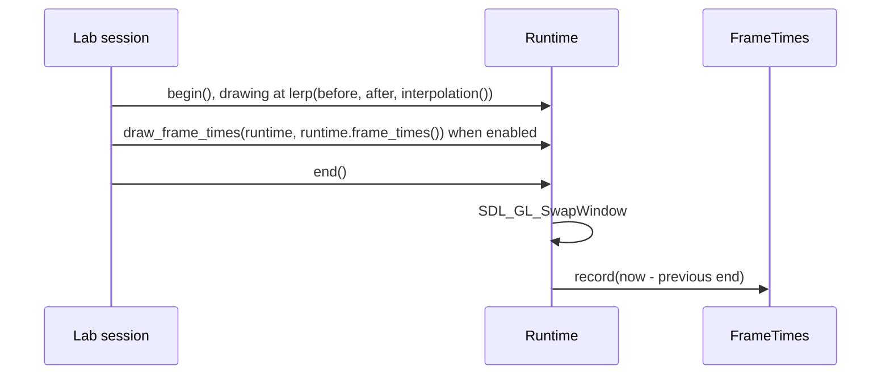

# Frame times and interpolation helpers

Status: implemented · Branch: `feat/frame-times` · Related: [Lab design](https://github.com/SMB-M87/Kinetra-Lab/blob/feat/smooth-rendering/docs/design/2026-11-19-smooth-rendering.md), [runtime and rendering](../engine/runtime.md#sessions-and-timing)

The user sees short freezes and uneven motion in WSL and on a Linux desktop that do not occur in the native Windows build. Two engine pieces help. A frame-time record in `Runtime`, with a graph, shows where a stall happens. Helpers let applications draw between fixed ticks. Lab uses both in its three applications; that half is in the Lab design document.

## Table of contents

- [Problem](#problem)
- [Goals and non-goals](#goals-and-non-goals)
- [Decisions](#decisions)
- [Design](#design)
- [Affected areas](#affected-areas)
- [Test plan](#test-plan)
- [Review](#review)
- [Verification](#verification)
- [Pull request](#pull-request)
- [Open points](#open-points)

[Directory guide](README.md) · [Project overview](../../README.md) · [Documentation index](../README.md)

## Problem

- Nothing measures how long frames take to reach the screen. `RateCounter` gives an average frame rate, which hides a single 80 ms stall among 59 good frames.
- `FixedClock::interpolation()` exists ([timing.h](../../include/kinetra/timing.h)), but no application uses it. The [runtime guide](../engine/runtime.md#verification-and-limits) lists pose interpolation as not implemented.
- In WSLg, `Runtime` logs `VSync unavailable: That operation is not supported`: frame pacing there is up to the WSLg compositor.

## Goals and non-goals

- Goal: every Kinetra window records the interval between presented frames; a helper draws it as a graph.
- Goal: an angle interpolation helper next to `lerp`, for applications that interpolate rotations.
- Non-goal: storing poses or interpolating inside the engine. What moves and what must not be blended (teleports, respawns) is application knowledge.
- Non-goal: fixing the WSLg compositor. The graph makes its behavior visible.

## Decisions

| Decision | Choice | Why |
| --- | --- | --- |
| Scope | Frame-time graph plus interpolation in all three Lab applications | User's choice |
| Where the graph is switched on | A FRAME TIMES row in each Lab settings panel, off by default | User's choice; Lab adds the row |
| What is measured | Wall-clock time between successive `end()` calls, after the swap returns | A late frame shows wherever it was held: simulation, drawing, a blocking VSync, the driver or the compositor |
| Storage | `FrameTimes`, a fixed ring of 240 frames (4 s at 60 fps) in `timing.h` | Header-only and testable without a window, like `RateCounter` |
| Graph placement | Top-right corner of the window | Lab keeps its toolbar and debug menu top left and its statistics at the bottom. (First placed at the top center, where the open debug menu overlapped it on narrow windows; found in review) |
| Bar colors | Green up to one 60 Hz refresh, yellow up to two, red beyond, each with 5 % allowance for timer jitter | Matches what a viewer perceives as on time, one dropped frame, or a stall |
| Angle interpolation | `lerp_angle`, the shorter way around | Bodies near ±pi would otherwise spin a full turn for one frame |

## Design

*Takeaway:* the engine measures and draws; applications decide what to interpolate and when to show the graph.

## Affected areas

- [timing.h](../../include/kinetra/timing.h): `FrameTimes`.
- [engine.h](../../include/kinetra/engine.h), [runtime.cpp](../../src/engine/runtime.cpp): `Runtime::frame_times()`, recorded in `end()`.
- [debug_view.h](../../include/kinetra/debug_view.h): `FrameTimeGraph`, `draw_frame_times`.
- [math.h](../../include/kinetra/math.h): `lerp_angle`.
- Docs: [runtime and rendering](../engine/runtime.md), [tests README](../../tests/README.md).

The change is additive to the public API; no existing signature changes.

## Test plan

| Behavior | Test | Level |
| --- | --- | --- |
| `FrameTimes` keeps the newest frames in order, reports average and worst, drops the oldest when full, rejects invalid durations | Three `kinetra_presentation` cases | Headless |
| `lerp_angle` takes the shorter way, also across pi and a full turn | `kinetra_presentation:angle interpolation takes the shorter way around` | Headless |
| `Runtime` records one interval per presented frame after the first; the graph draws short frames as green bars | `kinetra_engine_graphics:presented frames are timed and the frame-time graph draws them` | Graphics |

Public headers and the runtime change, so the level is Full with graphics, plus Lab's integration build.

## Review

See the [Lab design document](https://github.com/SMB-M87/Kinetra-Lab/blob/feat/smooth-rendering/docs/design/2026-11-19-smooth-rendering.md#review), which reviewed both branches together.

## Verification

| Command | Result |
| --- | --- |
| `cmake --workflow --preset ci` | 219/219 passed |
| `cmake --workflow --preset graphics` | 228/229 passed; `input drawing and resizing reach SDL and OpenGL` fails at its synthetic click and wheel check, the known WSLg failure that also occurs on `main` |
| `python3 tools/check_docs.py` | All links resolve |
| Lab integration | See the Lab design document |

## Pull request

Title: `feat(runtime): record frame times and add interpolation helpers`

**Summary.** `Runtime` now records the time between presented frames, and `draw_frame_times` shows them as a graph, so a stall can be told apart from a compositor that paces frames unevenly. `lerp_angle` joins `lerp` for applications that draw between fixed ticks.

**Changes.**
- `FrameTimes` (timing.h); `Runtime::frame_times()`, recorded after each swap.
- `FrameTimeGraph` and `draw_frame_times` (debug_view.h).
- `lerp_angle` (math.h).
- Tests and the runtime guide.

**Design.** [docs/design/2026-11-19-frame-times.md](2026-11-19-frame-times.md).

**Verification.** `ci` 219/219; `graphics` 228/229 (the known WSLg input failure, also on `main`); docs check; Lab integration in the Lab pull request.

**Review notes.** The graph sits in the top-right corner; Lab's overlays leave that free.

**Dependencies and merge order.** Merge before the Lab pull request, with a merge commit. Independent of the window-icon pull request; whichever Kinetra branch merges second needs no change, but the Lab pointer then moves to the merge commit that holds both.

**Follow-up.** None.

## Open points

None.
