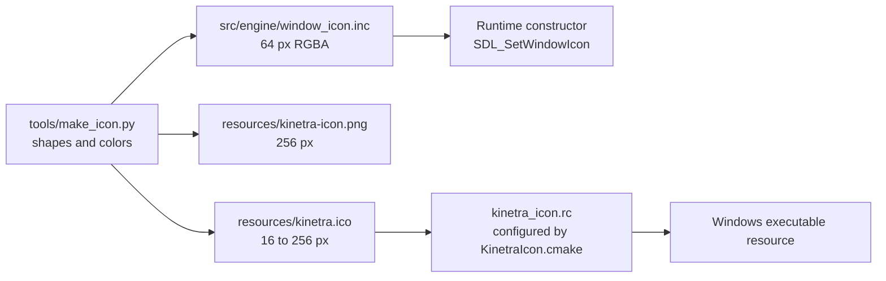

# Window icon

Status: implemented · Branch: `feat/window-icon` · Related: [Lab design](https://github.com/SMB-M87/Kinetra-Lab/blob/feat/window-icon/docs/design/2026-11-19-window-icon.md), [runtime and rendering](../engine/runtime.md#lifecycle), [tools](../../tools/README.md#make_iconpy)

Every Kinetra window shows the desktop's empty default icon, and the Windows executables show the generic program icon in Explorer. The user asked for a real icon. This document covers the engine half: the icon itself, the window icon in `Runtime`, and a CMake helper that embeds the icon in a Windows executable.

## Table of contents

- [Problem](#problem)
- [Goals and non-goals](#goals-and-non-goals)
- [Decisions](#decisions)
- [Design](#design)
- [Affected areas](#affected-areas)
- [Test plan](#test-plan)
- [Review](#review)
- [Verification](#verification)
- [Pull request](#pull-request)
- [Open points](#open-points)

[Directory guide](README.md) · [Project overview](../../README.md) · [Documentation index](../README.md)

## Problem

- `Runtime::Runtime` creates the window with `SDL_CreateWindow` and never calls `SDL_SetWindowIcon` ([runtime.cpp](../../src/engine/runtime.cpp)), so the window manager shows its default icon.
- No executable carries an icon resource, so Explorer and Windows shortcuts show the generic program icon.
- The repository has no logo or image to use.

## Goals and non-goals

- Goal: every Kinetra window has the Kinetra icon, on Linux (X11 and XWayland) and Windows.
- Goal: the Windows executables embed the same icon.
- Goal: one source for the icon, so the window icon and the `.ico` cannot drift apart.
- Non-goal: an icon per application. Lab's applications share the engine icon.
- Non-goal: Linux desktop integration (`.desktop` file, installed icon theme). Nothing is installed today.
- Non-goal: native Wayland. SDL2 has no window-icon support there.

## Decisions

| Decision | Choice | Why |
| --- | --- | --- |
| Icon source | Generated by Claude, approved by the user in the conversation ("Kan jij een icoon genereren?") | User's choice |
| How the icon is made | Vector shapes in [make_icon.py](../../tools/make_icon.py), rasterized with 4x4 supersampling in pure Python | Reproducible and editable as code; no image tool or Python package needed. Rejected: a hand-drawn binary with no source |
| How the window gets it | Raw 64 px RGBA bytes in a generated `src/engine/window_icon.inc`, passed to `SDL_SetWindowIcon` | No image decoder in the engine. Rejected: decoding a PNG at run time (a new dependency) and drawing the shapes again in C++ (a second definition of the icon) |
| Who sets the icon | `Runtime`, always | Every Kinetra window shares the engine brand. No public API until an application needs its own icon |
| Executable icon | `kinetra_executable_icon(<target>)` in [KinetraIcon.cmake](../../cmake/KinetraIcon.cmake), a no-op outside Windows | The executables live in Lab, the icon in Kinetra; the helper keeps the resource path in one place |
| Failure to set the icon | Logged with `SDL_Log`, not thrown | An icon is cosmetic; it must not stop an application |
| Drift guard | `make_icon.py --check` in CI, comparing decoded pixels | File bytes can differ between zlib versions; pixels cannot |

## Design

*Takeaway:* the script is the only place the icon is defined; every other file is derived from it and checked against it.

- The icon is a rounded square with an indigo-to-teal gradient and a white "K". The ends of the K's arms are an amber and a cyan node, for moving agents.
- `runtime.cpp` includes `window_icon.inc` inside its anonymous namespace. Right after `SDL_CreateWindow`, it wraps the bytes in an `SDL_Surface` without copying them and calls `SDL_SetWindowIcon`, which copies them.
- On Windows, [KinetraIcon.cmake](../../cmake/KinetraIcon.cmake) configures `kinetra_icon.rc` with the absolute path of `kinetra.ico`, because the resource compiler resolves relative paths against its working directory. CMake already enables the RC language for the MinGW and MSVC platforms.

## Affected areas

- [runtime.cpp](../../src/engine/runtime.cpp), [engine.h](../../include/kinetra/engine.h) (constructor contract).
- New: [make_icon.py](../../tools/make_icon.py), `resources/kinetra.ico`, `resources/kinetra-icon.png`, `resources/kinetra.rc.in`, `src/engine/window_icon.inc`, [KinetraIcon.cmake](../../cmake/KinetraIcon.cmake).
- [CMakeLists.txt](../../CMakeLists.txt), [ci.yml](../../.github/workflows/ci.yml).
- Docs: [tools](../../tools/README.md), [runtime and rendering](../engine/runtime.md).

## Test plan

| Behavior | Test | Level |
| --- | --- | --- |
| The committed icon files match the script | `python3 tools/make_icon.py --check`, in CI | Docs-like check |
| A Runtime still opens, draws and closes with the icon set | Existing `kinetra_engine_graphics` cases | Graphics |
| The window carries the icon on X11 | Manual: `xprop _NET_WM_ICON` on a running Lab window | Manual |
| The Windows executable embeds the icon | Lab: the `windows` cross build links `kinetra_icon.rc`; the resource is checked with `x86_64-w64-mingw32-objdump` | Lab Full (windows) |

SDL2 offers no `SDL_GetWindowIcon`, so no automated test reads the icon back from a window. The change touches a public header, CMake and the runtime, so the level is Full with graphics, plus Lab's integration build.

## Review

Self-review of `git diff main...HEAD`:

- `const_cast` on the icon bytes: `SDL_CreateRGBSurfaceWithFormatFrom` takes `void *` but only reads when the surface is passed to `SDL_SetWindowIcon`, which copies the pixels. The surface is freed right after.
- The `.inc` is included inside the anonymous namespace, so its two constants get internal linkage and cannot clash with Lab code.
- `kinetra_executable_icon` on a non-executable target would add a resource to a library; the helper documents that it is for executables, and Lab calls it only for those.
- The generator is deterministic: it uses only IEEE double arithmetic and `math.hypot`, and the check compares pixels.

## Verification

| Command | Result |
| --- | --- |
| `python3 tools/make_icon.py --check` | Passes |
| `cmake --workflow --preset ci` | 215/215 passed, no Kinetra warnings |
| `cmake --workflow --preset graphics` | 223/224 passed. `input drawing and resizing reach SDL and OpenGL` fails at its synthetic click and wheel check, the known WSLg failure that also occurs on `main` ([static window titles](2026-11-19-static-window-titles.md#verification)); unrelated |
| `python3 tools/check_docs.py` | All links resolve |
| Lab integration and Windows cross build | See the [Lab design](https://github.com/SMB-M87/Kinetra-Lab/blob/feat/window-icon/docs/design/2026-11-19-window-icon.md#verification) |

## Pull request

Title: `feat(runtime): give every window the Kinetra icon`

**Summary.** Kinetra windows showed the desktop's empty default icon. `Runtime` now sets a generated Kinetra icon on every window, and `kinetra_executable_icon(<target>)` embeds the same icon in Windows executables.

**Changes.**
- `tools/make_icon.py`: draws the icon and writes `resources/kinetra.ico`, `resources/kinetra-icon.png` and `src/engine/window_icon.inc`; `--check` verifies them.
- `Runtime`: sets the 64 px icon after creating the window; a failure is logged.
- `cmake/KinetraIcon.cmake`: `kinetra_executable_icon(<target>)`, Windows only.
- CI: the icon check next to the documentation check.
- Docs: tools README, runtime guide, constructor contract.

**Design.** [docs/design/2026-11-19-window-icon.md](https://github.com/SMB-M87/Kinetra/blob/feat/window-icon/docs/design/2026-11-19-window-icon.md).

**Verification.** `make_icon.py --check`, `ci` 215/215, `graphics` 223/224 (the known WSLg input failure, also on `main`), docs check; Lab integration and Windows cross build in the Lab pull request.

**Review notes.** The icon design is a first proposal; changing it means editing the constants in `make_icon.py` and regenerating. Native Wayland shows no window icon (SDL2 limitation).

**Dependencies and merge order.** Merge before the Lab pull request, with a merge commit.

**Follow-up.** A `.desktop` file for Linux desktops when Lab gets an install step.

## Open points

- Native Wayland: SDL2 cannot set a window icon. SDL3 supports the `xdg-toplevel-icon` protocol where the compositor offers it.
