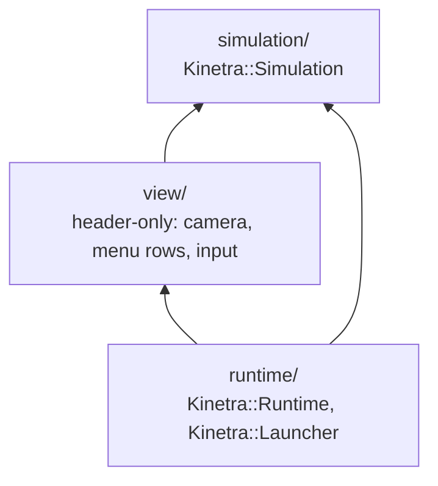

# Include layout

Status: accepted · Branch: `refactor/include-layout` · Related: [ADR 0015](../decisions/0015-include-layout.md), [Lab design](https://github.com/SMB-M87/Kinetra-Lab/blob/main/docs/design/2026-11-20-include-layout.md), [conventions](../conventions.md#directory-layout)

Kinetra's 21 public headers sit side by side in `include/kinetra/`, so the include path does not show which layer a header belongs to. Lab's logic layer includes `camera.h` and `debug_menu.h` headless, and through `debug_menu.h` also `engine.h`, which declares `Runtime`. This change groups the headers by layer, moves the plain input types out of `engine.h`, and writes the directory rule into the shared conventions. Kinetra-Lab applies the same rule to its modules on its own branch.

## Table of contents

- [Problem](#problem)
- [Goals and non-goals](#goals-and-non-goals)
- [Decisions](#decisions)
- [Design](#design)
- [Affected areas](#affected-areas)
- [Test plan](#test-plan)
- [Review](#review)
- [Verification](#verification)
- [Pull request](#pull-request)
- [Open points](#open-points)

[Directory guide](README.md) · [Project overview](../../README.md) · [Documentation index](../README.md)

## Problem

- **No layer in the path.** `#include <kinetra/simulation/steering.h>` and `#include <kinetra/runtime/settings_view.h>` look alike, although the first needs only `Kinetra::Simulation` and the second `Kinetra::Runtime`. The layer rule in [conventions](../conventions.md#layers-and-dependencies) cannot be read from an include line.
- **Headless types in a runtime header.** `Key`, `Input` and `Color` live in [engine.h](../../include/kinetra/runtime/engine.h) next to `Runtime`. [debug_menu.h](../../include/kinetra/view/debug_menu.h), which Lab's logic includes headless, includes `engine.h` for them.
- **No directory rule.** [conventions.md](../conventions.md#files-and-formatting) says `.h` and `.cpp`, but not where they go. Kinetra-Lab drifted: headers in `src/` and `tests/`, one-file `include`/`src` pairs, and `../../` includes across modules.

## Goals and non-goals

- Goal: every public header sits in a directory named after its layer: `simulation/`, `view/` or `runtime/`.
- Goal: a headless consumer includes nothing from `runtime/`.
- Goal: one written directory rule for both repositories.
- Non-goal: renaming types, functions or targets; changing behavior.
- Non-goal: forwarding headers at the old paths (user's choice: break once, Kinetra first).
- Non-goal: moving third-party headers (`include/glad`, `include/KHR`).

## Decisions

| Decision | Choice | Why |
| --- | --- | --- |
| Grouping of engine headers | `simulation/`, `view/` (headless view and input types), `runtime/` | User's choice. The path shows the layer rule; `view/` gives Lab's logic a headless home for camera, menu and input types |
| Plain input types | Move `Key`, `Input` and `Color` from `engine.h` to `view/input.h` | `debug_menu.h` no longer reaches `Runtime`; a type move without behavior change |
| Compatibility | Hard break, no forwarding headers | User's choice; the only consumers are Kinetra-Lab and the consumer test, both updated in the same round |
| Merge order | Kinetra first with a merge commit, then Lab records it | Lab AGENTS.md pointer rule |
| Directory rule | In [conventions.md](../conventions.md#directory-layout), shared with Lab | One authoritative place |
| Topic folders | When a layer holds more than about twelve headers; never a folder for one file | User's choice for i4sim, Dotio, Demo and the engine; the one-file rule follows the user's objection to Dotio's `gmath` |
| Internal headers | `include/<name>/.../detail/` when no public header reaches them | User's choice; common C++ practice, one include root per module |
| ADR | [0015](../decisions/0015-include-layout.md) | The include path is public API, and the split is hard to reverse |

## Design

```text
include/kinetra/
  simulation/  math.h physics.h navigation.h steering.h avoidance.h traffic.h
               spatial_grid.h collision_grid.h weighted_grid.h
  view/        camera.h debug_menu.h input.h            (headless, header-only)
  runtime/     engine.h timing.h session.h launcher.h debug_view.h
               settings_view.h help_view.h overlay_style.h bitmap_text.h
src/
  simulation/  (unchanged)
  runtime/     (was src/engine/)
```



*Takeaway:* a header in `view/` may include `simulation/`, never `runtime/`; Lab logic includes `simulation/` and `view/` only.

- `view/input.h` holds `Key`, `Input` and `Color` exactly as they are today; `runtime/engine.h` includes it, so `Runtime` users see no difference apart from the path.
- `timing.h` stays with the runtime: its clocks and frame limiter serve the main loop. Whether it belongs in `view/` is an open point.
- `Kinetra::Simulation` keeps `include/` as its include directory, so `view/` stays available headless as it is today.
- Inside `include/kinetra/`, headers include each other as `<kinetra/<layer>/<name>.h>` instead of `"name.h"`.
- The new **Directory layout** section in [conventions.md](../conventions.md#directory-layout) states the rule for both repositories:
  - every module has one `include/<name>/` and one `src/`; a `.h` never sits outside an include root;
  - `src/` mirrors the folders of `include/<name>/`;
  - topic folders once a layer holds more than about twelve headers, never for one file;
  - internal headers in a `detail/` folder within their topic;
  - test helper headers in `tests/include/<name>/testing/`;
  - includes always start with the module name (`"i4sim/simulation/simulation.h"`, `<kinetra/view/camera.h>`), never `../`.

## Affected areas

- All of `include/kinetra/` (moved), `src/engine/` → `src/runtime/`, every `#include <kinetra/...>` in `src/`, `tests/` and `tests/consumer/`.
- [CMakeLists.txt](../../CMakeLists.txt) source paths.
- Docs: [conventions.md](../conventions.md), [architecture.md](../architecture.md), [engine guides](../engine/), module READMEs under `src/`, the root README, `AGENTS.md` paths. ADR [0015](../decisions/0015-include-layout.md).

## Test plan

| Behavior | Test | Level |
| --- | --- | --- |
| Behavior unchanged | Every existing suite, unchanged apart from include lines | Full |
| A headless consumer builds without the runtime | `cmake --workflow --preset ci` (headless) and the consumer test | Full |
| Runtime and overlays unchanged | `cmake --workflow --preset graphics` | Full with graphics |
| No old path remains | `grep -rn '<kinetra/[a-z_]*\.h>'` over Kinetra and Lab returns nothing | Manual |
| Docs links | `python3 tools/check_docs.py` | Docs |

A refactor: no new tests, no changed assertions. Lab verifies the new pointer on its own branch at the Full level, with graphics and the Windows build.

## Review

To be filled in after implementation.

## Verification

To be filled in after implementation.

## Pull request

To be filled in after implementation.

## Open points

- `timing.h` in `runtime/` or `view/`: the frame-time graph data is headless, the frame limiter is not. Left in `runtime/`.
