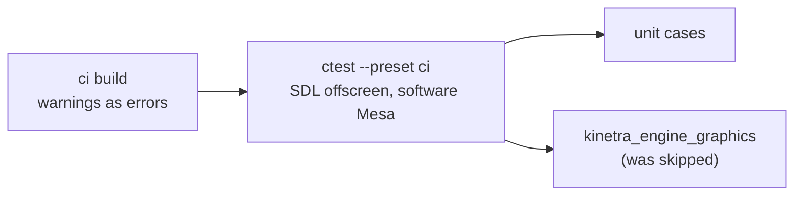

# Graphics tests in CI

Status: implemented · Branch: `build/graphics-in-ci` · Related: [testing, Full](../testing.md#full), [continuous integration](../testing.md#continuous-integration), Lab design `2026-11-22-graphics-tests-in-ci.md` (the application half), [Local verification runs only graphics](2026-11-20-verify-locally-graphics.md) (the rule this one replaces)

CI compiled the graphics tests but did not run them, so the Full level asked for a local graphics run on top of the pull request's checks. The `graphics` preset already renders without a GPU, with SDL's offscreen driver and software Mesa. This change makes CI run the graphics cases on that same backend, and the user decided on 2026-11-22 that CI is then the whole Full level: no local graphics run is required any more.

## Table of contents

- [Problem](#problem)
- [Goals and non-goals](#goals-and-non-goals)
- [Decisions](#decisions)
- [Design](#design)
- [Affected areas](#affected-areas)
- [Test plan](#test-plan)
- [Review](#review)
- [Verification](#verification)
- [Pull request](#pull-request)
- [Open points](#open-points)

[Directory guide](README.md) · [Project overview](../../README.md) · [Documentation index](../README.md)

## Problem

- The `ci` test preset inherited `no-graphics` (`CMakePresets.json`), so CI built `kinetra_engine_runtime_tests` and skipped its 13 cases. The reason in `ci.yml` was "no GPU", but the `graphics` preset never used one: it sets `SDL_VIDEODRIVER=offscreen` and `LIBGL_ALWAYS_SOFTWARE=1`.
- The Full level therefore needed a local `cmake --workflow --preset graphics` ([testing](../testing.md#full), `AGENTS.md`, `verify` and `pr-review` skills). An agent in a cloud session ran a check that CI could have run, and a runtime change from a session that could not run it was not checked at all.
- Measured on 2026-11-22 in a cloud session (Ubuntu 24.04, SDL 2.30, Mesa 25.2 llvmpipe, no GPU, no display): all 13 `kinetra_engine_graphics` cases pass in 0.8 s, including the injected mouse-input case that fails under WSL2 ([testing, open points](../testing.md#open-points)).

## Goals and non-goals

- Goal: CI runs every test, the graphics cases included, on every pull request and push to `main`.
- Goal: the rules say that CI is the Full level; locally only the targeted checks, and graphics cases as optional quick feedback.
- Goal: every copy of the old rule changes: `AGENTS.md`, testing, development, workflow, and the `verify` and `pr-review` skills.
- Goal: the reviewer only reviews code and comments, and starts once CI is green.
- Non-goal: Windows. Lab's native Windows job keeps skipping graphics; a software OpenGL 3.3 context on the Windows runner would be a change of its own.
- Non-goal: desktop feel, real GPU drivers and performance. Software rendering cannot prove them; they stay a playtest by the user.

## Decisions

| Decision | Choice | Why |
| --- | --- | --- |
| The local rule once CI runs graphics | CI is the Full level. Locally only the targeted checks of every changed area; graphics cases optional, as quick feedback or to reproduce a CI failure | The user's choice of 2026-11-22. CI uses the same backend as a local run, so the local run only repeated it |
| Kinetra and Lab | Both, Kinetra first | The user's choice of 2026-11-22. The rule lives here and Lab copies it |
| How CI runs them | The `ci` test preset runs everything, with the offscreen environment; a hidden `software-gl` test preset holds that environment for `graphics` and `ci` | No second build: `build-ci` already has the graphics tests. One step, and one preset that a developer can run to reproduce CI |
| Desktop checks | A design document names a playtest by the user when a change depends on feel, a GPU driver or performance | Neither CI nor a local software run proves them |
| The reviewer | `pr-review` reviews the code and comments, and builds, tests and runs nothing; the author starts it only once the pull request's CI is green, and after new commits it reviews only a green head. A screenshot of a changed scene is the author's; the reviewer checks it is there | The user's choice of 2026-11-22, during this pull request: CI and the author run everything, so a run by the reviewer only repeated it |

## Design

*Takeaway:* CI runs the graphics cases in the build it already makes; nothing else in the pipeline changes.

- `CMakePresets.json`: the hidden test preset `software-gl` (base plus `SDL_VIDEODRIVER=offscreen`, `LIBGL_ALWAYS_SOFTWARE=1`); `graphics` and `ci` inherit it, so `ci` no longer excludes the `graphics` label. The `ci` configure preset's display name says so.
- `.github/workflows/ci.yml`: the header comment and the step name.
- Rules: the Full level is CI plus local targeted checks (`AGENTS.md`, [testing](../testing.md#full)); the reviewer reads CI's graphics results and adds a screenshot ([pr-review](../../.agents/skills/pr-review/SKILL.md), [workflow](../workflow.md#6-review)); `verify` stops asking for a local graphics run.

## Affected areas

`CMakePresets.json`, `.github/workflows/ci.yml`, `AGENTS.md`, `docs/testing.md`, `docs/development.md`, `docs/workflow.md`, `.agents/skills/verify/`, `.agents/skills/pr-review/` (`SKILL.md` and `README.md`), `.agents/skills/feature/SKILL.md`, `.agents/skills/README.md`, `tests/runtime_tests.cpp`, the roadmap item *Graphics tests in CI* (removed), this document and the design index.

## Test plan

| Behavior | Check | Level |
| --- | --- | --- |
| `ctest --preset ci` runs the graphics cases with the offscreen environment | Locally: `cmake --preset ci && cmake --build --preset ci && ctest --preset ci` lists and passes 278 cases, 13 of them `graphics` | Full |
| They pass in CI's pinned Arch image (`sdl2-compat`, Mesa from the snapshot) | This pull request's `checks` job | Full |
| Docs and skills links | `python3 tools/check_docs.py` | Docs |

The pinned Arch image could not be run in the cloud session: its network policy refuses `archive.archlinux.org` and the Arch mirrors, so the Arch result comes from this pull request's CI.

## Review

To be filled in after the agent review.

## Verification

| Command | Result |
| --- | --- |
| `cmake --preset ci && cmake --build --preset ci && ctest --preset ci -j4` (Ubuntu 24.04, GCC 13.3, SDL 2.30, Mesa 25.2 llvmpipe, offscreen) | passed, 278 of 278, 13 graphics |
| `python3 tools/check_docs.py` | passed |
| Pull request CI | pending |

## Pull request

**Title:** `build(ci): run the graphics tests in CI and make CI the Full level`

**Summary.** CI compiled the graphics tests but skipped them. The `ci` test preset now runs them with SDL's offscreen driver and software Mesa, the backend the `graphics` preset always used, so they need no GPU. With that, the user decided that CI is the whole Full level: agents no longer run the graphics workflow locally.

**Changes.**
- `CMakePresets.json`: hidden test preset `software-gl` with the offscreen environment; `graphics` and `ci` inherit it.
- `ci.yml`: comment and step name.
- `AGENTS.md`, testing, development, workflow, `verify` and `pr-review`: CI is the Full level; locally the targeted checks, graphics cases optional; a desktop playtest stays with the user.
- `pr-review`, `feature`, workflow and `AGENTS.md`: the reviewer reviews code and comments only, and starts once CI is green; the author adds a screenshot of a changed scene.
- `runtime_tests.cpp`: the mouse-input case fills its injected events as SDL does, and checks click and wheel separately.
- Roadmap item *Graphics tests in CI* removed.

**Verification.** Local `ci` workflow in a cloud session: 278 of 278 cases, 13 graphics. The Arch result is this pull request's CI.

**Dependencies and merge order.** Kinetra-Lab's pull request on `ccr-ad794af0-y32jzm` (the application half) points at this branch and merges after this one, with a merge commit. This pull request changes the agent rules and CI, so it waits for the user.

**Follow-up.** The WSL2 mouse-input open point stays: CI does not run under WSL2.

## Open points

- `kinetra_engine_graphics` still fails under WSL2 ([testing, open points](../testing.md#open-points)); a cloud session passes it with SDL 2.30, which points at WSLg or `sdl2-compat` there rather than at the test.
