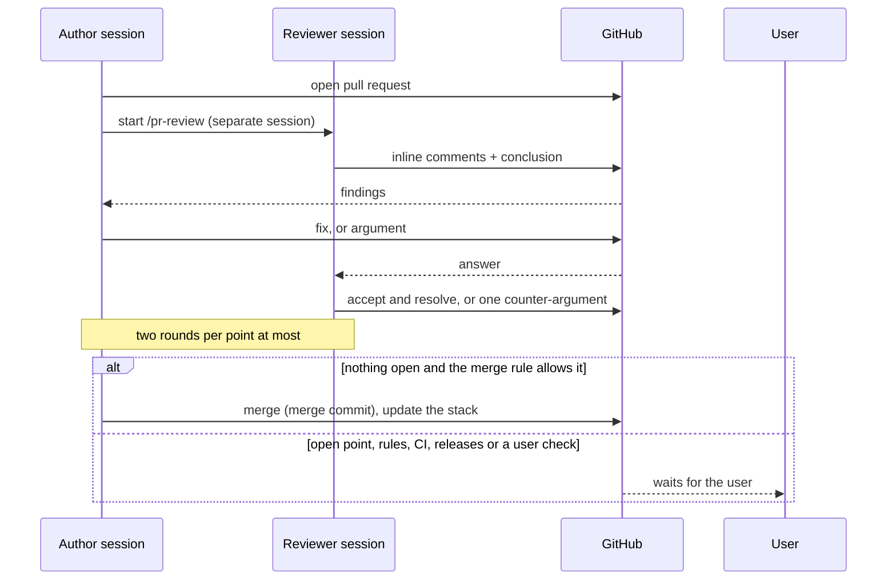

# Review loop and merges by agents

Status: implemented · Branch: `feat/pr-review-loop` (stacked on `feat/pr-review-skill`) · Related: [pull request review skill](2026-11-22-pr-review-skill.md), [roadmap decisions](2026-11-22-roadmap-decisions.md), [workflow, review](../workflow.md#6-review), [agent rules, Git](../../AGENTS.md#git)

After the review skill was built, the user changed two rules. Every pull request now waits for an agent review. The reviewer and the author may discuss a finding, and when nothing is open the author's agent may merge. What the two cannot settle, and every change to rules, CI, releases or the user's own checks, stays for the user. The user also asked that the reviewer checks whether a change meets its goal. This change writes the loop and the merge rule into the agent rules, the workflow and the three skills involved.

## Table of contents

- [Problem](#problem)
- [Goals and non-goals](#goals-and-non-goals)
- [Decisions](#decisions)
- [Design](#design)
- [Affected areas](#affected-areas)
- [Test plan](#test-plan)
- [Review](#review)
- [Verification](#verification)
- [Pull request](#pull-request)
- [Open points](#open-points)

[Directory guide](README.md) · [Project overview](../../README.md) · [Documentation index](../README.md)

## Problem

- The rules say agents never merge, and `pr-review` runs only on request ([roadmap decisions](2026-11-22-roadmap-decisions.md#decisions)). So every pull request waits for the user, even when a second agent found nothing.
- A reviewer's finding and the author's answer have no way to end: no rule says who has the last word, or when the user takes over.
- The checklist checks the process, not whether the change does what its roadmap item and design document promise. Presentation changes are seen by nobody but the user, because CI does not run graphics.

## Goals and non-goals

- Goal: every pull request gets an agent review, started by its author; the two discuss at most two rounds per point; open points stay for the user.
- Goal: the author's agent merges when nothing is open, and never a change to the agent rules, CI, releases or one with a check by the user.
- Goal: the reviewer checks every goal and runs what CI does not cover.
- Non-goal: approvals. Agents post with the user's account, which cannot approve its own pull request; the conclusion and resolved threads take that place.

## Decisions

Settled with the user on 2026-11-22. ⚑ marks the decisions that reverse an earlier one.

| Decision | Choice | Why |
| --- | --- | --- |
| When a review runs ⚑ | After every pull request, started by its author in a separate session; the pull request waits for its conclusion | The user's change: "a pull request waits for an agent review". Reverses *only on request* of the same morning |
| Discussion | At most two rounds per point; then the point stays open for the user | The user's choice; keeps two agents from talking in circles |
| Who merges ⚑ | The author's agent, under the merge rule | The user's change: agents may merge when nothing is open. Reverses "an agent may never merge" of 2026-11-21. The author knows the stack and the pointer steps |
| When nothing is open | The reviewer's latest conclusion *Ready to merge* on the current head, every thread resolved, CI green, no conflict, the pull requests below in the stack merged | Each is visible on GitHub, so the author cannot merge on a guess |
| What always waits for the user | Changes to the agent rules (both `AGENTS.md`, `.agents/skills/`, workflow, conventions, testing, documentation guide), to CI or releases (`.github/`, `tools/release/`, `CMakePresets.json`), and pull requests with a check by the user | The user's choice: agents do not approve their own rules, a CI or release error hits every later pull request, and the user's checks are the user's |
| Goals | The reviewer traces every goal of the roadmap item and the design document to code and proof; a missed goal is blocking, a vague one a question for the user | The user asked whether the reviewer checks the functionality and the goal |
| Running | The reviewer builds and runs what CI does not cover: graphics tests and, in Lab, a screenshot it looks at | CI does not run graphics; otherwise only the user sees presentation changes |
| Threads (cosmetic) | The reviewer resolves a thread when it accepts the fix or the argument; an open thread is an open point | Makes "nothing open" checkable |
| Conclusion (cosmetic) | *Ready to merge* names the head it covers; a later push needs a review of the new commits; a *Merge* line says whether the author or the user merges | A merge must never rest on an older review |
| Starting the review (cosmetic) | In a cloud session a new session with `/pr-review <url>`; elsewhere a fresh sub-agent with only the link | Independence from the author's context |

This change edits the agent rules, so by its own rule it waits for the user.

## Design

*Takeaway:* a merge by an agent needs a second agent's *Ready to merge* on the current head and nothing open; everything else ends with the user.

- [AGENTS.md, Git](../../AGENTS.md#git): the review loop, the merge rule with its exceptions, and a new *Why*. The old "never merge" line is gone.
- [Workflow](../workflow.md): the cycle diagram ends in the agent review and the merge, step 6 describes the loop, step 8 starts it, review feedback names the two rounds, and a stack merges by the author or by the user.
- [pr-review](../../.agents/skills/pr-review/SKILL.md): new steps for goals (3), running (6) and discussion rounds (9); the conclusion *Needs the user* and a *Merge* line; the reviewer resolves the threads it accepts.
- `pr-feedback`: processes agent reviews at once, argues instead of asking, stops after two rounds, and merges under the merge rule.
- `feature`: starts the review in step 9 and merges, or leaves the pull request for the user, when the review is done.

## Affected areas

`AGENTS.md`, `docs/workflow.md`, `.agents/skills/pr-review/SKILL.md` and `README.md`, `.agents/skills/pr-feedback/SKILL.md`, `.agents/skills/feature/SKILL.md`, `.agents/skills/README.md`, this document and the design index. Kinetra-Lab adds the merge order with the pointer to its `AGENTS.md`.

## Test plan

Documentation and skills only: the Docs level (`python3 tools/check_docs.py`). The first pull request after this merges is the first run of the loop.

## Review

- Searched for every remaining "never merge" and "the user merges" outside design documents; each now names the merge rule.
- The rule cannot let an agent merge this change: it edits the agent rules.

## Verification

- `python3 tools/check_docs.py`: all links resolve.

## Pull request

**feat(workflow): agent review on every pull request, and merges under a rule**

- **Summary:** every pull request waits for an agent review; reviewer and author discuss at most two rounds per point; when nothing is open the author's agent merges, except for changes to agent rules, CI, releases or with a check by the user, which stay for the user. The reviewer now checks every goal and runs what CI does not cover.
- **Changes:** AGENTS.md Git rules and skills row; workflow diagram, steps 6 and 8, review feedback, stacks; `pr-review` steps 3, 6 and 9, conclusion and merge line; `pr-feedback` and `feature` steps; skills overview.
- **Design:** `docs/design/2026-11-22-pr-review-loop.md`.
- **Verification:** Docs level.
- **Review notes:** reverses two earlier decisions on the user's word (see ⚑); the user merges this one.
- **Dependencies and merge order:** stacked on #24; merge #24 first, then this, both with a merge commit; Kinetra-Lab #67 records the top.
- **Follow-up:** the first pull request after the merge runs the loop.

## Open points

- The first real run will show whether two rounds and the checklist are the right size.
