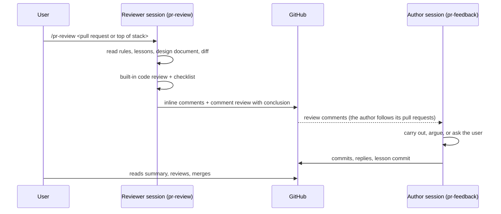

# Pull request review skill and review lessons

Status: implemented · Branch: `feat/pr-review-skill` (stacked on `docs/roadmap-decisions`) · Related: [roadmap decisions](2026-11-22-roadmap-decisions.md), [workflow, review](../workflow.md#6-review), [review lessons](../review-lessons.md), [skill](../../.agents/skills/pr-review/README.md)

The user asked for an agent that reviews pull requests: comments that the agent which opened the pull request picks up, a summary with a conclusion and points of attention for the user, never a merge, and lessons that other agents learn from. The design was settled with the user on 2026-11-22. This change adds the `pr-review` skill, a review lessons page, and the steps in `feature`, `pr-feedback`, the workflow and the agent rules that connect them.

## Table of contents

- [Problem](#problem)
- [Goals and non-goals](#goals-and-non-goals)
- [Decisions](#decisions)
- [Design](#design)
- [Affected areas](#affected-areas)
- [Test plan](#test-plan)
- [Review](#review)
- [Verification](#verification)
- [Pull request](#pull-request)
- [Open points](#open-points)

[Directory guide](README.md) · [Project overview](../../README.md) · [Documentation index](../README.md)

## Problem

- The [review step](../workflow.md#6-review) is the author reviewing its own diff with `/code-review`. A second reader only comes with the user's review, and the user then finds mistakes that an agent could have found.
- `/code-review` looks for bugs, not for the repository's rules: design document, tests, verification level, docs, roadmap, merge order.
- Mistakes repeat between sessions, because a finding lives only in one pull request's comments. On 2026-11-21 alone: a link to a document that only the branch above held (#20, caught before the push), and invented mirror names (#22).

## Goals and non-goals

- Goal: a skill that reviews one pull request or a whole stack on request, and posts findings the author's session can process.
- Goal: a lessons page per repository that agents read before building and reviewing, filled from reviews.
- Non-goal: automatic reviews after every pull request (the user chose on request). Non-goal: approving, requesting changes or merging, ever.
- Non-goal: Kinetra-Lab's lessons page; Lab adds its own on its branch.

## Decisions

The load-bearing decisions are in [roadmap decisions](2026-11-22-roadmap-decisions.md#decisions). Taken here by the agent:

| Decision | Choice | Why |
| --- | --- | --- |
| Marking agent comments | Every comment and summary starts with `**Agent review**` | Agents post with the user's account; the author's session and the user must tell agent findings from the user's |
| Correctness pass | The built-in review, run without posting, each finding checked before it is kept | The skill posts in its own format, and an unchecked finding costs the author time |
| Severities | blocking, should fix, question, nit; a nit never decides the conclusion | Gives the summary's conclusion a rule |
| Who edits the lessons page | The author, in a commit on the reviewed pull request | The reviewer stays read-only on the code; the lesson merges with the fix (user's decision) |
| First lessons | Two from 2026-11-21 (#20, #22) | Real patterns from this work, so the page starts useful |
| Tools | `gh` where installed, otherwise a cloud session's GitHub tools | Cloud sessions have no `gh` |

## Design

*Takeaway:* the reviewer only comments; the author changes code and lessons; the user merges.

- [pr-review](../../.agents/skills/pr-review/SKILL.md): find the pull requests (a stack bottom-up), read, correctness pass, checklist, classify, post, propose lessons, hand over.
- [Review lessons](../review-lessons.md): format, topics, the rule that a recurring lesson is proposed as a rule.
- `pr-feedback`: recognizes agent reviews, answers a finding shown wrong with evidence, adds proposed lessons.
- `feature`: reads the lessons page in step 1, follows its pull requests after opening them, mentions `/pr-review` in the hand-over.
- [Workflow](../workflow.md) and [AGENTS.md](../../AGENTS.md): the agent review in step 6 and the review feedback steps, the outward rule, the routing row and the skills row.

## Affected areas

`.agents/skills/pr-review/` (new), `.agents/skills/pr-feedback/SKILL.md`, `.agents/skills/feature/SKILL.md`, `.agents/skills/README.md`, `docs/review-lessons.md` (new), `docs/workflow.md`, `docs/README.md`, `AGENTS.md`, `docs/roadmap.md` (item closed), this document and the design index.

## Test plan

Documentation and skills only: the Docs level (`python3 tools/check_docs.py`). The skill's first real use is the check of its instructions; findings from it go into its README and this document.

## Review

Read the diff against the user's decisions: on request only, both outputs, stacks, the author's triage, lessons per repository, patterns only, added on the reviewed pull request. The skill name does not collide with the built-in `code-review`.

## Verification

- `python3 tools/check_docs.py`: all links resolve.

## Pull request

**feat(skills): add pr-review and a review lessons page**

- **Summary:** on request, a second agent reviews a pull request or a stack, posts inline comments and a summary with a conclusion, and proposes lessons; the author's session processes them with `pr-feedback`, and agents read the lessons before building and reviewing.
- **Changes:** skill `pr-review` with README; `docs/review-lessons.md` with two first lessons; steps in `pr-feedback`, `feature`, the workflow; AGENTS.md rule, routing and skills rows; skills overview and documentation index; roadmap item closed.
- **Design:** `docs/design/2026-11-22-pr-review-skill.md`.
- **Verification:** Docs level.
- **Dependencies and merge order:** stacked on `docs/roadmap-decisions`; merge that first, then this, both with a merge commit; the Kinetra-Lab pull request on `ccr-cc3e854a-v10cnx` records this branch and merges last.
- **Follow-up:** the first review with the skill.

## Open points

- The skill has not reviewed a pull request yet; its first use may sharpen the checklist.
