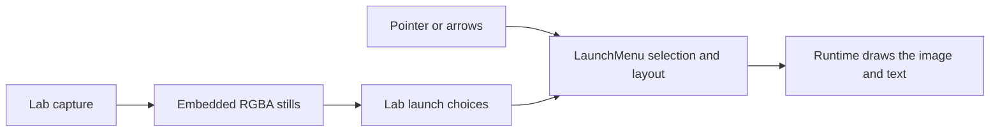

# Lab previews in the launcher

Status: accepted · Branches `feat/launcher-images` in Kinetra and `feat/lab-launcher-preview` in Lab · Related [original request](https://github.com/SMB-M87/Kinetra-Lab/blob/main/docs/design/2026-11-23-roadmap-media-labs-cycle.md)

The launcher shows a capture and a short description of the highlighted lab before the user chooses whether to start it.

## Table of contents

- [Problem](#problem)
- [Goals and non-goals](#goals-and-non-goals)
- [Decisions](#decisions)
- [Design](#design)
- [Affected areas](#affected-areas)
- [Test plan](#test-plan)
- [Verification](#verification)
- [Review](#review)
- [Pull request](#pull-request)

[Directory guide](README.md) · [Project overview](../../README.md) · [Documentation index](../README.md)

## Problem

`LaunchChoice` has a description, but the application list displays only the row labels. `Runtime` can draw shapes and bitmap text. A new Lab user has to launch an application to see what it offers.

## Goals and non-goals

Show a still and a short description for Demo, Dotio and i4sim. Follow both pointer and keyboard selection. The change covers the main launcher menu. Configuration pages and application sessions keep their current flow. Animation and live miniature sessions are outside this change.

## Decisions

| Decision | Choice | Reason |
| --- | --- | --- |
| Preview media | Use stills from the Lab capture tool | A picture satisfies the original picture-or-GIF request and avoids putting the separate README GIF work on the critical path |
| Distribution | Embed three reduced RGBA captures in the Lab executable at build time | The launcher and portable Windows zip need no extra files or image decoder |
| Ownership | Append an optional immutable image to `LaunchChoice`. `LaunchMenu` lays it out and draws the choice description | Engine consumers opt in through their registrations and use the same layout for rendering and picking |
| Texture resources | Upload on first use and reuse the most recently drawn image in each runtime | One preview is drawn per menu frame. A separate textured draw keeps the existing primitive batch format |

## Design

The top-level preview appears beside the list in landscape windows and below it in portrait windows. A menu whose choices have no images keeps the centered list. The layout is shared with scripted captures. The panel keeps its dimensions as selection changes and fits the image without stretching it.

## Affected areas

Kinetra's runtime, launcher API, graphics and menu tests, and launcher contracts. Lab's registrations, capture scripts and media, and launcher guide.

## Test plan

- Exercise pointer and arrow selection and configuration transitions with the shared layout in menu and Lab tests.
- Assert textured drawing from actual framebuffer pixels, including orientation, shape ordering and a changed selection.
- Run the graphics workflow in both repositories, Lab's smoke runs, and the docs check. Regenerate and inspect the affected captures.

## Verification

Pending implementation.

## Review

Pending implementation.

## Pull request

Kinetra provides the textured draw and opt-in preview panel. Lab supplies and embeds the previews and updates its captures. Kinetra merges first.
