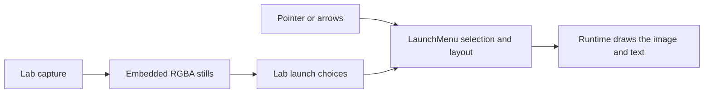

# Lab previews in the launcher

Status: implemented · Branches `feat/launcher-images` in Kinetra and `feat/lab-launcher-preview` in Lab · Related [original request](https://github.com/SMB-M87/Kinetra-Lab/blob/main/docs/design/2026-11-23-roadmap-media-labs-cycle.md)

The launcher shows a capture and a short description of the highlighted lab before the user chooses whether to start it.

## Table of contents

- [Problem](#problem)
- [Goals and non-goals](#goals-and-non-goals)
- [Decisions](#decisions)
- [Design](#design)
- [Affected areas](#affected-areas)
- [Test plan](#test-plan)
- [Verification](#verification)
- [Review](#review)
- [Pull request](#pull-request)

[Directory guide](README.md) · [Project overview](../../README.md) · [Documentation index](../README.md)

## Problem

`LaunchChoice` has a description, but the application list displays only the row labels. `Runtime` can draw shapes and bitmap text. A new Lab user has to launch an application to see what it offers.

## Goals and non-goals

Show a still and a short description for Demo, Dotio and i4sim. Follow both pointer and keyboard selection. The change covers the main launcher menu. Configuration pages and application sessions keep their current flow. Animation and live miniature sessions are outside this change.

## Decisions

| Decision | Choice | Reason |
| --- | --- | --- |
| Preview media | Use stills from the Lab capture tool | A picture satisfies the original picture-or-GIF request and avoids putting the separate README GIF work on the critical path |
| Distribution | Embed three reduced RGBA captures in the Lab executable at build time | The launcher and portable Windows zip need no extra files or image decoder |
| Ownership | Append an optional immutable image to `LaunchChoice`. `LaunchMenu` lays it out and draws the choice description | Engine consumers opt in through their registrations and use the same layout for rendering and picking |
| Texture resources | Upload on first use and reuse the last successful upload in each runtime | One preview is drawn per menu frame. A separate textured draw keeps the existing primitive batch format |
| Alpha and filtering | Accept straight-alpha bytes and store premultiplied RGBA pixels | Transparent texels contribute no hidden RGB to the scaled image. Ordinary shapes keep their existing blending |

## Design

The top-level preview appears beside the list in landscape windows and below it in portrait windows. A menu whose choices have no images keeps the centered list. The layout is shared with scripted captures. The panel keeps its dimensions as selection changes and fits the image without stretching it.

## Affected areas

Kinetra's runtime, launcher API, graphics and menu tests, and launcher contracts. Lab's registrations, capture scripts and media, and launcher guide.

## Test plan

- Exercise pointer and arrow selection and configuration transitions with the shared layout in menu and Lab tests.
- Assert textured drawing from actual framebuffer pixels, including orientation, blending at a transparent edge, shape ordering and a changed selection. Check that drawing the previous image still works after an OpenGL error interrupts an upload.
- Run the graphics workflow in both repositories, Lab's smoke runs, and the docs check. Regenerate and inspect the affected captures.

## Verification

Kinetra's `cmake --workflow --preset graphics` passed all 289 tests under offscreen SDL and software Mesa, with engine warnings as errors enabled. The new cases verify texture orientation, filtered transparency, draw order, upload recovery, menu selection and description pixels. Clang-format 23.1.5 and the documentation link check passed. Lab also passed all 349 tests with the graphics workflow, including eight 120-frame smoke runs and the capture smoke test. The [Lab pull request](https://github.com/SMB-M87/Kinetra-Lab/pull/110) tracks verification on its current engine pointer.

## Review

Reviewed the drawing and picking geometry, context ownership, shape order and consumers without previews. The refreshed screenshot and GIF show Demo, Dotio and i4sim with their own images and descriptions, and the Demo configuration page.

[Independent review round 1](https://github.com/SMB-M87/Kinetra/pull/48#pullrequestreview-6034740314) found incorrect filtering at transparent edges, stale cache metadata after an upload error, and logical pixels passed directly to framebuffer readback. The renderer filters premultiplied pixels, checks pending OpenGL errors before replacing the cached image and drops its cache key before a new upload. Graphics tests use drawable pixel coordinates and cover the transparent edge and error recovery. Both regressions were reproduced before the fix.

## Pull request

**feat(launcher): show previews for highlighted applications**

- Add immutable RGBA images with alpha-correct filtering and textured drawing that preserves draw order with the shape batch.
- Let registrations supply an optional still. The application list follows hover or arrow selection and draws the image and description in the same layout used for input.
- Refresh the shared launcher GIF. [The Lab pull request](https://github.com/SMB-M87/Kinetra-Lab/pull/110) supplies the three captured stills, updates the capture scripts and records this branch's submodule commit.

The graphics workflow passed in both repositories. Review round 1 added coverage for filtered transparency and upload failure recovery. Kinetra merges first with a merge commit. The pointer workflow records the engine merge commit after both pull requests land.
