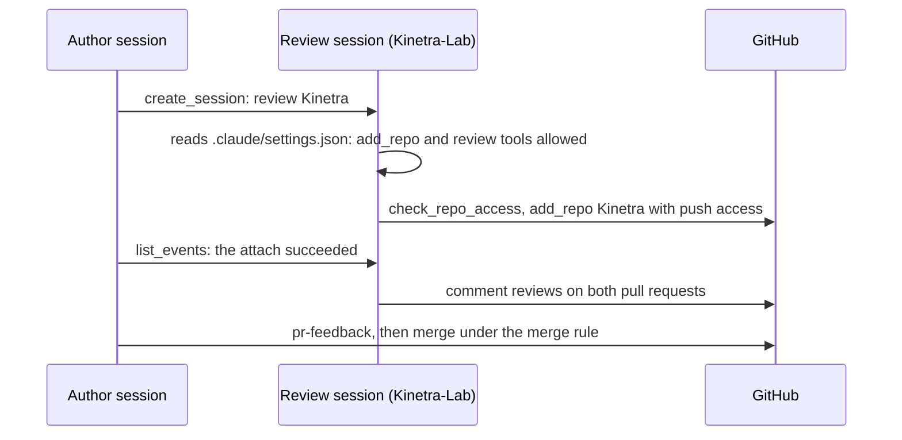

# Review access and merges by the author

Status: implemented · Branch: `chore/review-access-and-merges` and, after the review, `chore/review-access-follow-ups`; in Kinetra-Lab `ccr-f93b2da2-0j3r2i` · Related: roadmap item *Review sessions that can post on both repositories* (both repositories), [Review loop and merges by agents](2026-11-22-pr-review-loop.md), Kinetra#42, Kinetra#52, Kinetra-Lab#114

A review session must write to every repository it reviews, and on 2026-11-24 the user asked that agents merge without waiting for them. Both repositories' `.claude/settings.json` now let a Claude Code session attach the other repository with push access and post its review without a prompt, and the workflow says how the author starts the reviewer and checks its access. No kind of change waits for the user any more: the author merges agent rules, skills, CI and releases under the same merge rule, after two rounds on one point the author's answer stands, and the user checks merged work afterwards.

## Table of contents

- [Problem](#problem)
- [Goals and non-goals](#goals-and-non-goals)
- [Decisions](#decisions)
- [Design](#design)
- [Affected areas](#affected-areas)
- [Test plan](#test-plan)
- [Review](#review)
- [Verification](#verification)
- [Pull request](#pull-request)
- [Open points](#open-points)

[Directory guide](README.md) · [Project overview](../../README.md) · [Documentation index](../README.md)

## Problem

- **Reviews that never reach the pull request.** Kinetra#42 merged without its review, which its review session had written but could not post. Step 0 of `pr-review` has since told the reviewer to stop when it cannot post.
- **A review that waited for the user.** On 2026-11-24 the review of Kinetra#52 and Kinetra-Lab#114 stopped before it began: the author's session had started it with only Kinetra-Lab attached, the reviewer's request to attach Kinetra with push access was refused by its session's permission check, and the review waited until the user granted it.
- **A rule without a mechanism.** The [workflow](../workflow.md#6-review) and `pr-review` said that the reviewer gets write access to both repositories, not how. Neither repository's `.claude/settings.json` held a permission rule; it held only the SessionStart hook of `tools/cloud_setup.sh`.
- **Merges that waited for the user.** The [merge rule](../../AGENTS.md#git) kept changes to the agent rules, skills, CI and releases, and every pull request whose roadmap item or design document named a check by the user, for the user, and a point the agents did not settle in two rounds stayed open for the user. On 2026-11-24 the user asked the agent to merge whatever it judges good, including the changes these rules reserved, and said they check what happens afterwards.

## Goals and non-goals

Goals:

1. A review session started from one repository attaches the other with push access and posts on both, without the user.
2. The author knows whether the reviewer got its access, and asks the user only when the attach failed.
3. No kind of change waits for the user before its merge: the reserved categories, the check by the user and the point open after two rounds leave the merge rule and every copy of it.
4. The roadmap item leaves both roadmaps.

Non-goals:

- The rest of the review loop and the merge conditions (a *Ready to merge*, green CI, resolved threads, no conflict, the stack merged below) stay as they are.
- Other agents than Claude Code keep the rule that the reviewer gets write access, without a mechanism from this change.
- Merging and starting sessions get no permission rule (see [Decisions](#decisions)).

## Decisions

The user's instruction of 2026-11-24 settled the merge gates; the agent chose the rest, and the user checks the result after the merge.

| Decision | Choice | Why |
| --- | --- | --- |
| Mechanism | `permissions.allow` rules in both repositories' `.claude/settings.json` | The roadmap item's second option. A cloud session reads these rules when it starts with one repository, as a review session does. The rules are versioned and reviewed like the SessionStart hook beside them |
| Allowed tools | `check_repo_access`, `add_repo`, `register_repo_root`, `subscribe_pr_activity` and `list_events` of the session server; `pull_request_read`, `pull_request_review_write`, `add_comment_to_pending_review`, `add_reply_to_pull_request_comment`, `resolve_review_thread` and `add_issue_comment` of the GitHub server | What steps 0, 7 and 8 of `pr-review` use, and the author's check of the reviewer's events; the subscription and `list_events` were added after review round 1. None of them merges or pushes. A rule cannot name one repository: `add_repo` is allowed for every repository the account's GitHub access reaches, and the server's own access checks still run. Accepted, because the user owns both repositories and wants fewer stops |
| Not allowed | `merge_pull_request`, `enable_pr_auto_merge`, `create_session` | A merge stays a call that the session's permission check sees. `create_session` refuses an effort while it is pre-approved, and the review levels set an effort |
| How the author starts the reviewer | `create_session` from the pull request's repository, Kinetra-Lab for a change across both, with a prompt that names every pull request and asks the reviewer to attach each other repository with push access first | The item's first option, both repositories attached at the start, is not available: a new session takes one repository |
| How the author checks the access | The reviewer's first events (`list_events`); the user only when the attach failed | The item's third option, as the check after the start rather than a gate before it |
| Reserved merges | Removed: agent rules, skills, CI, releases and a check by the user merge under the same rule as any other change | The user's instruction of 2026-11-24 |
| A point after two rounds | The author's last answer stands; the reviewer resolves the thread and lists the point under *For the user* in its summary | Keeps the two-round limit, so no pull request stalls on a point, and the user sees it afterwards |
| Rounds from 3 on | Every pull request gets only blocking findings; the rest goes under *For the user* | Rounds still converge now that the user no longer weighs the rest at the merge |
| Conclusions | *Needs the user* and the *Merge* line leave the review summary | No conclusion hands the merge to the user any more |
| A playtest by the user | Still named in the design document, and done after the merge | Software rendering still cannot prove feel or performance; only the order changes |
| Agent rules after the user gate | A pull request that changes the agent rules (both `AGENTS.md` files, `.agents/skills/`, the workflow, conventions, testing and documentation pages) always gets an agent review, even when it is docs-only, and a commit to them after a *Ready to merge* gets a new round | Review round 1: the docs-only exemption was safe for rule pages only while the user merged them; without that, a rule change would merge with no second agent and no user. The second agent does not wait for the user, so it keeps the user's instruction |
| Kinetra-Lab's pointer | Not moved by the Lab pull request | Lab's part uses nothing of this Kinetra change; its links point at existing anchors, and Kinetra's `lab-pointer` workflow records the Kinetra merge |

## Design

- **Settings.** Both `.claude/settings.json` files get the same `permissions.allow` list beside the existing hook.
- **Workflow.** Step 6 of the [workflow](../workflow.md#review-access) gets a *Review access* part: why, the permission rules, how the author starts the reviewer and checks its access. [AGENTS.md](../../AGENTS.md#git) names the rule and links there; `pr-review` step 0 checks and attaches each repository; `feature` step 9.7 starts the reviewer that way.
- **Merges.** The merge rule loses its list of reserved changes and says that no kind of change waits for the user. The two-round limit ends with the author's answer, resolved by the reviewer. The review summary lists what the user should check afterwards under *For the user*. Every copy changes with it: the workflow's cycle, review, feedback and stack text and its cross-repository diagram, `pr-review`, `pr-feedback`, `feature` and their READMEs, `verify` and the [testing](../testing.md#full) page for the playtest. A change to the agent rules keeps its agent review even when it is docs-only, and a commit to them after a *Ready to merge* gets a new round, so a rule change never merges unchecked.

## Affected areas

| Repository | Files |
| --- | --- |
| Kinetra | `.claude/settings.json`; `AGENTS.md` (Git); `docs/workflow.md` (cycle, step 6 with *Review access*, step 8, review feedback, branches, stacks, changes across Kinetra and Lab); `docs/testing.md` (Full); `.agents/skills/pr-review/`, `feature/`, `pr-feedback/` (skill and README), `verify/SKILL.md`, `.agents/skills/README.md`; `docs/review-lessons.md`; `docs/roadmap.md`; this document and the index |
| Kinetra-Lab | `.claude/settings.json`; `AGENTS.md` (verification table, docs-only paragraph); `README.md` (the cloud-session paragraph); `docs/roadmap.md` |

## Test plan

| Behavior | Proof | Level |
| --- | --- | --- |
| Both settings files are valid JSON with the same rules | `python3 -m json.tool` on each, and `diff` of the two | Docs |
| Links and anchors resolve | `tools/check_docs.py` in both repositories | Docs |
| No copy of the old merge gates is left | `check_copies.py` with the old wordings, from Kinetra-Lab so it covers both | Docs |
| A review session started from Kinetra-Lab attaches Kinetra and posts on both pull requests without the user | The agent review of these two pull requests, started with `create_session` on the Lab branch, which holds the new rules; its events show the attach without a prompt, and both pull requests get its review | Recorded run |
| Nothing else changes | CI on both pull requests: `.claude/settings.json` is not documentation, so both run in full | Full (CI) |

## Review

**Merge before the review.** Kinetra#56 merged at 10:37 through GitHub under the user's account, 4.5 minutes after its CI turned green and before its agent review started; the author's session did not merge it. The review ran after the merge, and its fixes went into the follow-up branch `chore/review-access-follow-ups`, with Kinetra-Lab#117 following.

**Agent review, round 1** (Kinetra#56 at 286784f and Kinetra-Lab#117 at 53d73fb, code review `medium`, session effort `xhigh`): *Fix first* on both.

| Finding | Resolution |
| --- | --- |
| Should fix: the allow list misses `subscribe_pr_activity` (`pr-review` step 8) and `list_events` (the author's access check) | Added to both settings files and to the workflow's *Review access*; *Decisions* updated |
| Should fix: with the user gate gone, the docs-only exemption lets a rule change merge with no second agent and no user | Rule changes always get an agent review, and a commit to the rules after a *Ready to merge* gets a new round: `AGENTS.md`, workflow, `pr-review`, `pr-feedback`, `feature`, skills overview; new row in *Decisions* |
| Should fix: *Review* and *Verification* still empty although `implemented` | Filled in here |
| Question: who merged #56 before its review | The user, through GitHub (above); the conditional lesson does not apply |
| Nit: which conclusion a point settled after two rounds gives | `pr-review` step 7: such a point, and a goal question the author settled, count toward neither *Fix first* nor *Questions* |
| Nit: which repository's settings file applies | Workflow: a session that starts with one repository reads that repository's file; the two files are identical |
| Nit: the cross-repository diagram let the Lab branch merge | `A as Author` participant |

Lessons added to the [review lessons](../review-lessons.md): *When a change removes a gate, check every exemption that the gate made safe*; *When a permission list is meant to unblock a procedure, list every tool call of that procedure, in each session that runs it*.

**Agent review, round 2** (Kinetra#57 at ddf4496, the commits since round 1): *Fix first*. The allow list, the design document and the nits of round 1 settled; the rule change missed two copies.

| Finding | Resolution |
| --- | --- |
| Blocking: `pr-feedback` step 5.5 let an old *Ready to merge* cover a commit to the agent rules | "and none of the agent rules" added to its *Ready to merge* clause |
| Blocking: `AGENTS.md` development cycle still said a docs-only change skips the agent review | Reworded as the workflow's opening: no agent review unless it changes the agent rules |
| Should fix: "docs-only" was redefined in the workflow and `pr-review` but given an exception in `AGENTS.md` | The exception form everywhere: "a docs-only one that leaves the agent rules alone"; a skill-only pull request stays docs-only and needs no design document |
| Should fix: *Branch*, *Design*, *Affected areas*, the copies claim and CI in this document | Updated |
| Nits: `pr-review` step 3 "reviewed on request"; "have" in the `pr-feedback` README; a Lab pointer range with Kinetra rule pages | Carried out; `AGENTS.md` says such a pointer range is not a rule change, as Lab's copy does |

Lesson added: *Add an exception to a defined term in the same form on every page, never by redefining the term on some of them*.

## Verification

- `python3 -m json.tool` on both `.claude/settings.json`: valid; `diff` of the two: identical.
- `python3 tools/check_docs.py` in Kinetra and Kinetra-Lab: all links resolve.
- `check_copies.py` from Kinetra-Lab with the old wordings (`wait for the user`, `waits for the user`, `waiting for you`, `Needs the user`, `Merge line`, `always wait`, `user merges`, `open for the user`, `user's decision`, `reserved for you`, `otherwise the user`, `point is the user`, `check by the user`, `write access`, `push access`), and after rounds 1 and 2 with `docs-only`, `no agent review`, `needs no review`, `Markdown-only`, `keeps a *Ready`, `keeps this conclusion`, `still holds`, `skips the design document` and `only Markdown`: every remaining hit is new text, has another meaning, or names the pointer-only or docs-only exception in its full form. Round 2 found two copies that round 1's search had listed and that were judged wrongly (`AGENTS.md` development cycle, `pr-feedback` step 5.5).
- **The recorded run.** The agent review of Kinetra#56 and Kinetra-Lab#117 was started with `create_session` from Kinetra-Lab on `ccr-f93b2da2-0j3r2i`, which held the new rules. Its events show `check_repo_access` on Kinetra (`attachable`, push) at 10:47:14, `add_repo` with push access at 10:47:18 and `register_repo_root`, with no permission request between them; it then posted its reviews on both pull requests. The session ran in permission mode `auto`, inherited from the author's session, and that mode can allow these calls without the rules; on 2026-11-24 the same mode had refused the attach before the rules existed. A session in default mode would show whether the rules alone suffice.
- CI: green on Kinetra#56 (286784f), on the follow-up Kinetra#57 (ddf4496, and its head after round 2) and on Kinetra-Lab#117 (17a6c1d, 53d73fb after `main` was merged in, fbea613).

## Pull request

**Title:** `chore(agents): review sessions attach both repositories; the author merges every change`

**Summary**

A review session must post on every repository it reviews; Kinetra#42 lost its review and the review of Kinetra#52 and Kinetra-Lab#114 waited for the user. Both repositories' `.claude/settings.json` now allow a Claude Code session to attach the other repository with push access and post a review without a prompt, and the workflow says how the author starts the reviewer and checks its access. On the user's instruction of 2026-11-24, no change waits for the user any more: agent rules, skills, CI and releases merge under the same rule, after two rounds the author's answer stands, and the user checks merged work afterwards.

**Changes**

- `.claude/settings.json`: `permissions.allow` for `check_repo_access`, `add_repo`, `register_repo_root` and the GitHub review tools.
- `AGENTS.md`, `docs/workflow.md`: review access, the merge rule without reserved changes, the two-round limit ending with the author's answer.
- `pr-review`, `feature`, `pr-feedback` (skills and READMEs), `verify`, `docs/testing.md`: the same, with *Needs the user* and the *Merge* line gone from the review summary.
- Roadmap item removed; design document and index.

**Design:** [Review access and merges by the author](2026-11-24-review-access-and-agent-merges.md).

**Verification:** see the design document.

**Dependencies and merge order:** Kinetra first, then Kinetra-Lab's pull request (its own `.claude/settings.json`, README and roadmap), which does not move the pointer; Kinetra's `lab-pointer` workflow records this merge.

**Follow-up:** none planned; see *Open points*.

## Open points

- Whether the permission rules alone suffice outside auto mode: the recorded run was in auto mode. The next review session started in default mode shows it.
- The `add_repo` rule allows every repository the account's GitHub access reaches, not only the sibling repository; a permission rule cannot name a repository.
