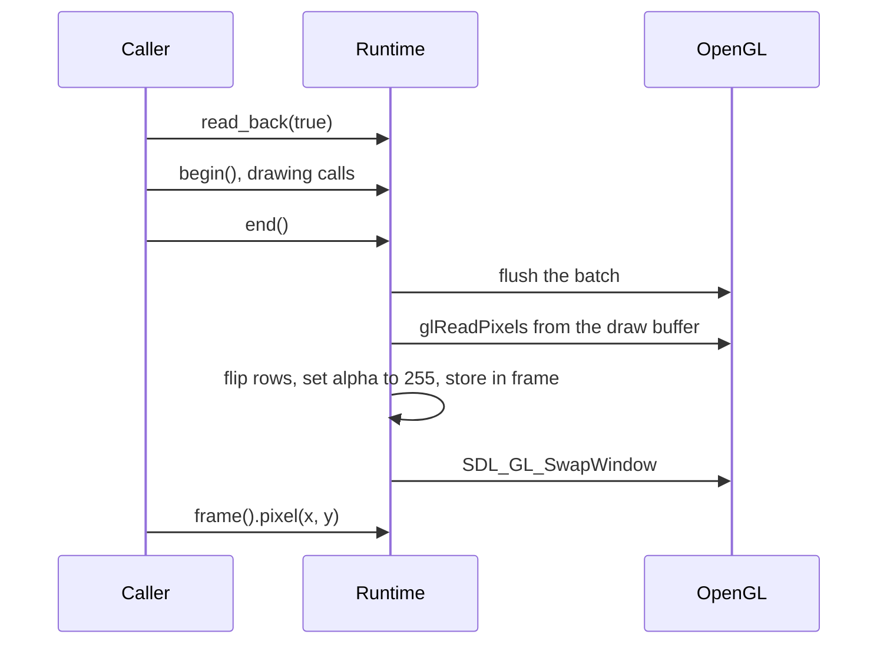

# Frame read-back on Runtime

Status: implemented · Branch: `feat/frame-read-back` (Kinetra), `ccr-3cd68603-h1b79l` (Kinetra-Lab) · Related: roadmap items *Frame read-back on `Runtime`* (Kinetra) and *Capture on Kinetra's frame read-back* (Kinetra-Lab)

`Runtime` gets an opt-in read-back: with `read_back(true)`, `end()` copies each frame into CPU memory before it presents it, and `frame()` returns that copy. Kinetra's own graphics tests and, in Kinetra-Lab, the capture tool and every graphics suite use it instead of calling `glReadPixels` themselves.

## Table of contents

- [Problem](#problem)
- [Goals and non-goals](#goals-and-non-goals)
- [Decisions](#decisions)
- [Design](#design)
- [Affected areas](#affected-areas)
- [Test plan](#test-plan)
- [Review](#review)
- [Verification](#verification)
- [Pull request](#pull-request)
- [Open points](#open-points)

[Directory guide](README.md) · [Project overview](../../README.md) · [Documentation index](../README.md)

## Problem

`Runtime` has no way to hand out the pixels it drew. Every program that needs them includes GLAD and reads the default framebuffer itself after `end()`:

- Kinetra's [runtime tests](../../tests/runtime_tests.cpp) read pixels at nine places, each after `end()`.
- Kinetra-Lab's capture tool (`tools/capture/src/stage.cpp`, `tools/capture/src/tour/tour.cpp`) and the graphics suites of Demo, Dotio, i4sim and the launcher read them at about thirty places.

`end()` flushes the batch and calls `SDL_GL_SwapWindow` straight away (`src/runtime/runtime.cpp`, `Runtime::end`). After a swap the contents of both buffers depend on the platform: OpenGL leaves the back buffer undefined, and the front buffer of a composited window is not guaranteed to hold the frame either. So almost every call site reads `GL_FRONT` and falls back to `GL_BACK` when the expected color is missing, and some count pixels in both buffers and keep the larger number. The fallback relies on the expected color, so a test that reads a wrong pixel can still find it in the other buffer. The capture tool reads only the front buffer, which works on SDL's offscreen driver with software Mesa, but not reliably in a window. Each call site also flips OpenGL's bottom-up rows itself, and Lab code includes `<glad/glad.h>`, an implementation detail that [the architecture rules](../../AGENTS.md#architecture-boundaries) keep out of the public interface.

## Goals and non-goals

Goals:

- One public, GLAD-free way to get the pixels of a presented frame that is reliable on every platform: offscreen, in a window, with or without a compositor.
- Kinetra's runtime tests use it, and in Kinetra-Lab the capture tool and the graphics suites of Demo, Dotio, i4sim and the launcher.
- No cost for a program that does not ask for it.

Non-goals:

- Reading part of a frame, or any buffer other than the frame that `end()` presents. A test that needs one pixel reads it from the whole frame.
- Reading pixels between `begin()` and `end()`.
- GPU-side capture (pixel buffer objects, asynchronous reads). The capture tool and the tests read one frame at a time and wait for it.
- Other uses of GLAD in tests, such as `glGetError()`, `glFinish()` and the viewport check of the resize test: they test the runtime's OpenGL state, not the frame.

## Decisions

Settled with the user on 2026-11-26; every choice matched the recommendation.

| Decision | Choice | Why |
| --- | --- | --- |
| Scope | A stack across both repositories: the Kinetra pull request adds the helper and moves Kinetra's runtime tests onto it; the Kinetra-Lab pull request above it moves the pointer, the capture tool and every Lab graphics suite onto it. One design document, here | The Kinetra item exists so that Lab's code stops reading pixels itself; the helper alone has no user in Lab. The design document lives in Kinetra because the contract is Kinetra's, and Lab's part is a mechanical move of call sites onto it |
| When the frame is read | Opt-in: `read_back(true)` makes `end()` read each frame after the batch flush and before the swap; `frame()` returns the last one | Before the swap the back buffer is defined on every platform, so the read needs no fallback. Sessions call `end()` inside `render`, so a read on request after `end()` would need the after-swap buffers. The read costs nothing while it is off |
| Pixel format | RGBA, four bytes per pixel, rows from the top left, no padding; alpha always 255 | The same layout as `RgbaImage` input, window coordinates, input and PNG files. Alpha is set to 255 because the window is opaque and the framebuffer's alpha depends on whether the platform gave it an alpha channel |
| Size | Drawable pixels, the size the frame's `begin()` set as the viewport | That is what the framebuffer holds; with display scaling it differs from the logical size, and callers convert as they do now |
| No frame | `frame()` throws `std::logic_error` before the first read-back frame and after `read_back(false)` | A test that forgot to switch it on fails with a message instead of reading an empty image |
| Names | `FramePixels`, `Runtime::read_back(bool)`, `Runtime::frame()`, `FramePixels::pixel(x, y)` | Cosmetic; proposed with the decisions |

## Design

```cpp
/// The pixels of one presented frame, as Runtime::frame() returns them.
struct FramePixels {
    int width{}, height{};               // drawable pixels
    std::vector<std::uint8_t> rgba;      // rows from the top left, 4 bytes per pixel
    std::array<std::uint8_t, 4> pixel(int x, int y) const; // throws std::out_of_range
};

class Runtime {
    void read_back(bool enabled);        // off by default
    const FramePixels &frame() const;    // throws std::logic_error without a frame
};
```



*Takeaway:* the read happens inside `end()` before the swap, so it reads the buffer that was drawn, never a buffer the swap left undefined.

- `begin()` stores the drawable size it set as the viewport; `end()` reads that rectangle, so a resize between `begin()` and `end()` cannot mismatch the frame.
- The read buffer is the current draw buffer (`GL_DRAW_BUFFER`), which is `GL_BACK` for the double-buffered window the runtime asks for, and the right buffer if a platform gives a single-buffered surface.
- The read packs at `GL_PACK_ALIGNMENT` 1 and restores the caller's alignment afterwards: at 8, an odd-width drawable would pad each row and overrun the buffer.
- `FramePixels::pixel` also throws `std::out_of_range` when `rgba` holds fewer bytes than its size needs, since callers can build or change the plain struct.
- The frame's vector keeps its capacity between frames, so a loop that reads every frame allocates once.
- `read_back(false)` releases the stored frame.

## Affected areas

Kinetra (`feat/frame-read-back`):

- Public API: `include/kinetra/runtime/engine.h` gains `FramePixels`, `Runtime::read_back` and `Runtime::frame`. No existing signature changes.
- `src/runtime/runtime.cpp`: the read in `end()`.
- `tests/runtime_tests.cpp`: a new case for the contract; the nine existing reads move onto `frame()`.
- Docs: [runtime guide](../engine/runtime.md) (contract row and a *Read-back* paragraph), [runtime module README](../../src/runtime/README.md) (rendering and tests), the roadmap.

Kinetra-Lab (`ccr-3cd68603-h1b79l`):

- The `external/Kinetra` pointer.
- `tools/capture/src/stage.cpp` and `tools/capture/src/tour/tour.cpp`: switch read-back on in the `Stage` and `Tour` constructors, read through `frame()` and drop RGBA's alpha for the PNG and the tour canvas; the tour checks that the drawable has its canvas size. `main.cpp`'s comment on the offscreen driver, the capture README (diagrams, *Frames*, its open point) and Lab's media guide.
- The graphics suites `launcher/tests/runtime_tests.cpp`, `labs/demo/tests/presentation_tests.cpp`, `labs/dotio/tests/presentation_tests.cpp` and `labs/i4sim/tests/presentation_tests.cpp`.
- Lab's roadmap item *Capture on Kinetra's frame read-back* and the pages that say the tool reads with `glReadPixels`.

## Test plan

| Behavior | Test | Level |
| --- | --- | --- |
| `frame()` throws before a read-back frame, after `read_back(true)` without `end()`, and after `read_back(false)` | New case in Kinetra's `runtime_tests.cpp` | Full (graphics, CI) |
| The frame has the drawable size, rows from the top (a box drawn in the top-left quarter shows at small `y`, not at large `y`), and alpha 255 | Same case | Full |
| `pixel` throws `std::out_of_range` outside the frame | Same case | Full |
| Rows stay unpadded under a caller's `GL_PACK_ALIGNMENT` of 8 at an odd width, and that alignment is restored | `read-back packs rows unpadded under any pack alignment and restores it`; fails without the fix | Full |
| A frame drawn without read-back leaves the stored frame alone | Not tested: switching it off releases the frame, which the throw above proves | |
| Existing primitive, circle, resize, frame-time graph and overlay reads find the same pixels through `frame()` | The existing cases in Kinetra's `runtime_tests.cpp`, rewritten onto `frame()` with y flipped once | Full |
| The capture tool writes the same images | `kinetra_capture_tests`, and `kinetra_capture_smoke` in the `graphics` preset (CI) | Full |
| The Lab graphics suites find the same pixels | Their existing cases on `frame()` (CI's `ci` job, software Mesa) | Full |

## Review

`code-review` (medium) over the Kinetra branch and Lab's working tree:

| Finding | Resolution |
| --- | --- |
| The read assumed every `GL_PACK_ALIGNMENT` packs RGBA rows unpadded; at 8 an odd width pads them and overruns the buffer | Fixed: the read packs at 1 and restores the caller's alignment; a regression case fails without it |
| `pixel` checked only `width` and `height`, not the bytes of a caller-built frame | Fixed: it throws `std::out_of_range` for too few bytes |
| `read_back(true)` while on keeps the stored frame, which the contract did not say | Contract now says it changes nothing |
| The frame-time row conversion was off by one for a fractional origin | Fixed: the exact conversion `ceil(origin.y + height - 2) - 1` |
| A comment in the capture tool's `main.cpp` still said frames come from the front buffer | Fixed |
| SDL's offscreen driver keeps the first surface size, so a grown frame is undefined beyond it | Documented in the [runtime guide](../engine/runtime.md#input-and-drawing) and at the resize case; nothing the runtime can detect |
| Some Lab tests index frames with logical sizes, which equal drawable sizes only without display scaling | Pre-existing: the old reads made the same assumption, and the suites run without scaling; left alone |

While moving the resize case, the read-back showed that its old center pixel lay outside the offscreen surface after the window grew to 640 x 360, and the old front-or-back fallback had passed on whatever was left there. The case now reads the pixel just above and left of the center.

## Verification

Kinetra, `cmake --preset ci` (warnings as errors, offscreen SDL, software Mesa), `cmake --build build-ci` and `ctest --preset ci`: 317 of 317 passed, the 22 graphics cases included. `python3 tools/check_docs.py`: all links resolve.

Kinetra-Lab, with the pointer on this branch:

- `cmake --build --preset graphics --target kinetra_runtime_tests kinetra_demo_presentation_tests kinetra_dotio_presentation_tests kinetra_i4sim_presentation_tests kinetra_capture kinetra_capture_tests`, then `ctest --preset graphics -R 'kinetra_graphics|kinetra_demo_graphics|kinetra_dotio_graphics|kinetra_i4sim_graphics|^kinetra_capture'`: 57 of 57 passed, `kinetra_capture_smoke` included.
- The same targets in the `ci` preset build without a warning, so the warning-free modules stay so.
- `kinetra_capture <dir> launcher` writes a `launcher.png` byte-identical to the committed `docs/media/launcher.png`: row order and channels match the old read.
- `python3 external/Kinetra/tools/check_docs.py` and `check_copies.py` with the terms `glReadPixels`, `front buffer`, `GL_FRONT`, `both swap buffers` and `read back`: the remaining hits are the roadmap items this change closes and correct uses of the words.

The Full level is the pull requests' CI.

## Pull request

**Kinetra:** `feat(runtime): read frames back before the swap`

> ## Summary
> `Runtime::read_back(true)` makes every following `end()` copy the frame it drew into `frame()` before the buffer swap: `FramePixels`, RGBA rows from the top left in drawable pixels, alpha 255. Tests and capture tools get the pixels without GLAD and without guessing whether the front or the back buffer holds the frame after the swap.
>
> ## Changes
> - `engine.h`: `FramePixels` with `pixel(x, y)`, `Runtime::read_back(bool)` and `Runtime::frame()`.
> - `runtime.cpp`: the read in `end()`, from the draw buffer, packed at alignment 1, flipped to top-down, alpha set to 255.
> - `runtime_tests.cpp`: two contract cases (orientation, size, alpha, errors, replacement in place; pack alignment); the nine existing reads move onto `frame()`.
> - Runtime guide and module README; roadmap item closed.
>
> ## Design
> [docs/design/2026-11-26-frame-read-back.md](https://github.com/SMB-M87/Kinetra/blob/feat/frame-read-back/docs/design/2026-11-26-frame-read-back.md). Decisions settled with the user: a stack with Kinetra-Lab, opt-in read before the swap, RGBA from the top.
>
> ## Verification
> `ctest --preset ci`: 317 of 317 passed locally. Kinetra-Lab's graphics suites and capture smoke test pass on this branch. CI is the Full level.
>
> ## Review notes
> The resize case read a pixel outside SDL's offscreen surface after the window grew; it now reads one inside. See *Review* in the design document.
>
> ## Dependencies and merge order
> Kinetra-Lab's pull request on `ccr-3cd68603-h1b79l` records this branch and merges after this one. Merge this one with a merge commit.
>
> ## Follow-up
> None.

**Kinetra-Lab:** `test(capture): read frames through Kinetra's frame read-back`

> ## Summary
> The capture tool and the graphics suites of the launcher, Demo, Dotio and i4sim read pixels through Kinetra's new `Runtime::read_back` and `frame()` instead of `glReadPixels` from the front or back buffer after the swap.
>
> ## Changes
> - Pointer to Kinetra's `feat/frame-read-back`.
> - Capture tool: `Stage` and `Tour` switch read-back on and write the frame's RGB; no GLAD include left.
> - Graphics suites: every pixel read uses `frame()`, the front-or-back fallbacks and the second renders that filled both buffers are gone.
> - Capture README, media guide, roadmap.
>
> ## Design
> In Kinetra: [Frame read-back on Runtime](https://github.com/SMB-M87/Kinetra/blob/feat/frame-read-back/docs/design/2026-11-26-frame-read-back.md).
>
> ## Verification
> The graphics suites and the capture tests and smoke test: 57 of 57 passed; the `ci` preset builds them without a warning; the launcher screenshot is byte-identical to the committed one.
>
> ## Dependencies and merge order
> Kinetra's pull request merges first, with a merge commit; then this one, with its pointer at the Kinetra branch commit; then the `lab-pointer` workflow's pointer-only pull request.
>
> ## Follow-up
> None.

## Open points

- SDL's offscreen driver does not resize its surface with the window, so after a window grows there the read-back frame is undefined beyond its first size. The graphics tests keep their reads inside it.
- Tests in Kinetra-Lab index frames with logical sizes in places; that holds only without display scaling, as the old reads did.
