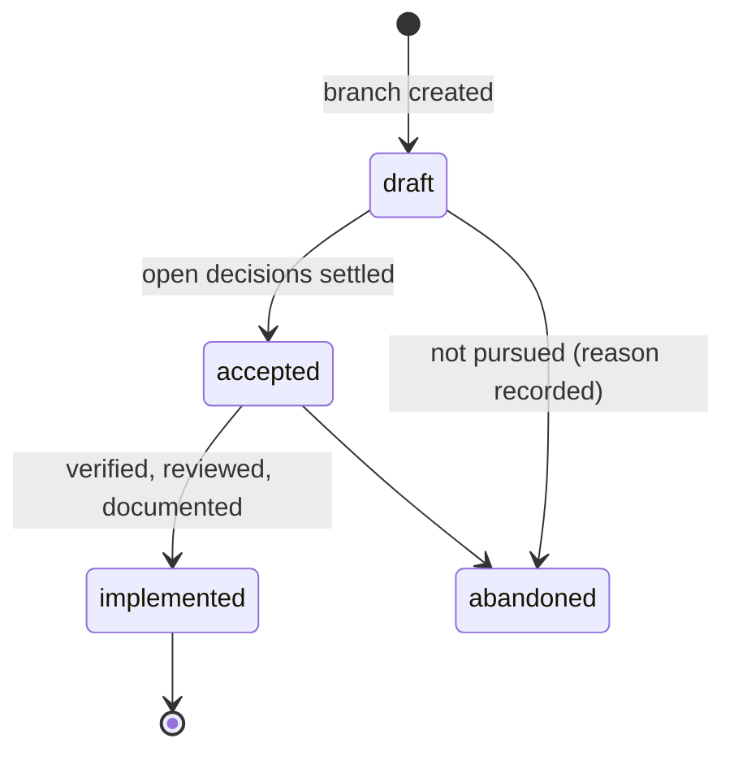

# Design documents

Every branch has a design document, written before the code. It records the problem, the decisions taken with the user, the test plan, the review outcome and the text for the pull request. Design documents are kept after merging: together they are the change history *with reasons*.

## Table of contents

- [Lifecycle](#lifecycle)
- [Template](#template)
- [Index](#index)

[Parent guide](../README.md) · [Project overview](../../README.md) · [Documentation index](../README.md) · [Workflow](../workflow.md)

## Lifecycle



- File name: `YYYY-MM-DD-<topic>.md`, with the date the branch starts.
- A design document describes one change. Durable decisions also become an ADR in [decisions](../decisions/README.md), and the design document links to it.
- Once implemented, a design document is history. Current behavior is described by READMEs, contracts and `///` comments, not by old design documents.

## Template

```markdown
# <Title>

Status: draft | accepted | implemented | abandoned · Branch: `<type>/<topic>` · Related: <links>

<One paragraph: what changes and why now.>

## Table of contents
<local heading links>

[Directory guide](README.md) · [Project overview](../../README.md) · [Documentation index](../README.md)

## Problem
What is wrong or missing, with evidence (paths, measurements).

## Goals and non-goals
What this change achieves; what it deliberately leaves alone.

## Decisions
| Decision | Choice | Why |
Including the decisions settled with the user.

## Design
How it will work. A diagram if structure or interaction changes.

## Affected areas
Files, targets, public API, docs.

## Test plan
Which behavior is proven by which test; the verification level.

## Review
Findings and how they were resolved.

## Verification
Commands and results.

## Pull request
Title and description used for `gh pr create`: Summary, Changes, Design,
Verification, Review notes, Dependencies and merge order, Follow-up.

## Open points
```

## Index

| Date | Document | Status |
| --- | --- | --- |
| 2026-11-19 | [README icon](2026-11-19-readme-icon.md): the Kinetra icon at the top of the README | implemented |
| 2026-11-19 | [Border corner slide](2026-11-19-border-corner-slide.md): `constrain_borders` lets a box sliding along a wall pass a convex corner | implemented |
| 2026-11-19 | [Debug menu steppers](2026-11-19-debug-menu-steppers.md): `[-]` and `[+]` buttons on a `DebugMenu` row | implemented |
| 2026-11-19 | [Frame times and interpolation helpers](2026-11-19-frame-times.md): `Runtime::frame_times()`, a frame-time graph, `lerp_angle` | implemented |
| 2026-11-19 | [Window icon](2026-11-19-window-icon.md): a generated Kinetra icon on every window and in Windows executables | implemented |
| 2026-11-19 | [Static window titles](2026-11-19-static-window-titles.md): "Launcher" in the menu, the application name in a session | implemented |
| 2026-11-19 | [Documentation cleanup](2026-11-19-docs-cleanup.md): header contracts, module READMEs, ADR index | implemented |
| 2026-11-18 | [Skill documentation](2026-11-18-skill-documentation.md): a README with use cases for every skill | implemented |
| 2026-11-18 | [Tooling and CI](2026-11-18-tooling-and-ci.md) | implemented |
| 2026-11-18 | [Development process and agent rules](2026-11-18-development-process.md) | implemented |
| 2026-11-18 | [Settings overlay, glyphs and session navigation](2026-11-18-overlay-glyphs-navigation.md): Lab roadmap phase 3, engine side | implemented |
