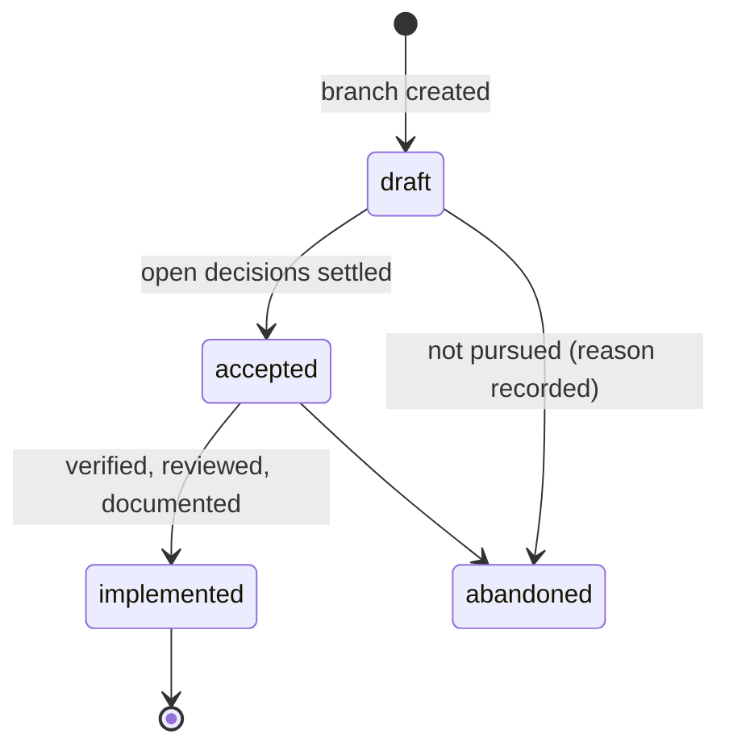

# Design documents

Every branch has a design document, written before the code, except a docs-only one; a change across Kinetra and Lab has one, in the repository that holds most of it ([rule](../../AGENTS.md#development-cycle)). It records the problem, the decisions taken with the user, the test plan, the review outcome and the text for the pull request. Design documents are kept after merging: together they are the change history *with reasons*. They are looked up, not read at the start of a task: the index below is for a search by topic.

## Table of contents

- [Lifecycle](#lifecycle)
- [Template](#template)
- [Index](#index)

[Parent guide](../README.md) · [Project overview](../../README.md) · [Documentation index](../README.md) · [Workflow](../workflow.md)

## Lifecycle



- File name: `YYYY-MM-DD-<topic>.md`, with the date the branch starts.
- A design document describes one change. Durable decisions also become an ADR in [decisions](../decisions/README.md), and the design document links to it.
- Once implemented, a design document is history. Current behavior is described by READMEs, contracts and `///` comments, not by old design documents.

## Template

```markdown
# <Title>

Status: draft | accepted | implemented | abandoned · Branch: `<type>/<topic>` · Related: <links>

<One paragraph: what changes and why now.>

## Table of contents
<local heading links>

[Directory guide](README.md) · [Project overview](../../README.md) · [Documentation index](../README.md)

## Problem
What is wrong or missing, with evidence (paths, measurements).

## Goals and non-goals
What this change achieves; what it deliberately leaves alone.

## Decisions
| Decision | Choice | Why |
Including the decisions settled with the user.

## Design
How it will work. A diagram if structure or interaction changes.

## Affected areas
Files, targets, public API, docs.

## Test plan
Which behavior is proven by which test; the verification level.

## Review
Findings and how they were resolved.

## Verification
Commands and results.

## Pull request
Title and description used for `gh pr create`: Summary, Changes, Design,
Verification, Review notes, Dependencies and merge order, Follow-up.

## Open points
```

## Index

| Date | Document | Status |
| --- | --- | --- |
| 2026-11-23 | [Copies check](2026-11-23-copies-check.md): `tools/check_copies.py` lists the names a change removes that a page still names; `verify` runs it | implemented |
| 2026-11-23 | [CI Linux matrix](2026-11-23-ci-linux-matrix.md): one `linux` job with an Arch and an Ubuntu container, and `checks` requires both | implemented |
| 2026-11-23 | [Roadmap: the shared UI in GIFs, images in the launcher menu and a leaner cycle](2026-11-23-roadmap-media-labs-cycle.md): Kinetra's part of the user's wishes of 2026-11-23 | implemented |
| 2026-11-23 | [Docs-only pull requests, one design document, and less to read](2026-11-23-docs-only-pull-requests.md): a pull request with only Markdown, `docs/` or `.agents/` gets no review, design document or build; one design document per change across both repositories; design documents read only when linked | implemented |
| 2026-11-22 | [Linux beyond Arch](2026-11-22-linux-beyond-arch.md): `kinetra::atan2` and `kinetra::asin` round the same on every C library; an Ubuntu LTS job in CI and dependency commands per distribution | implemented |
| 2026-11-22 | [Agent inspector overlay](2026-11-22-agent-inspector-overlay.md) | implemented |
| 2026-11-22 | [Graphics tests in CI](2026-11-22-graphics-tests-in-ci.md): the `ci` preset runs the graphics cases with software OpenGL, and CI becomes the whole Full level | implemented |
| 2026-11-22 | [Every copy of a changed rule](2026-11-22-copies-rule.md): a recurring review lesson becomes a rule and a review step | implemented |
| 2026-11-22 | [Pointer-only pull requests](2026-11-22-pointer-only-prs.md): no review, merged by the agent, always separate, CI only for engine changes | implemented |
| 2026-11-22 | [Skill READMEs](2026-11-22-skill-readmes.md) for the seven skills that lacked a user guide | implemented |
| 2026-11-22 | [Review depth by the kind of change](2026-11-22-pr-review-levels.md): reviewer session at effort `high` or `xhigh`, code review at `low`, `medium` or `high` | implemented |
| 2026-11-22 | [Review loop and merges by agents](2026-11-22-pr-review-loop.md): every pull request waits for an agent review; the author merges when nothing is open, except rules, CI, releases and the user's checks | implemented |
| 2026-11-22 | [Pull request review skill](2026-11-22-pr-review-skill.md): `pr-review` on request, comments the author's session processes, and a review lessons page | implemented |
| 2026-11-22 | [Roadmap decisions](2026-11-22-roadmap-decisions.md): the user settles the order and the design of the pull request review skill | implemented |
| 2026-11-21 | [Roadmap priorities](2026-11-21-roadmap-priorities.md): the roadmap ordered by priority, with the engine half of the user's new wishes | implemented |
| 2026-11-21 | [Stacked pull requests](2026-11-21-stacked-pull-requests.md): agents deliver a goal as small pull requests stacked on each other | implemented |
| 2026-11-21 | [CI falls back to current Arch packages](2026-11-21-ci-mirror-fallback.md): when `archive.archlinux.org` is down, a run uses the current packages and says it is not pinned | implemented |
| 2026-11-21 | [Contact response tests](2026-11-21-contact-response-tests.md): the Demo's engine-only contact cases move from Kinetra-Lab | implemented |
| 2026-11-21 | [Roadmap as a backlog](2026-11-21-roadmap-backlog.md): `docs/roadmap.md`, its format and the `roadmap` skill | implemented |
| 2026-11-21 | [Weighted grid search](2026-11-21-weighted-grid-search.md): `WeightedGrid::search`, the cheapest route to the nearest cell a predicate accepts | implemented |
| 2026-11-20 | [Navigation rebuild validates first](2026-11-20-navigation-rebuild-validation.md): a rejected `Navigation::rebuild` keeps the previous snapshot | implemented |
| 2026-11-20 | [Include layout](2026-11-20-include-layout.md): headers grouped as `simulation/`, `view/` and `runtime/`, one directory rule for Kinetra and Lab | implemented |
| 2026-11-20 | [Local verification runs only graphics](2026-11-20-verify-locally-graphics.md): `ci`, `headless` and Windows from the pull request's CI | implemented |
| 2026-11-19 | [Debug workbench](2026-11-19-debug-workbench.md): `DebugEntry` tree menu, restyled overlays, Shift+Ctrl, frame pacing without VSync | implemented |
| 2026-11-19 | [README icon](2026-11-19-readme-icon.md): the Kinetra icon at the top of the README | implemented |
| 2026-11-19 | [Border corner slide](2026-11-19-border-corner-slide.md): `constrain_borders` lets a box sliding along a wall pass a convex corner | implemented |
| 2026-11-19 | [Debug menu steppers](2026-11-19-debug-menu-steppers.md): `[-]` and `[+]` buttons on a `DebugMenu` row | implemented |
| 2026-11-19 | [Frame times and interpolation helpers](2026-11-19-frame-times.md): `Runtime::frame_times()`, a frame-time graph, `lerp_angle` | implemented |
| 2026-11-19 | [Window icon](2026-11-19-window-icon.md): a generated Kinetra icon on every window and in Windows executables | implemented |
| 2026-11-19 | [Static window titles](2026-11-19-static-window-titles.md): "Launcher" in the menu, the application name in a session | implemented |
| 2026-11-19 | [Documentation cleanup](2026-11-19-docs-cleanup.md): header contracts, module READMEs, ADR index | implemented |
| 2026-11-18 | [Skill documentation](2026-11-18-skill-documentation.md): a README with use cases for every skill | implemented |
| 2026-11-18 | [Tooling and CI](2026-11-18-tooling-and-ci.md) | implemented |
| 2026-11-18 | [Development process and agent rules](2026-11-18-development-process.md) | implemented |
| 2026-11-18 | [Settings overlay, glyphs and session navigation](2026-11-18-overlay-glyphs-navigation.md): Lab roadmap phase 3, engine side | implemented |
