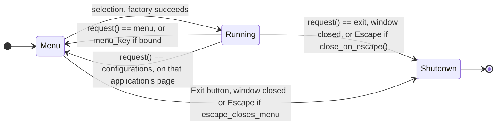

# Launcher, sessions and overlays

Contracts of the optional application shell: sessions and their requests, the launcher loop, and the screen-space overlays (settings, debug menu, help and bitmap text). Kinetra owns the layout, drawing and input capture of these pieces; applications supply rows, actions and content. [Kinetra-Lab](https://github.com/SMB-M87/Kinetra-Lab) registers the concrete applications; the README's [shared UI](../../README.md#shared-ui) shows them in use.

## Table of contents

- [Sessions and requests](#sessions-and-requests)
- [Launcher](#launcher)
- [Settings overlay](#settings-overlay)
- [Debug menu, help and text](#debug-menu-help-and-text)
- [Agent inspector](#agent-inspector)
- [HUD text and errors](#hud-text-and-errors)
- [Presentation helpers](#presentation-helpers)
- [Tests](#tests)

[Project overview](../../README.md) · [Documentation index](../README.md)

## Sessions and requests

A [Session](../../include/kinetra/runtime/session.h) is the application behind a window: `advance`, `render` and `title`. After every advance the host reads `request()` ([ADR 0014](../decisions/0014-session-navigation-requests.md)):

| `SessionRequest` | `run_session` (direct launch) | `run_launcher` |
| --- | --- | --- |
| `none` | Render and continue | Render and continue |
| `menu` | End the run without rendering; there is no menu | Destroy the session and draw the menu in the same frame |
| `configurations` | End the run without rendering, as `menu` | As `menu`, on the configuration page of the application that ran, with its configuration selected; the application list for an application without configurations |
| `exit` | End the run without rendering | End the loop without rendering |

A request is state, not an event: it stays set until the host acts on it, once, and a `menu` or `configurations` request destroys the session, so a session does not reset a request it passes on. `configurations` lets a session offer a way back to its own choice of variant, as Kinetra-Lab's Demo does from its settings panel, without knowing the menu. A session whose choice of variant is a screen of its own, such as Kinetra-Lab's i4sim, serves the settings panel's `configurations` itself and clears it with `SettingsOverlay::clear_request()` instead of returning it. `close_on_escape()` decides whether Escape closes the window while the session runs; sessions with their own exit action return false.

## Launcher

[`kinetra/runtime/launcher.h`](../../include/kinetra/runtime/launcher.h) is the `Kinetra::Launcher` target, built with `KINETRA_BUILD_RUNTIME`. It publicly links Runtime. Consumers may use it or call `run_session` directly.

- **`LaunchMenu`** draws the centered KINETRA LAUNCHER menu: up to six entries per page, Previous and Next buttons that wrap, arrow keys that reveal the selected page, and pointer hover that preselects without confirming. An application with configurations asks for one before launching. `show_configurations(selection)` opens that page with a given configuration selected, which `run_launcher` uses for a `configurations` request; a pointer that the session left over another row keeps that selection until it moves. The configuration page has a LAUNCHER button that returns to the application list, as the M key does. Exit sets `LaunchMenu::exit_requested()`, which custom loops must consume. An optional heading and error message let applications reuse the menu for their own resource selection: `draw(runtime, error)` shows a non-empty error in the [error panel](#hud-text-and-errors) over the menu, `update(input, viewport, error)` gives that panel the pointer first, and `error_closed()` reports a click on its close button, after which the application removes its message. A nested menu passes `LauncherButton::every_page`, which shows LAUNCHER on every page and only sets `launcher_requested()`, for the owner to leave through its own request.
- **Footer.** EXIT, LAUNCHER where the menu shows it, and PREVIOUS and NEXT when the list has more than one page. Without LAUNCHER they sit at panel x 50 (PREVIOUS), 150 (EXIT) and 250 (NEXT); with it at 100 (LAUNCHER) and 200 (EXIT), or with paging at 37.5, 112.5, 187.5 and 262.5 in the order PREVIOUS, LAUNCHER, EXIT, NEXT. Each is clickable `MenuLayout::footer_half_width` (36) panel pixels either side of its center. `LaunchMenu::footer_x(button)` gives a button's x on the current page, for `MenuLayout::footer_center()`.
- **Previews.** Supply an immutable `RgbaImage` in at least one `LaunchChoice::preview` to enable the preview panel on the application list. It shows the highlighted application's image and up to four lines of its description. The panel sits beside the list in landscape windows and below it in portrait windows. Configuration pages use the centered list. Use `LaunchMenu::layout(viewport)` to position scripted clicks on the current page.
- **`SessionHost`** owns one session and remembers its `selection()`. A factory that throws leaves the current session and camera untouched. The first advance after a transition gets zero elapsed time and empty input, so the selecting click and the construction time never reach the new session.
- **`run_launcher`** is the standard loop over a `SessionHost` and a `LaunchMenu`:

*Takeaway:* a session leaves through its own request; the two keys the loop handles itself are configurable.

`LauncherBindings` holds those keys: `menu_key` (M by default; `std::nullopt` leaves returning to the session's own `menu` and `configurations` requests) and `escape_closes_menu` (true by default). During a run, Escape follows `Session::close_on_escape()`. Kinetra-Lab passes `{std::nullopt, false}`, so only its sessions' own requests and the window's close button leave a run.

The window title names what is on screen, nothing more: `launcher_window_title` ("Launcher") while the menu is open, and `Session::title()`, the application's name, while a session runs. The loop sets it on the first frame and on every transition, and otherwise refreshes it every 500 ms. Status such as pause state or counters belongs in the window, where the application draws it.

## Settings overlay

[`SettingsOverlay`](../../include/kinetra/runtime/settings_view.h) is a modal settings panel ([ADR 0013](../decisions/0013-settings-overlay-in-kinetra.md)). Applications supply rows in display order:

| Row | Shows | On click |
| --- | --- | --- |
| `ZoomRow` | ZOOM with a `[-]` and a `[+]` button | Zooms by one `zoom_factor` step (1.1), clamped to the limits the row's function returns at that moment |
| `ToggleRow` | A check box and the label | Flips the borrowed flag |
| `HelpSection` | An arrow and the label, and its lines while expanded | Expands or collapses; each section keeps its own state and starts collapsed |

Kinetra supplies the rest:
- the title bar: SETTINGS and the `CTRL` hint;
- the closed-state toolbar: SETTINGS at screen pixels `x 0–64`, and DEBUG at `64–112` while the borrowed debug flag is true, both at `y 0–24`. DEBUG is lit while the debug menu shows;
- the action row: the leave button, RESUME and EXIT.

The leave button is the overlay's `LeaveAction`: LAUNCHER with `menu` by default, or the application's own choice of variant with `configurations`, such as Kinetra-Lab's SCENARIOS, DIFFICULTY and BLUEPRINTS. Its label has at most 11 characters, and the constructor throws `std::invalid_argument` for an empty or longer label and for any other request. A click on it sets `request()` to its request and closes the panel; EXIT sets `exit`, and RESUME closes the panel. A session returns the overlay's request from its own `request()`, or serves a `configurations` request itself and calls `clear_request()`.

**Input.** A session calls `update()` and then `update_debug()` every frame.

| Input | Effect |
| --- | --- |
| SETTINGS button | Opens the panel |
| Ctrl | Opens or closes the panel when the key is released, unless Shift was down while it was held or the window lost focus (`Input::focus_lost`). A press whose key is not held, as scripted input sends it, acts at once |
| Shift+Ctrl (`debug_chord`) | On the frame the second key goes down, in either order: sets the borrowed debug flag and shows the debug menu, or hides a showing menu. Nothing while the panel is open |
| DEBUG button | Shows or hides the debug menu |

`update()` returns true while the panel captures input: whenever it is open, including the frame of the click that closes it. Sessions then ignore gameplay input. `update_debug()` places the `DebugMenu` at screen pixels `(8, 32)`, below the toolbar, and returns true while the pointer is on the menu or its button. It hides the menu and captures nothing while the panel is open or the debug flag is false, so a session needs no conditions around it. An overlay without a debug flag has no debug menu.

**Layout.** All positions are logical panel pixels and are shared by picking and drawing:

| Element | Position |
| --- | --- |
| Panel | 208 wide, centered; scale `min(2, viewport.x / 228, viewport.y / 315)`, so expanding a section never rescales it |
| Title bar | 22 high |
| Rows | `row_y()` is the top edge of a row's text: the first at 33, then every 18 |
| Help sections | 4 below where the next row would be; a collapsed section takes 18 |
| Expanded help lines | every 12, the first 18 below their heading; the next row follows 4 below the last line |
| Action row | `actions_y()`: 12 below where the next row would be; the panel ends 22 below it |
| Buttons | The leave button (72 wide), RESUME and EXIT around `leave_x`, `resume_x` and `exit_x`; the zoom buttons around `zoom_out_x` and `zoom_in_x` |
| Click band | across the whole panel, from 5 above to 13 below a row's `y` |

Zoom and toggle rows must come before help sections; the constructor throws `std::invalid_argument` otherwise, and for a toggle without a flag or a zoom row without limits. `row_y()`, `actions_y()`, `half_extent()`, `expanded()` and the button centers expose the layout for tests and for callers that click or place things by it.

## Debug menu, help and text

- **Debug entries.** [`kinetra/view/debug_menu.h`](../../include/kinetra/view/debug_menu.h) describes a menu as plain data, without `Runtime`, so an application's logic layer builds and tests its menu headless.

  | Piece | Role |
  | --- | --- |
  | `DebugEntry` | One row: `label`, `kind`, `action`, `active`, `value`, `decrease` / `increase`, `depth`, `swatch`, `rule_above` |
  | `DebugEntryKind` | `button` (a command), `check` (on or off), `choice` (one value of a list), `group` (a heading that opens rows) |
  | `DebugFolds` | Keeps one section and one list open and makes their heading rows; a list closes with its section |
  | `debug_check`, `debug_number`, `debug_count` | Rows over a borrowed `bool`, `float` or `int`; a number steps by an amount or a factor within limits, rounded to four decimals so a step up and down returns to the same value |
  | `debug_number_text` | Three significant digits, short enough to end before the buttons |

  Rows are rebuilt for every update and every draw, because open sections, open lists and current settings decide which rows exist. The functions in a row borrow the object that made it.
- **[DebugMenu](../../include/kinetra/runtime/debug_view.h)** draws those rows and maps clicks to them. A row is indented 10 panel pixels per `depth`; its mark (an arrow for a group, a box for a check, a ring for a choice) sits in a 10-pixel column before the label; the value is right-aligned before the `[-]` and `[+]` buttons or the swatch. The row under the pointer gets a band when a click would run its action, and a button lights up on its own. A click on a button runs only `decrease` or `increase`; the gap between the buttons is split between them and the `[+]` zone runs to the panel edge. The menu has no key of its own: `SettingsOverlay::update_debug` shows and hides it, and so may any other owner through `visible`. `screen_origin` fixes the origin in screen pixels; a negative x keeps the menu right-aligned. The scale is `min(1.5, viewport.x / 300, viewport.y / 420)`. The layout constants (`panel_width`, `heading_height`, `row_height`, `row_top()`, `label_left()`, `height()` and the button edges) are public, in panel pixels, for tests that click a row.
- **[Overlay style](../../include/kinetra/runtime/overlay_style.h)** holds what the panels share: the colors, the mark glyphs, `draw_rectangle` with edges rounded to whole pixels, `draw_panel` (body, title bar, outline) and the two button drawings.
- **[HelpOverlay](../../include/kinetra/runtime/help_view.h)** and `draw_help` draw application-owned help text in an application-owned style. Help never captures input.
- **[Bitmap text](../../include/kinetra/runtime/bitmap_text.h).** `draw_text` draws a 5×7 bitmap font with runtime primitives, in logical screen pixels; `draw_glyph` draws one bitmap, and `text_width` measures a text. `glyph(char)` returns the bitmap. It covers `A`–`Z`, `0`–`9` and `/ + [ ] : - _ . , *`; lowercase letters use the uppercase glyphs and every other character is blank.

## Agent inspector

An application supplies one `InspectorSnapshot` with a title and ordered groups of display rows. The value type owns all strings and is available to headless callers. Units belong to the row value. [Snapshot model](../../include/kinetra/view/inspector.h)

`InspectorView` anchors the snapshot to the top right of the available area. The view wraps rows to fit, scrolls them with the wheel and keeps the close button fixed. Use the same area when drawing and handling input. An input result with `captured` tells the caller to suppress pointer actions in the world. A result with `close` also asks the caller to clear its selection. Reset the view's scroll position on a selection change. [Runtime view](../../include/kinetra/runtime/inspector_view.h)

## HUD text and errors

An application's HUD is the text it lays over its view, outside any panel. [hud_text.h](../../include/kinetra/runtime/hud_text.h) gives every application the same HUD style, so an error reads the same everywhere:

- **Lines.** HUD text uses `hud::text_scale` (1.5) and `hud::line_height` (20 screen pixels), at `hud::margin` from the left. `line_top(viewport, line)` counts lines from the bottom, 1 being the lowest; `draw_line` draws one. Statistics are yellow (`statistics_color`) on the lowest lines.
- **Errors.** An error is red (`error_color`), in the same font and size as the statistics, on the lines directly above them. `draw_error(runtime, message, line, max_lines)` wraps the message to the window (`wrap`, at spaces where it can), puts its last line on `line` and the others above, cuts a message that needs more than `max_lines` with `cut_mark`, and returns the lines drawn, so the caller places its next text above them. `error_lines` gives those lines without drawing, for tests.
- **Error panel.** A screen without HUD lines to spare, such as a launch menu, shows its error in a panel instead ([error_view.h](../../include/kinetra/runtime/error_view.h)): at the bottom of the window and as wide as it, as high as the message needs up to the whole window, with the inspector's title bar and close button. `error_panel::update` returns `captured` while the pointer is on the panel and `close` for a click on the button; the caller then removes the message. `LaunchMenu` uses it for its error.

## Presentation helpers

Header-only helpers for the glue every interactive session needs:
- `zoom(camera, steps, limits)` ([camera.h](../../include/kinetra/view/camera.h)) applies `zoom_factor` per wheel step and clamps to `ZoomLimits`. Zero steps still clamp, so new limits take effect at once.
- `RateCounter` ([timing.h](../../include/kinetra/view/timing.h)) turns counted frames, updates or decisions into a per-second rate over fixed windows (0.5 s by default).

## Tests

| Behavior | Suite | Needs a window |
| --- | --- | --- |
| Menu paging and configuration, the error panel and its capture over the menu, `SessionHost` transitions, debug-menu clicks, buttons and scale | `kinetra_launcher` ([launcher_tests.cpp](../../tests/launcher_tests.cpp)) | No |
| Overlay layout, rows, capture and actions, Ctrl and Shift+Ctrl, showing and hiding the debug menu | `kinetra_settings_view` ([settings_view_tests.cpp](../../tests/settings_view_tests.cpp)) | No |
| Glyph table, zoom stepping, rate counter, frame limiter, debug folds and rows | `kinetra_presentation` ([presentation_tests.cpp](../../tests/presentation_tests.cpp)) | No |
| `run_session` and `run_launcher` requests, menu key and Escape policy; the drawn panels; frame pacing | `kinetra_engine_graphics` ([runtime_tests.cpp](../../tests/runtime_tests.cpp)) | Yes |

The external consumer links the public launcher, session and overlay API. Commands are in [testing](../testing.md).
