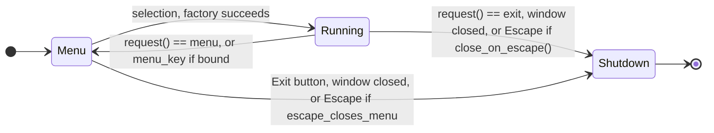

# Launcher, sessions and overlays

Contracts of the optional application shell: sessions and their requests, the launcher loop, and the screen-space overlays (settings, debug menu, help and bitmap text). Kinetra owns the layout, drawing and input capture of these pieces; applications supply rows, actions and content. [Kinetra-Lab](https://github.com/SMB-M87/Kinetra-Lab) registers the concrete applications.

## Table of contents

- [Sessions and requests](#sessions-and-requests)
- [Launcher](#launcher)
- [Settings overlay](#settings-overlay)
- [Debug menu, help and text](#debug-menu-help-and-text)
- [Presentation helpers](#presentation-helpers)
- [Tests](#tests)

[Project overview](../../README.md) · [Documentation index](../README.md)

## Sessions and requests

A [Session](../../include/kinetra/session.h) is the application behind a window: `advance`, `render` and `title`. After every advance the host reads `request()` ([ADR 0014](../decisions/0014-session-navigation-requests.md)):

| `SessionRequest` | `run_session` (direct launch) | `run_launcher` |
| --- | --- | --- |
| `none` | Render and continue | Render and continue |
| `menu` | End the run without rendering; there is no menu | Destroy the session and draw the menu in the same frame |
| `exit` | End the run without rendering | End the loop without rendering |

A request is state, not an event: the host acts on it once, and a menu request destroys the session, so sessions never reset it. `close_on_escape()` decides whether Escape closes the window while the session runs; sessions with their own exit action return false.

## Launcher

[`kinetra/launcher.h`](../../include/kinetra/launcher.h) is the `Kinetra::Launcher` target, built with `KINETRA_BUILD_RUNTIME`. It publicly links Runtime. Consumers may use it or call `run_session` directly.

- **`LaunchMenu`** draws the centered KINETRA LAUNCHER menu: up to six entries per page, Previous and Next buttons that wrap, arrow keys that reveal the selected page, and pointer hover that preselects without confirming. An application with configurations asks for one before launching. Exit sets `LaunchMenu::exit_requested()`, which custom loops must consume. An optional heading and status line let applications reuse the menu for their own resource selection.
- **`SessionHost`** owns one session. A factory that throws leaves the current session and camera untouched. The first advance after a transition gets zero elapsed time and empty input, so the selecting click and the construction time never reach the new session.
- **`run_launcher`** is the standard loop over a `SessionHost` and a `LaunchMenu`:

*Takeaway:* a session leaves through its own request; the two keys the loop handles itself are configurable.

`LauncherBindings` holds those keys: `menu_key` (M by default; `std::nullopt` leaves returning to `SessionRequest::menu`) and `escape_closes_menu` (true by default). During a run, Escape follows `Session::close_on_escape()`. Kinetra-Lab passes `{std::nullopt, false}`, so only its sessions' own requests and the window's close button leave a run.

The window title names what is on screen, nothing more: `launcher_window_title` ("Launcher") while the menu is open, and `Session::title()`, the application's name, while a session runs. The loop refreshes it on every transition and otherwise every 500 ms. Status such as pause state or counters belongs in the window, where the application draws it.

## Settings overlay

[`SettingsOverlay`](../../include/kinetra/settings_view.h) is a modal settings panel ([ADR 0013](../decisions/0013-settings-overlay-in-kinetra.md)). Applications supply rows in display order:

| Row | Shows | On click |
| --- | --- | --- |
| `ZoomRow` | ZOOM IN and ZOOM OUT | Multiplies or divides `pixels_per_unit` by `zoom_factor` (1.1), clamped to the limits the row's function returns at that moment |
| `ToggleRow` | `[X] LABEL` or `[ ] LABEL` | Flips the borrowed flag |
| `HelpSection` | `SHOW LABEL` or `HIDE LABEL`, and its lines while expanded | Expands or collapses; each section keeps its own state and starts collapsed |

Kinetra supplies the rest:
- the SETTINGS title;
- the closed-state toolbar: SETTINGS at screen pixels `x 0–64`, and DEBUG at `64–112` while the borrowed debug flag is true, both at `y 0–24`;
- the LAUNCHER / RESUME / EXIT row;
- the `CTRL  SETTINGS` hint.

LAUNCHER sets `request()` to `menu`, EXIT to `exit`, and RESUME closes the panel. A session returns the overlay's request from its own `request()`.

**Input.** Ctrl or the SETTINGS button opens and closes the panel. `update()` returns true while input is captured: whenever the panel is open, including the frame of the click that closes it. Sessions then ignore gameplay input. `update_debug()` handles the DEBUG button and places the `DebugMenu` at screen pixels `(8, 32)`, below the toolbar.

**Layout.** All positions are logical panel pixels and are shared by picking and drawing:

| Element | Position |
| --- | --- |
| Panel | 184 wide, centered; scale `min(2, viewport.x / 204, viewport.y / 418)`, so expanding a section never rescales it |
| Title | `y = 12` |
| Zoom and toggle rows | first at `y = 40`, then every 28 |
| Help sections | 4 pixels below where the next row would be; a collapsed section takes 28 |
| Expanded help lines | every 14, starting 14 below their toggle; the next section toggle follows 14 below the last line |
| Action row | 28 below the last row or help line |
| Hint | 28 below the action row; the panel ends 50 below the action row |
| Click band | from 4 above to 18 below a row's `y`, inside the column `x 10–174` |

Zoom and toggle rows must come before help sections; the constructor throws `std::invalid_argument` otherwise, and for a toggle without a flag or a zoom row without limits. `row_y()`, `actions_y()`, `half_extent()` and `expanded()` expose the layout for tests and for callers that place things next to the panel.

## Debug menu, help and text

- **[DebugMenu](../../include/kinetra/debug_view.h)** accepts labels, borrowed flags, actions and read-only getters (`text`, `number`, `visualization`). Applications keep the referenced state alive through `update` and `draw`, and suppress gameplay pointer input while the menu captures it. Backquote is the default toggle. Clickable rows turn blue under the pointer; read-only rows keep their color. `screen_origin` fixes the menu origin in screen pixels; a negative x keeps it right-aligned.
- **[HelpOverlay](../../include/kinetra/help_view.h)** and `draw_help` draw application-owned help text in an application-owned style. Help never captures input.
- **[Bitmap text](../../include/kinetra/bitmap_text.h).** `draw_text` draws a 5×7 bitmap font with runtime primitives, in logical screen pixels. `glyph(char)` returns the bitmap. It covers `A`–`Z`, `0`–`9` and `/ + [ ] : - _ . , *`; lowercase letters use the uppercase glyphs and every other character is blank.

## Presentation helpers

Header-only helpers for the glue every interactive session needs:
- `zoom(camera, steps, limits)` ([camera.h](../../include/kinetra/camera.h)) applies `zoom_factor` per wheel step and clamps to `ZoomLimits`. Zero steps still clamp, so new limits take effect at once.
- `RateCounter` ([timing.h](../../include/kinetra/timing.h)) turns counted frames, updates or decisions into a per-second rate over fixed windows (0.5 s by default).

## Tests

| Behavior | Suite | Needs a window |
| --- | --- | --- |
| Menu paging and configuration, `SessionHost` transitions, debug actions | `kinetra_launcher` ([launcher_tests.cpp](../../tests/launcher_tests.cpp)) | No |
| Overlay layout, rows, capture and actions | `kinetra_settings_view` ([settings_view_tests.cpp](../../tests/settings_view_tests.cpp)) | No |
| Glyph table, zoom stepping, rate counter | `kinetra_presentation` ([presentation_tests.cpp](../../tests/presentation_tests.cpp)) | No |
| `run_session` and `run_launcher` requests, menu key and Escape policy | `kinetra_engine_graphics` ([runtime_tests.cpp](../../tests/runtime_tests.cpp)) | Yes |

The external consumer links the public launcher, session and overlay API. Commands are in [testing](../testing.md).
