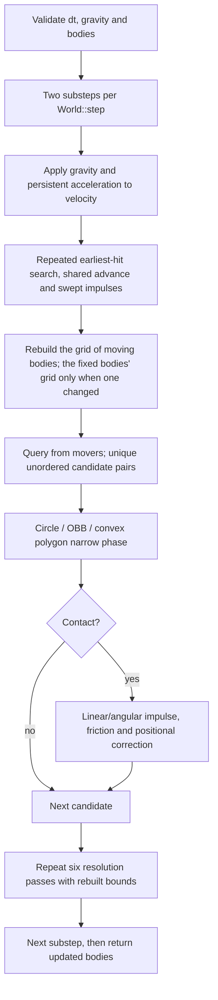

# Math and physics

Headless mechanisms use world units, seconds and radians. Positive rotation is counterclockwise; world Y points up.

## Table of contents

- [Public contracts](#public-contracts)
- [Physics update flow](#physics-update-flow)
- [Collision and queries](#collision-and-queries)
- [Limits and verification](#limits-and-verification)

[Project overview](../../README.md) · [Documentation index](../README.md)

## Public contracts

| API | Contract |
| --- | --- |
| [math.h](../../include/kinetra/simulation/math.h) | Vec2 arithmetic, dot/cross, normalization, rotation, signed angle, `atan2` and `asin` that round the same on every C library, interpolation, distances, bounds and shape values |
| [physics.h](../../include/kinetra/simulation/physics.h) | Body state, contacts, integration, impulses and World |
| [spatial_grid.h](../../include/kinetra/simulation/spatial_grid.h) | Rebuildable AABB index; sorted unique overlapping input indices |
| [collision_grid.h](../../include/kinetra/simulation/collision_grid.h) | Row-major occupancy collision and first blocked segment fraction |
| [camera.h](../../include/kinetra/view/camera.h) | Logical screen pixels Y-down ↔ world Y-up; validates finite positive viewport/zoom |

`normalized({0,0})` returns zero; degenerate segment distance reduces to point distance. Arithmetic helpers generally follow IEEE floating-point propagation; `finite` lets boundaries reject invalid vectors. Body, camera, grid, navigation and clock entry points validate their contracts. AABB touching counts as overlap.

| Motion enum | Integration | Contact translation | Collision rotation / restitution |
| --- | --- | --- | --- |
| fixed | No | No | No |
| controlled | Yes | Yes | No |
| dynamic | Yes | Yes | Yes |

Body dimensions and mass must be finite and positive. `Shape::polygon` uses 3–32 strictly convex counterclockwise `Body::vertices` in local coordinates, centered at the area centroid. Edges shorter than 0.0001 world units, collinear vertices and concave/self-intersecting outlines are rejected. `radius` applies to circles and `half_extents` to boxes. `regular_polygon(sides, radius)` creates centered geometry. `local_extents` and `bounding_radius` provide conservative envelopes for all shapes. Polygon inertia integrates the uniform-density area about the local origin; contacts use SAT and a clipped representative point. Concave/compound bodies are not implemented. Acceleration persists until the caller changes it. `World::add` returns an index stable until `clear`; the engine has no body-removal API.

## Physics update flow

[World::step](../../src/simulation/physics.cpp) accepts finite `0 < dt <= 0.1`. It does not accumulate forces or clear acceleration for the caller. Rebuilding after each correction pass discovers contacts introduced by corrections. Fixed bodies never move during a step, so they have a grid of their own, rebuilt only when the caller has changed one of them since the last step; queries merge both grids in body-index order.

## Collision and queries

- `collide` returns a normal from the first body toward the second, contact point and penetration, including touching contacts.
- `resolve_contact`, `apply_body_impulse` and `integrate` are independently callable. Consumers can use these without storing bodies in `kinetra::World`.
- `sweep_circle(circle, end, obstacle)` returns the earliest hit fraction and contact against the obstacle's current pose, ignoring its velocity. It includes initial overlap/touch at fraction zero and supports circles, OBBs and convex polygons as obstacles. Normals point from the moving circle toward the obstacle. Offset faces and rounded corners avoid the false positives of an expanded box.
- `sweep_translation(body, end, obstacle)` supports every circle/box/convex-polygon pair with fixed orientations. Velocities and angular velocities are not used by this query. Circle pairs reuse rounded-feature sweeps; convex pairs intersect the entry/exit time intervals for all separating axes (swept SAT). Contact reconstruction uses a floating-point tolerance scaled to geometry and world coordinates.
- The four-argument `sweep_translation(a, end_a, b, end_b)` overload sweeps both bodies with fixed orientations, using relative travel and mapping the contact point back into world coordinates at the common hit fraction. Motion modes do not override these explicit endpoints.
- `World::step` sweeps every supported fixed/moving or moving/moving pair on one shared timeline. It advances all bodies to the earliest approaching contact, resolves both velocities, and rebuilds the remaining swept bounds after each event. Acceleration/gravity are applied once per substep; angular motion follows the piecewise updated angular velocity. Sweep selection uses the same contact-point velocities (including angular motion) as impulse resolution, evaluated at the predicted impact poses. Separating contacts and closing speeds at or below `8 * float epsilon * max(1, contact-point speeds)` are deferred to discrete passes. This avoids repeatedly selecting zero-time contacts that the impulse solver leaves unchanged. Already-touching/overlapping contacts whose predicted normal travel stays within positional slop are handled by the bounded discrete passes rather than repeated zero-time events. This resting tolerance is at most 0.001 world units and at most 1% of either shape's centered inscribed radius; new future impacts still use continuous detection. Equal-time contacts use stable body-index pair order, not a simultaneous constraint solve. `candidate_pairs()` includes swept and discrete candidate checks, not distinct pairs.
- Each substep has a shared event-iteration budget of `8 * max(1, moving body count)`. Exhausting it discards the remaining translation and rotation of **all** bodies while retaining their velocities, favoring containment over accurate elapsed travel in extreme repeated-bounce cases. `World::sweep_budget_exhausted()` reports whether either substep used this fallback; the flag resets on the next `step` or `clear`. Existing overlaps still receive discrete correction passes; the sweep is not a general overlap-recovery guarantee.
- `segment_circle` returns the earliest fraction, including starts inside. Double intermediates protect grazing/small relative-motion hits.
- `segment_grid` blocks solid cells and outside-view travel. `collide_grid` resolves overlapping cells using engine contacts.
- Navigation sweeps a circular envelope against circles and oriented boxes; polygon obstacles use conservative oriented local bounding boxes. Steering uses conservative expanded bounds for local prediction.
- Callers select which bodies enter their queries; no general collision-layer/mask API is implemented.

Application-specific math adapters and pixel/world coordinate conversions remain consumer-owned.

## Limits and verification

The solver uses a representative contact point. Continuous detection covers circle and nonrotating box/polygon pairs, including moving/moving contacts. Pairs containing rotating boxes/polygons remain discrete and can tunnel. If an impact imparts angular velocity to a dynamic box/polygon, subsequent pairs containing that body also use discrete detection; the translation sweep is not rotational CCD. There are no joints, robust stacking manifolds or cross-machine bitwise determinism. `kinetra::atan2` and `kinetra::asin` close the gap that moved trajectories between glibc versions: they return the correctly rounded float, except in rare double-rounding cases near a midpoint between two floats. `atan2f` and `asinf` themselves differ in the last bit between glibc 2.39 and 2.41 ([design](../design/2026-11-22-linux-beyond-arch.md#problem)). This needs IEEE-conforming float semantics: under `-ffast-math` or `-funsafe-math-optimizations` the compiler may narrow them back to the C library's float functions, and does so for `asin`. Simulation code uses them instead of `std::atan2` and `std::asin` on floats; `sin`, `cos`, `exp`, `pow` and `hypot` still come from the C library. Segment queries are not a complete scene raycasting API.

[Simulation tests](../../tests/simulation_tests.cpp) cover shape boundaries, containment, momentum, rotation, material response, mixed modes, invalid inputs, grid queries and a 400-body workload. [Navigation tests](../../tests/navigation_tests.cpp) also exercise zero vectors, degenerate segments, finite-value checks and exact endpoints. Which suites to run for a change is in [testing](../testing.md#choosing-targeted-tests); every suite is listed in the [test map](../../tests/README.md#test-map).
