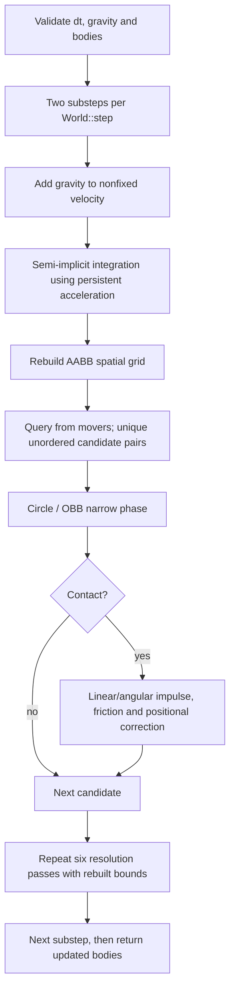

# Math and physics

Headless mechanisms use world units, seconds and radians. Positive rotation is counterclockwise; world Y points up.

## Table of contents

- [Public contracts](#public-contracts)
- [Physics update flow](#physics-update-flow)
- [Collision and queries](#collision-and-queries)
- [Limits and verification](#limits-and-verification)

## Public contracts

| API | Contract |
| --- | --- |
| [math.h](../../include/kinetra/math.h) | Vec2 arithmetic, dot/cross, normalization, rotation, signed angle, interpolation, distances, bounds and shape values |
| [physics.h](../../include/kinetra/physics.h) | Body state, contacts, integration, impulses and World |
| [spatial_grid.h](../../include/kinetra/spatial_grid.h) | Rebuildable AABB index; sorted unique overlapping input indices |
| [collision_grid.h](../../include/kinetra/collision_grid.h) | Row-major occupancy collision and first blocked segment fraction |
| [camera.h](../../include/kinetra/camera.h) | Logical screen pixels Y-down ↔ world Y-up; validates finite positive viewport/zoom |

`normalized({0,0})` returns zero; degenerate segment distance reduces to point distance. Arithmetic helpers generally follow IEEE floating-point propagation; `finite` lets boundaries reject invalid vectors. Body, camera, grid, navigation and clock entry points validate their contracts. AABB touching counts as overlap.

| Motion enum | Integration | Contact translation | Collision rotation / restitution |
| --- | --- | --- | --- |
| fixed | No | No | No |
| controlled | Yes | Yes | No |
| dynamic | Yes | Yes | Yes |

Body dimensions and mass must be finite and positive. Acceleration persists until the caller changes it. `World::add` returns an index stable until `clear`; the engine has no body-removal API.

## Physics update flow

[World::step](../../src/simulation/physics.cpp) accepts finite `0 < dt <= 0.1`. It does not accumulate forces or clear acceleration for the caller. Rebuilding after each correction pass discovers contacts introduced by corrections.

## Collision and queries

- `collide` returns a normal from the first body toward the second, contact point and penetration, including touching contacts.
- `resolve_contact`, `apply_body_impulse` and `integrate` are independently callable. Consumers can use these without storing bodies in `kinetra::World`.
- `segment_circle` returns the earliest fraction, including starts inside. Double intermediates protect grazing/small relative-motion hits.
- `segment_grid` blocks solid cells and outside-view travel. `collide_grid` resolves overlapping cells using engine contacts.
- Navigation sweeps a circular envelope against circles and oriented boxes. Steering uses conservative expanded bounds for local prediction.
- Callers select which bodies enter their queries; no general collision-layer/mask API is implemented.

Application-specific math adapters and pixel/world coordinate conversions remain consumer-owned.

## Limits and verification

The solver uses discrete contacts and a representative contact point, without continuous rigid-body collision detection, joints, robust stacking manifolds or cross-machine bitwise determinism. Segment queries are not a complete scene raycasting API.

[Simulation tests](../../tests/simulation_tests.cpp) cover shape boundaries, containment, momentum, rotation, material response, mixed modes, invalid inputs, grid queries and a 400-body workload. [Navigation tests](../../tests/navigation_tests.cpp) also exercise zero vectors, degenerate segments, finite-value checks and exact endpoints. Test commands are in [development](../development.md).
