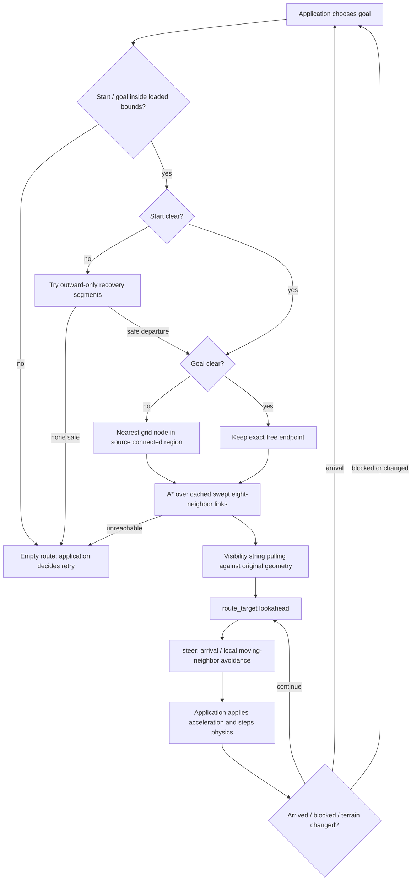

# Navigation and steering

`Kinetra::Simulation` provides body-aware path planning and local steering without SDL/OpenGL. Applications choose goals and when to retry.

## Table of contents

- [Planning and following](#planning-and-following)
- [Contracts](#contracts)
- [Reciprocal local avoidance](#reciprocal-local-avoidance)
- [Traffic admission](#traffic-admission)
- [Weighted grids and priority steering](#weighted-grids-and-priority-steering)
- [Application policies](#application-policies)
- [Verification](#verification)

[Project overview](../../README.md) · [Documentation index](../README.md)

## Planning and following

A direct clear segment bypasses A*. Route calculation and following share the same swept-clearance predicate. Replanning and arrival decisions stay in the application.

## Contracts

| Interface | Responsibility |
| --- | --- |
| [Navigation](../../include/kinetra/simulation/navigation.h) | Configurable positive finite grid resolution and circular envelope; owns a snapshot of obstacle bodies |
| `rebuild(bounds, obstacles)` | Validates the bounds and every body first, then caches grid occupancy, swept neighbor links and connected-region labels; a rejected rebuild keeps the previous snapshot |
| `path(start, goal)` | Returns waypoints excluding start; empty means failure; free endpoints retain exact coordinates |
| `clear(a,b)` | Swept-circle clearance against stored geometry; does not enforce navigation bounds |
| `route_target(position, route, navigation)` | Consumes visible intermediate waypoints and supplies corner lookahead |
| [steer](../../include/kinetra/simulation/steering.h) | Bounded acceleration with arrival, optional separation and predictive local avoidance |

The raster is limited to 262,144 cells. The default resolution is one world unit and clearance radius 0.85. Touching the clearance envelope is blocked. Disconnected free goals fail; occupied goals project within the source region. Starts inside the conservative margin may depart outward, but never cross a surface. Rebuild can allocate; it is not a transaction guarantee on allocation failure.

Pathfinding uses Euclidean heuristic and orthogonal/diagonal travel costs. Smoothing tests actual circle/rotated-box geometry, including corners. Moving obstacles are not continuously replanned automatically. Finite grids and conservative envelopes can reject physically passable gaps.

`Steering::rectangular_clearance` is an opt-in for axis-aligned box pairs: avoidance
uses summed half extents plus clearance instead of a circumscribed agent circle.
This permits physically clear rectangular passages. Rotated boxes and other shape
pairs retain the conservative envelope; the option is off by default.

## Reciprocal local avoidance

[avoidance.h](../../include/kinetra/simulation/avoidance.h) provides `avoid_collisions(agent, preferred_velocity, neighbors, dt, settings)` in `Kinetra::Simulation`. Its circular velocity-obstacle construction follows [Optimal Reciprocal Collision Avoidance](https://gamma-web.iacs.umd.edu/ORCA/), with a speed disc and a reachable-velocity disc for the caller's acceleration bound.

- Supply one immutable snapshot per update, unique stable agent IDs, positive circular radii and consistent time units. Cooperative neighbors share pairwise corrections equally; noncooperative neighbors retain their supplied velocity and assign full avoidance responsibility to the caller. Convex body consumers can use `bounding_radius` for conservative envelopes.
- Set `half_extents` to positive components for a fixed axis-aligned rectangle, or leave both zero for a circle. Box/box pairs use the summed rectangular footprint, expanded by `clearance` on each axis. Their finite-horizon velocity obstacle is projected onto its visible cutoff edges and two tangent rays. Overlap recovery uses the timestep cutoff. Mixed circle/box pairs retain enclosing circles; `radius` must therefore enclose any supplied rectangle. Rotating rectangles require conservative circular envelopes.
- All supplied neighbors contribute constraints. Stable ID ordering makes input order irrelevant. The selected velocity stays closest to the passing-adjusted preferred velocity within the discs and half-planes. A small right-hand passing preference starts near forward neighbors before a symmetric crowd reaches a packed standstill; its magnitude scales down with preferred speed to permit arrival. Set `passing_bias=0` for an unmodified preference.
- `velocity` and `acceleration` describe the next bounded control update. Existing overspeed may persist while decelerating, but selection cannot increase it. `dt` and `horizon` use the caller's time units, permitting consistent second/tick conversions.
- If constraints cannot be met within the motion bounds, a bounded minimax relaxation reduces the largest violation. `feasible=false` and `violation` expose this condition. Approximate feasibility uses a 0.00001 velocity-unit tolerance; it is not a certificate for acceleration tracking, unseen obstacles or subsequent noncooperative decisions.

This is holonomic local avoidance. Applications still own route planning, static geometry selection, traffic scheduling, starvation prevention, deadlock recovery and vehicle steering limits. Circular envelopes can reject passages that actual polygons could traverse. No general collision-free or globally live behavior is promised for arbitrary crowds.

## Traffic admission

[traffic.h](../../include/kinetra/simulation/traffic.h) provides `TrafficGate` in
`Kinetra::Simulation`, independently of geometry and steering. Call `update` once
per control step with complete unique-ID request and physical-occupancy snapshots
for one exclusive conflict zone. New requests join in stable ID order; existing
requests keep their FIFO turn. The admitted request persists until cancelled.
Physical occupancy takes precedence over the queue, even if an occupant cancels
its request, stops, or is absent from the request set. Multiple occupants report
`occupied_conflict` and admit nobody; applications must still permit occupants to
leave. `waiting` counts requesting agents other than the admitted agent.

The three-argument `update(requests, occupants, ineligible)` overload permits
application-owned readiness checks, such as exit clearance. Ineligible IDs must be
unique members of `requests`; they keep their tickets while new admission selects
the oldest eligible request. An existing admission remains valid even if later
marked ineligible. This avoids revoking a grant during approach; the application
must retain any space reserved for that grant until it is safely released. With
all requests ineligible and no occupant/grant, admission is empty. The
two-argument overload treats every request as eligible.

No timer revokes an approaching grant. Cancel only when the agent can safely stop
outside the zone. Fair progress depends on admitted agents eventually clearing it.
Applications own zone discovery, safe stopping lines, exit availability, stalled
occupants, multi-zone dependencies and deadlock recovery. `clear` resets logical
state when the caller deliberately disables or replaces the policy; it does not
move bodies. Duplicate IDs throw before changing queue state. See
[ADR 0012](../decisions/0012-traffic-admission.md) and the
[traffic tests](../../tests/traffic_tests.cpp).

## Weighted grids and priority steering

`WeightedGrid` accepts positive finite rectangular cells and a bounded world, up to one million cells. `cell()` returns -1 outside the truncated full-cell envelope. `block()` changes topology; `weights()` atomically validates a full nonnegative finite cost array. Its eight-neighbor A* prevents blocked diagonal corner cuts and retains exact free endpoints. Unreachable or blocked endpoints return an empty path. Costs multiply physical edge length by one plus destination-cell weight; heuristic uses Euclidean distance. The caller supplies occupancy and retry policy. `search(start, accept, enter, half_extents)` looks for a cell with a property instead of a known goal: with the same moves and costs, but no heuristic (Dijkstra), it offers each reachable cell once to `accept`, the start's own cell first and then in nondecreasing route cost, and returns the route to the center of the first cell `accept` takes; `enter` limits the cells a route may enter. Because the order is fixed, an `accept` that counts the cells it is offered is well defined (Kinetra-Lab's Dotio skips a number of hidden cells before it takes a shelter). `path(start, goal, half_extents)` optionally checks every endpoint and swept link
against an axis-aligned rectangular footprint; the default zero footprint retains
point planning. `clear(start, goal, half_extents)` exposes the same predicate.
Touching a surface is permitted; penetrating blocked cells or extending outside
the world fails. Exact endpoints are used when checking the first and last link.
`borders()` merges contiguous collinear edges of the free-cell union, removing
raster seams from steering and contact geometry.

`priority_steer` accepts axis-aligned boxes and axis-aligned border segments. It returns overlap, predictive and seek forces plus capped acceleration. Immediate
overlap recovery precedes prediction and arrival. `constrain_borders` then limits
normal velocity toward expanded wall segments while preserving feasible tangential
steering and braking. This function can also constrain another steering profile.
It assumes one semi-implicit integration step per call. Its stopping bound includes
the next step's travel; lookahead provides additional damping. Only penetration
requests a smooth bounded outward recovery, so a stationary body touching a wall
is not repelled. Beside the end of a segment, the face the body would reach last at
its current velocity applies, as in a swept-box test, so a body sliding flush along
one wall passes the convex corner where another wall begins. `border_distance` and `border_strength` tune penetration recovery;
`border_lookahead` tunes inward approach speed. Conflicting constraints in overlaps
receive bounded recovery, not a collision-free guarantee. `SteeringForces::border`
reports the applied acceleration correction (at most twice the acceleration cap),
not an unbounded inverse-square diagnostic force. Arrival can be disabled at intermediate waypoints. Settings are explicit in caller-selected time units: defaults use 2 units/time and 0.6 units/time squared, eight prediction steps and a 1.025 safety multiplier. Caller-owned integration and clock must use consistent units. Neighbor spans exclude the agent. Coincident bodies receive a finite separating force. Unsupported rotated/circular bodies and invalid settings throw.

`tangent_steer` is experimental tangent/spring local steering translated from i4sim. It returns bounded acceleration with explicit speed, force and horizon; callers keep integration and boundary/contact handling. It is not a collision-free velocity solver.

These functions are separate from `steer` and `Navigation`, which keep their own geometry and units. See [ADR 0011](../decisions/0011-weighted-navigation-and-priority-steering.md) and [weighted navigation tests](../../tests/weighted_navigation_tests.cpp).

## Application policies

Applications own goal selection, replanning schedules, streamed obstacle residency and game-specific AI. Coordinate adapters and legacy graph representations belong to consumers rather than the engine.

## Verification

[Engine navigation tests](../../tests/navigation_tests.cpp) exercise configurable geometry, exact endpoints, projection, invalid settings and NaN goals. Implementation: [navigation.cpp](../../src/simulation/navigation.cpp), [steering.cpp](../../src/simulation/steering.cpp).
