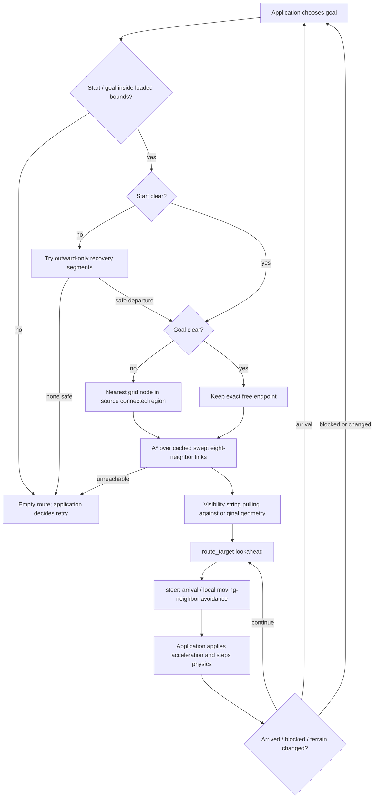

# Navigation and steering

`Kinetra::Simulation` provides body-aware path planning and local steering without SDL/OpenGL. Applications choose goals and when to retry.

## Table of contents

**Navigation:**

[Directory guide](README.md) · [Project overview](../../README.md) · [Documentation index](../README.md)

**On this page:**

- [Planning and following](#planning-and-following)
- [Contracts](#contracts)
- [Application policies](#application-policies)
- [Verification](#verification)

## Planning and following

A direct clear segment bypasses A*. Route calculation and following share the same swept-clearance predicate. Replanning and arrival decisions stay in the application.

## Contracts

| Interface | Responsibility |
| --- | --- |
| [Navigation](../../include/kinetra/navigation.h) | Configurable positive finite grid resolution and circular envelope; owns a snapshot of obstacle bodies |
| `rebuild(bounds, obstacles)` | Validates geometry, caches grid occupancy, swept neighbor links and connected-region labels |
| `path(start, goal)` | Returns waypoints excluding start; empty means failure; free endpoints retain exact coordinates |
| `clear(a,b)` | Swept-circle clearance against stored geometry; does not enforce navigation bounds |
| `route_target(position, route, navigation)` | Consumes visible intermediate waypoints and supplies corner lookahead |
| [steer](../../include/kinetra/steering.h) | Bounded acceleration with arrival, optional separation and predictive local avoidance |

The raster is limited to 262,144 cells. The default resolution is one world unit and clearance radius 0.85. Touching the clearance envelope is blocked. Disconnected free goals fail; occupied goals project within the source region. Starts inside the conservative margin may depart outward, but never cross a surface. Rebuild can allocate; it is not a transaction guarantee on allocation failure.

Pathfinding uses Euclidean heuristic and orthogonal/diagonal travel costs. Smoothing tests actual circle/rotated-box geometry, including corners. Moving obstacles are not continuously replanned automatically. Finite grids and conservative envelopes can reject physically passable gaps.

## Application policies

Applications own goal selection, replanning schedules, streamed obstacle residency and game-specific AI. Coordinate adapters and legacy graph representations belong to consumers rather than the engine.

## Verification

[Engine navigation tests](../../tests/navigation_tests.cpp) exercise configurable geometry, exact endpoints, projection, invalid settings and NaN goals. Implementation: [navigation.cpp](../../src/simulation/navigation.cpp), [steering.cpp](../../src/simulation/steering.cpp).
