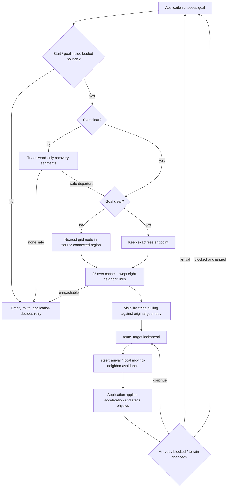

# Navigation and steering

`Kinetra::Simulation` provides body-aware path planning and local steering without SDL/OpenGL. Applications choose goals and when to retry.

## Table of contents

- [Planning and following](#planning-and-following)
- [Contracts](#contracts)
- [Reciprocal local avoidance](#reciprocal-local-avoidance)
- [Predictive passing](#predictive-passing)
- [Stall detection](#stall-detection)
- [Right of way](#right-of-way)
- [Making way](#making-way)
- [Traffic admission](#traffic-admission)
- [Weighted grids and priority steering](#weighted-grids-and-priority-steering)
- [Application policies](#application-policies)
- [Verification](#verification)

[Project overview](../../README.md) · [Documentation index](../README.md)

## Planning and following

A direct clear segment bypasses A*. Route calculation and following share the same swept-clearance predicate. Replanning and arrival decisions stay in the application.

## Contracts

| Interface | Responsibility |
| --- | --- |
| [Navigation](../../include/kinetra/simulation/navigation.h) | Configurable positive finite grid resolution and circular envelope; owns a snapshot of obstacle bodies |
| `rebuild(bounds, obstacles)` | Validates the bounds and every body first, then caches grid occupancy, swept neighbor links and connected-region labels; a rejected rebuild keeps the previous snapshot |
| `path(start, goal)` | Returns waypoints excluding start; empty means failure; free endpoints retain exact coordinates |
| `clear(a,b)` | Swept-circle clearance against stored geometry; does not enforce navigation bounds |
| `route_target(position, route, navigation)` | Consumes visible intermediate waypoints and supplies corner lookahead |
| [steer](../../include/kinetra/simulation/steering.h) | Bounded acceleration with arrival, optional separation and predictive local avoidance |

The raster is limited to 262,144 cells. The default resolution is one world unit and clearance radius 0.85. Touching the clearance envelope is blocked. Disconnected free goals fail; occupied goals project within the source region. Starts inside the conservative margin may depart outward, but never cross a surface. Rebuild can allocate; it is not a transaction guarantee on allocation failure.

Pathfinding uses Euclidean heuristic and orthogonal/diagonal travel costs. Smoothing tests actual circle/rotated-box geometry, including corners. Moving obstacles are not continuously replanned automatically. Finite grids and conservative envelopes can reject physically passable gaps.

`Steering::rectangular_clearance` is an opt-in for axis-aligned box pairs: avoidance
uses summed half extents plus clearance instead of a circumscribed agent circle.
This permits physically clear rectangular passages. Rotated boxes and other shape
pairs retain the conservative envelope; the option is off by default.

## Reciprocal local avoidance

[avoidance.h](../../include/kinetra/simulation/avoidance.h) provides `avoid_collisions(agent, preferred_velocity, neighbors, dt, settings)` in `Kinetra::Simulation`. Its circular velocity-obstacle construction follows [Optimal Reciprocal Collision Avoidance](https://gamma-web.iacs.umd.edu/ORCA/), with a speed disc and a reachable-velocity disc for the caller's acceleration bound.

- Supply one immutable snapshot per update, unique stable agent IDs, positive circular radii and consistent time units. Cooperative neighbors share pairwise corrections equally; noncooperative neighbors retain their supplied velocity and assign full avoidance responsibility to the caller. Convex body consumers can use `bounding_radius` for conservative envelopes.
- Set `half_extents` to positive components for a fixed axis-aligned rectangle, or leave both zero for a circle. Box/box pairs use the summed rectangular footprint, expanded by `clearance` on each axis. Their finite-horizon velocity obstacle is projected onto its visible cutoff edges and two tangent rays. Overlap recovery uses the timestep cutoff. Mixed circle/box pairs retain enclosing circles; `radius` must therefore enclose any supplied rectangle. Rotating rectangles require conservative circular envelopes.
- All supplied neighbors contribute constraints. Stable ID ordering makes input order irrelevant. The selected velocity stays closest to the passing-adjusted preferred velocity within the discs and half-planes. A small right-hand passing preference starts near forward neighbors before a symmetric crowd reaches a packed standstill; its magnitude scales down with preferred speed to permit arrival. Set `passing_bias=0` for an unmodified preference.
- `velocity` and `acceleration` describe the next bounded control update. Existing overspeed may persist while decelerating, but selection cannot increase it. `dt` and `horizon` use the caller's time units, permitting consistent second/tick conversions.
- If constraints cannot be met within the motion bounds, a bounded minimax relaxation reduces the largest violation. `feasible=false` and `violation` expose this condition. Approximate feasibility uses a 0.00001 velocity-unit tolerance; it is not a certificate for acceleration tracking, unseen obstacles or subsequent noncooperative decisions.

This is holonomic local avoidance. Applications still own route planning, static geometry selection, traffic scheduling, starvation prevention, deadlock recovery and vehicle steering limits. Circular envelopes can reject passages that actual polygons could traverse. No general collision-free or globally live behavior is promised for arbitrary crowds.

## Predictive passing

[Passing geometry](../../include/kinetra/simulation/passing.h) helps an application
coordinate a head-on encounter between two axis-aligned footprints. A pair moving at
a common speed qualifies when the closest approach of its route headings lies within
the horizon and the expanded footprints overlap. Candidate lanes are considered in a
fixed order, with three lateral placements per side. Each participant goes to its
entry before traversing to its exit. The application checks the swept legs against the
world and reserves the first acceptable candidate.

During the maneuver, a guard considers neighbors whose centers are ahead along the
entry-to-exit axis. A stationary footprint ahead that overlaps a remaining leg blocks
it. Moving neighbors ahead are sampled over the horizon on the reachable path, including braking
distance. Crossing traffic can require a wait at the braking target. Oncoming traffic
in that reach blocks the lane. The caller supplies the active neighbors, priority,
sampling cadence and response. [ADR 0016](../decisions/0016-predictive-passing.md)

The [passing coordinator](../../include/kinetra/simulation/passing_coordinator.h) runs
that geometry as a plan lifecycle for applications that need no factory rules. Each step
the caller hands it every mover as a body, a route heading, a destination and a state:
free (follows its own route, may join and keep a plan), busy (moves under another control),
standing (stands still for now; blocks a lane whatever the priority) or absent (does not
exist in this step, such as an empty slot of a pool, so its index stays stable). A plan
whose participant is no longer free ends at once. Any shape takes part
through a footprint, the axis-aligned box around its bounds centered on its position. The
coordinator forms plans between movers whose headings will bring them into contact, asks
the caller to approve each leg against the world, and checks the legs against the other
movers and the space of older plans itself. It guards every plan with a
`PassingLaneGuard`: a participant waits at its braking point while a mover with priority
is predicted in its lane ahead, and resumes after the lane stayed clear for the resume
time. A plan yields to movers in no plan and to the participants of older plans. It ends
as completed, unavailable, obstructed, without progress, or cancelled by the caller, and
a plan that failed keeps its pair out of new plans for the retry time; `clear()`, an absent
mover and `cancel()` drop such a delay, so a new occupant of an index starts afresh. Every
input is validated before anything changes, and nothing after that check throws: a guard
or lane query wider than the spatial grid answers cheaply scans the footprints instead. Times are in
steps and velocities in world units per step; every value is the caller's tuning, with no
defaults. The caller steers each participant to its target and plans its route again
after the plan ends. Demo, Dotio and i4sim use it; i4sim maps its factory states to
`PassingMoverState` and keeps its traffic controls and event log around it.
[ADR 0017](../decisions/0017-passing-coordinator.md), [ADR 0018](../decisions/0018-stall-remedies-in-the-engine.md)

## Stall detection

[stall_detector.h](../../include/kinetra/simulation/stall_detector.h) provides `StallDetector`
in `Kinetra::Simulation`, beside the passing coordinator. After each step the caller supplies
its movers, each with:

- its body;
- the point it heads for now;
- its goal;
- the steps it went without progress, as the caller measures progress;
- a state: observed, busy, standing or absent.

The detector observes the motion of an observed mover while that count grows. It sets an axis
once the mover has moved the tuned excursion, counts a reversal when the mover backs up that
far from its farthest point, and takes a new axis after a sideways excursion. After the
threshold an episode starts, with the first evidence that applies at that moment:

- a standing mover on its leg within reach is a *stationary blocker*;
- an observed mover blocks the leg, and the mover blocks its leg in turn, on legs at more
  than the tuned angle, with neither making headway: an *opposing mover*;
- the mover backs away from its target while a moving neighbor ahead, within reach, drives at
  it: *pushed back*;
- enough reversals: *oscillating*;
- otherwise *unknown*.

The episode keeps that diagnosis. It ends, with an event, when the observation starts afresh:
the count stops growing, the goal changes, or the mover is no longer observed. A footprint is
the box around a body's bounds, as for passing. Every value is the caller's tuning, with no
defaults, and every input is validated before anything changes. The detector changes no
motion; the remedies decide what to do with an episode
([ADR 0018](../decisions/0018-stall-remedies-in-the-engine.md)).
`pushing_neighbor()` is the push test on its own (`pushing_neighbors()` for every mover at
once), and `validate()` the input check the detector and the right of way share.

## Right of way

[right_of_way.h](../../include/kinetra/simulation/right_of_way.h) provides `RightOfWay`, a
temporary motion fallback for a mover that a neighbor pushes away from its goal. Each step the
caller passes the movers as for the stall detector, with the same tuning and a window in steps.

- An observed mover whose steps without progress reach the detector's threshold, and that
  `pushing_neighbor()` finds pushed back, gets the right of way until the window has passed.
- It loses it earlier when its goal changes, or when it is no longer observed: it arrived,
  stopped, came under another control or is absent, or a shorter span leaves it out.
- When its window passes while it is still stalled and pushed, it gets a new one in the same
  step. A holder's pusher never holds a right of way itself: a mover gets none while its
  pusher holds one, or while a right of way names it as the pusher, so a holder and its pusher
  never each wait for the other to make room. Two holders that are not each other's pusher can
  still meet.

The fallback changes no motion itself. The caller keeps steering a mover with the right of way
at its target, and stops counting on it to make room. i4sim passes it to its other movers as a
fixed body: under reciprocal avoidance they take the whole avoidance instead of half, and
under its seek-and-avoid steering they avoid it as a standing body. The holder still avoids
them itself.
The window is the caller's tuning; i4sim's 480 ticks were measured against shorter windows and
against a return as soon as progress resumes, which did worse than no fallback
([design](https://github.com/SMB-M87/Kinetra-Lab/blob/main/docs/design/2026-11-27-stall-remedies-in-the-engine.md)).

## Making way

[make_way.h](../../include/kinetra/simulation/make_way.h) provides `MakeWay` for applications
that can temporarily move a blocking neighbor. On each step it advances existing trips first,
then considers current stall episodes in mover order. It tries a checked alternate route for
the beneficiary before asking the neighbor to move. If the neighbor can yield, it chooses the
nearest checked refuge that also opens a checked route for the beneficiary. The candidate
order breaks ties. Limits on unsuccessful searches apply to the current stall episode.

The yielding neighbor drives to the refuge, waits for the beneficiary to clear its home, then
returns by a checked route. A changed goal, hold or disabled policy can cancel a request. A
deadline releases a request even when the beneficiary still needs the space. An obstruction
can stop the yielding mover while the engine keeps checking for a return. Each request reports
its outcome once, which can be earlier than the actual return.

The application supplies indices that stay stable across steps, live observations, refuge
positions, route checks and the commands that apply a route or stop. It decides which neighbors
can yield and which traffic reservations each route must respect. i4sim keeps products, queue
positions and parking reservations in the factory ([ADR 0018](../decisions/0018-stall-remedies-in-the-engine.md)).

## Traffic admission

[traffic.h](../../include/kinetra/simulation/traffic.h) provides `TrafficGate` in
`Kinetra::Simulation`, independently of geometry and steering. Call `update` once
per control step with complete unique-ID request and physical-occupancy snapshots
for one exclusive conflict zone. New requests join in stable ID order; existing
requests keep their FIFO turn. The admitted request persists until cancelled.
Physical occupancy takes precedence over the queue, even if an occupant cancels
its request, stops, or is absent from the request set. Multiple occupants report
`occupied_conflict` and admit nobody; applications must still permit occupants to
leave. `waiting` counts requesting agents other than the admitted agent.

The three-argument `update(requests, occupants, ineligible)` overload permits
application-owned readiness checks, such as exit clearance. Ineligible IDs must be
unique members of `requests`; they keep their tickets while new admission selects
the oldest eligible request. An existing admission remains valid even if later
marked ineligible. This avoids revoking a grant during approach; the application
must retain any space reserved for that grant until it is safely released. With
all requests ineligible and no occupant/grant, admission is empty. The
two-argument overload treats every request as eligible.

No timer revokes an approaching grant. Cancel only when the agent can safely stop
outside the zone. Fair progress depends on admitted agents eventually clearing it.
Applications own zone discovery, safe stopping lines, exit availability, stalled
occupants, multi-zone dependencies and deadlock recovery. `clear` resets logical
state when the caller deliberately disables or replaces the policy; it does not
move bodies. Duplicate IDs throw before changing queue state. See
[ADR 0012](../decisions/0012-traffic-admission.md) and the
[traffic tests](../../tests/traffic_tests.cpp).

## Weighted grids and priority steering

`WeightedGrid` accepts positive finite rectangular cells and a bounded world, up to one million cells. `cell()` returns -1 outside the truncated full-cell envelope. `block()` changes topology; `weights()` atomically validates a full nonnegative finite cost array. Its eight-neighbor A* prevents blocked diagonal corner cuts and retains exact free endpoints. Unreachable or blocked endpoints return an empty path. Costs multiply physical edge length by one plus destination-cell weight; heuristic uses Euclidean distance. The caller supplies occupancy and retry policy. `search(start, accept, enter, half_extents)` looks for a cell with a property instead of a known goal: with the same moves and costs, but no heuristic (Dijkstra), it offers each reachable cell once to `accept`, the start's own cell first and then in nondecreasing route cost, and returns the route to the center of the first cell `accept` takes; `enter` limits the cells a route may enter. Because the order is fixed, an `accept` that counts the cells it is offered is well defined (Kinetra-Lab's Dotio skips a number of hidden cells before it takes a shelter). `path(start, goal, half_extents)` optionally checks every endpoint and swept link
against an axis-aligned rectangular footprint; the default zero footprint retains
point planning. `clear(start, goal, half_extents)` exposes the same predicate.
Touching a surface is permitted; penetrating blocked cells or extending outside
the world fails. Exact endpoints are used when checking the first and last link.
`borders()` merges contiguous collinear edges of the free-cell union, removing
raster seams from steering and contact geometry.

[`route_target(position, route, grid, options)`](../../include/kinetra/simulation/weighted_grid.h)
skips a prefix of raster waypoints as the next point becomes visible. It keeps
the exact final waypoint. `GridRouteOptions::half_extents` sets the footprint for
every clearance check. `GridRouteOptions::lookahead` sets the distance budget in
grid world units for a visible point past an upcoming corner. Use zero to skip
waypoints without looking past a corner. Shortcuts use geometric clearance only.
The follower can check a straight run with one sweep. It retains waypoint order
when that sweep is blocked or the route turns.
Follow the original waypoints when congestion weights or search admission rules
must also constrain the segment. The caller supplies a route whose leading
waypoint is reachable and decides when to replan if the raster changes.

`priority_steer` accepts axis-aligned boxes and axis-aligned border segments. It returns overlap, predictive and seek forces plus capped acceleration. Immediate
overlap recovery precedes prediction and arrival. `constrain_borders` then limits
normal velocity toward expanded wall segments while preserving feasible tangential
steering and braking. This function can also constrain another steering profile.
It assumes one semi-implicit integration step per call. Its stopping bound includes
the next step's travel; lookahead provides additional damping. Only penetration
requests a smooth bounded outward recovery, so a stationary body touching a wall
is not repelled. Beside the end of a segment, the face the body would reach last at
its current velocity applies, as in a swept-box test, so a body sliding flush along
one wall passes the convex corner where another wall begins. A face counts as
reached only within `max_speed / max_acceleration + border_lookahead`, the time to
brake from full speed plus the lookahead; when neither face is, the larger gap
decides, so a residual drift toward a far face cannot brake a move along the other
(a body at rest 3 units beside a wall's end stayed braked by it). "Far" means farther
than the horizon times the drift: a body resting closer to the face, about 1.6e-4
for a drift of 3e-5 at i4sim's settings, still gets the old choice, and at large
coordinates, where a float cannot absorb the drift, it stays braked. `border_distance` and `border_strength` tune penetration recovery;
`border_lookahead` tunes inward approach speed. Conflicting constraints in overlaps
receive bounded recovery, not a collision-free guarantee. `SteeringForces::border`
reports the applied acceleration correction (at most twice the acceleration cap),
not an unbounded inverse-square diagnostic force. Arrival can be disabled at intermediate waypoints. The caller supplies settings for its distance and time scales, including border recovery, arrival and prediction. Caller-owned integration and clock must use consistent units. Neighbor spans exclude the agent. Coincident bodies receive a finite separating force. Unsupported rotated/circular bodies and invalid settings throw.

`tangent_steer` is experimental tangent/spring local steering translated from i4sim. It returns bounded acceleration with explicit speed, force and horizon; callers keep integration and boundary/contact handling. It is not a collision-free velocity solver.

A passing target can feed any solver through a caller adapter. The solvers keep their own footprint models and diagnostics, so an application can combine overlap correction or border constraints with another controller. See [ADR 0011](../decisions/0011-weighted-navigation-and-priority-steering.md) and [weighted navigation tests](../../tests/weighted_navigation_tests.cpp).

## Application policies

Applications own goal selection, replanning schedules, streamed obstacle residency and game-specific AI. Coordinate adapters and legacy graph representations belong to consumers rather than the engine.

## Verification

[Engine navigation tests](../../tests/navigation_tests.cpp) exercise configurable geometry, exact endpoints, projection, invalid settings and NaN goals. Implementation: [navigation.cpp](../../src/simulation/navigation.cpp), [steering.cpp](../../src/simulation/steering.cpp).

The [weighted navigation tests](../../tests/weighted_navigation_tests.cpp) also check passing candidate order and guard classification. The [passing coordinator tests](../../tests/passing_coordinator_tests.cpp) run plans through a minimal host at two world scales: completion without contact, the world check between sides, obstruction and the retry delay, waits for crossing traffic and a wait that outlasts the timeout, the priority between plans, participants that turn busy or standing, absent movers, the progress timeout, parallel plans, cancellation and the retry delays it drops, circle, polygon and rotated-box footprints, tuning whose slow braking widens the formation range, and queries far beyond the grid. The [stall detector tests](../../tests/stall_detector_tests.cpp) run at two world scales: the threshold and the end on progress, each reason and its order (a standing blocker before a push), what is no blocker or no push, a round blocker, oscillation, the restarts of an observation, absent movers, and invalid input that changes nothing. The [right-of-way tests](../../tests/right_of_way_tests.cpp) run at two world scales: the grant at the threshold and the window, a new window at once for a mover still pushed, no grant below the threshold, without a push or for a mover not observed, the early end, the end on a new goal, no right of way for a holder's pusher or for a mover whose pusher holds one, a shorter span with its ends in mover order, the push test against the detector's reason and for every mover at once, and, at one scale, a window past the clock's end and invalid input that changes nothing.

The [make-way tests](../../tests/make_way_tests.cpp) cover alternate routes, refuge choice, the retry limit, the deadline and an obstructed or cancelled trip returning on a checked route.
