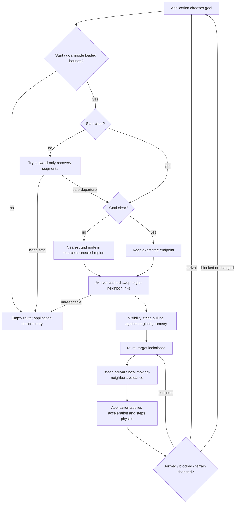

# Navigation and steering

`Kinetra::Simulation` provides body-aware path planning and local steering without SDL/OpenGL. Applications choose goals and when to retry.

## Table of contents

- [Planning and following](#planning-and-following)
- [Contracts](#contracts)
- [Weighted grids and priority steering](#weighted-grids-and-priority-steering)
- [Application policies](#application-policies)
- [Verification](#verification)

[Directory guide](README.md) · [Project overview](../../README.md) · [Documentation index](../README.md)

## Planning and following

A direct clear segment bypasses A*. Route calculation and following share the same swept-clearance predicate. Replanning and arrival decisions stay in the application.

## Contracts

| Interface | Responsibility |
| --- | --- |
| [Navigation](../../include/kinetra/navigation.h) | Configurable positive finite grid resolution and circular envelope; owns a snapshot of obstacle bodies |
| `rebuild(bounds, obstacles)` | Validates geometry, caches grid occupancy, swept neighbor links and connected-region labels |
| `path(start, goal)` | Returns waypoints excluding start; empty means failure; free endpoints retain exact coordinates |
| `clear(a,b)` | Swept-circle clearance against stored geometry; does not enforce navigation bounds |
| `route_target(position, route, navigation)` | Consumes visible intermediate waypoints and supplies corner lookahead |
| [steer](../../include/kinetra/steering.h) | Bounded acceleration with arrival, optional separation and predictive local avoidance |

The raster is limited to 262,144 cells. The default resolution is one world unit and clearance radius 0.85. Touching the clearance envelope is blocked. Disconnected free goals fail; occupied goals project within the source region. Starts inside the conservative margin may depart outward, but never cross a surface. Rebuild can allocate; it is not a transaction guarantee on allocation failure.

Pathfinding uses Euclidean heuristic and orthogonal/diagonal travel costs. Smoothing tests actual circle/rotated-box geometry, including corners. Moving obstacles are not continuously replanned automatically. Finite grids and conservative envelopes can reject physically passable gaps.

## Weighted grids and priority steering

`WeightedGrid` accepts positive finite rectangular cells and a bounded world, up to one million cells. `cell()` returns -1 outside the truncated full-cell envelope. `block()` changes topology; `weights()` atomically validates a full nonnegative finite cost array. Its eight-neighbor A* prevents blocked diagonal corner cuts and retains exact free endpoints. Unreachable or blocked endpoints return an empty path. Costs multiply physical edge length by one plus destination-cell weight; heuristic uses Euclidean distance. The caller supplies occupancy and retry policy. `borders()` returns axis-aligned edges of the free-cell union.

`priority_steer` accepts axis-aligned boxes and axis-aligned border segments. It returns border, overlap, predictive and seek forces plus capped acceleration. Border and immediate overlap forces take precedence, predictive avoidance is next, and seek/arrival is last. Arrival can be disabled at intermediate waypoints. Settings are explicit in caller-selected time units: defaults use 2 units/time and 0.6 units/time squared, eight prediction steps and a 1.025 safety multiplier. Caller-owned integration and clock must use consistent units. Neighbor spans exclude the agent. Coincident bodies receive a finite separating force. Unsupported rotated/circular bodies and invalid settings throw.

These supplement the existing APIs; `steer` and `Navigation` behavior remains compatible. See [ADR 0011](../decisions/0011-weighted-navigation-and-priority-steering.md) and [weighted navigation tests](../../tests/weighted_navigation_tests.cpp).

## Application policies

Applications own goal selection, replanning schedules, streamed obstacle residency and game-specific AI. Coordinate adapters and legacy graph representations belong to consumers rather than the engine.

## Verification

[Engine navigation tests](../../tests/navigation_tests.cpp) exercise configurable geometry, exact endpoints, projection, invalid settings and NaN goals. Implementation: [navigation.cpp](../../src/simulation/navigation.cpp), [steering.cpp](../../src/simulation/steering.cpp).

The additive `tangent_steer` function implements experimental tangent/spring local steering from i4sim. It returns bounded acceleration with explicit speed, force and horizon; callers retain integration and boundary/contact handling. It is not a collision-free velocity solver. Existing steering functions retain their defaults.
