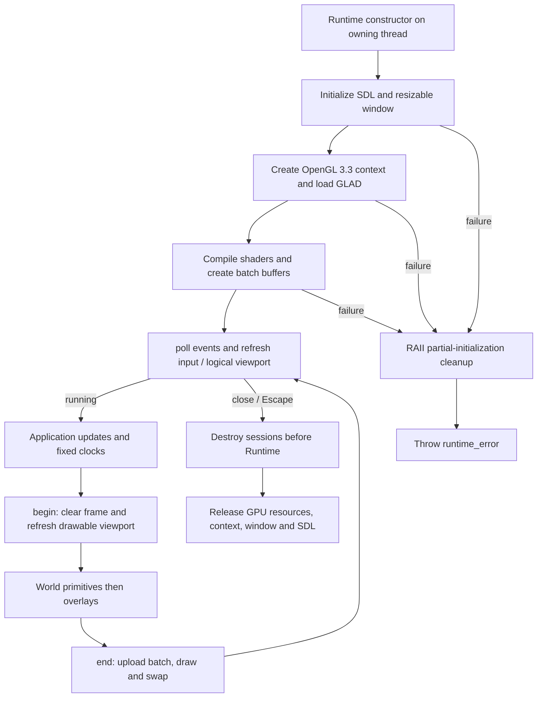

# Runtime and rendering

`Kinetra::Runtime` owns the SDL2/OpenGL backend and direct-session runner. Public headers contain no SDL, GLAD or raw OpenGL types.

## Table of contents

- [Lifecycle](#lifecycle)
- [Input and drawing](#input-and-drawing)
- [Sessions and timing](#sessions-and-timing)
- [External consumers](#external-consumers)
- [Verification and limits](#verification-and-limits)
- [Navigation](#navigation)

## Lifecycle



Only one Runtime can exist at a time. Construction, calls and destruction belong on its owning thread. Cleanup also handles failed initialization.

## Input and drawing

| Contract | Behavior |
| --- | --- |
| `poll()` | Updates held/pressed keys, mouse, held/clicked button and wheel; returns false on close/Escape |
| Focus loss | Clears held keyboard state |
| Camera viewport | Logical window pixels for picking; resize preserves center and zoom |
| OpenGL viewport | Drawable pixels, refreshed by `begin()` for high-DPI rendering |
| `circle`, `box`, `line` | Colored batched primitives between `begin` and `end` |
| Text / overlays | Header-only public helpers use primitive drawing and logical-pixel camera conversion |

Application renderers cull scene content before submitting primitives. Runtime triangulates circles and quads, uploads one dynamic vertex batch and draws/presents it. Primitive arguments must be finite with positive dimensions. GLAD and backend implementation remain in [runtime.cpp](../../src/engine/runtime.cpp) and generated `src/glad.c`.

## Sessions and timing

[Session](../../include/kinetra/session.h) provides `advance`, `render` and `title`. `run_session(runtime, session, frame_limit)` handles wall-clock elapsed time, event polling, updates, rendering and shutdown for a directly launched application. Zero frame limit means unlimited; negative limits throw.

Kinetra’s optional [SessionHost](launcher-overlays.md) manages registered factories and transitions. `run_launcher` owns the standard menu/session event loop; a custom launcher can drive the same host directly. Applications own pause/resume and `FixedClock` instances. FixedClock validates its step and caps backlog; excess stall time is dropped. Applications select their own update rates.

## External consumers

Headless integration is shown once in the [root README](../../README.md#using-kinetra). For runtime-only consumers, before adding Kinetra:

```cmake
set(KINETRA_BUILD_RUNTIME ON CACHE BOOL "" FORCE)
set(BUILD_TESTING OFF CACHE BOOL "" FORCE)
add_subdirectory(external/Kinetra)
target_link_libraries(my_app PRIVATE Kinetra::Simulation Kinetra::Runtime)
```

Source consumers use `add_subdirectory` and link the public targets; see the [README](../../README.md#using-kinetra).

Applications and the bundled launcher executable are built in [Kinetra-Lab](https://github.com/SMB-M87/Kinetra-Lab), which consumes a Kinetra source checkout. The core has no dependency on Lab.

## Verification and limits

[Runtime tests](../../tests/runtime_tests.cpp) cover window lifecycle, partial cleanup, resize, pixel output, camera transforms, focus, held/pressed input and quit. [External consumer fixture](../../tests/consumer/CMakeLists.txt) compile public simulation/runtime interfaces without any Lab source.

No texture system, pose interpolation, context sharing, multithreaded renderer or alternate backend is implemented. Software Mesa validates tested rendering contracts, not Artix desktop performance. See [development](../development.md) for commands.

## Navigation

[Directory guide](README.md) · [Project overview](../../README.md) · [Documentation index](../README.md)
