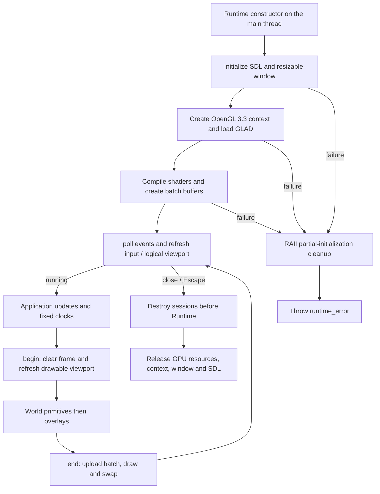

# Runtime and rendering

`Kinetra::Runtime` owns the SDL2/OpenGL backend and direct-session runner. Public headers contain no SDL, GLAD or raw OpenGL types.

## Table of contents

- [Lifecycle](#lifecycle)
- [Input and drawing](#input-and-drawing)
- [Sessions and timing](#sessions-and-timing)
- [External consumers](#external-consumers)
- [Verification and limits](#verification-and-limits)

[Project overview](../../README.md) · [Documentation index](../README.md)

## Lifecycle



Only one Runtime can exist at a time. Construction, calls and destruction belong on the main thread. Cleanup also handles failed initialization.

The constructor gives the window the Kinetra icon (64 px, generated by [make_icon.py](../../tools/README.md#make_iconpy)). A failure is logged, not thrown. SDL2 cannot set a window icon on native Wayland; desktops there take the icon from a `.desktop` file. WSLg draws its title bar itself, with its own icon for every window, and shows the application's icon in the Windows taskbar. On Windows, `kinetra_executable_icon(<target>)` from [KinetraIcon.cmake](../../cmake/KinetraIcon.cmake) also embeds the icon in the executable, so Explorer and shortcuts show it.

## Input and drawing

| Contract | Behavior |
| --- | --- |
| `poll(close_on_escape = true)` | Updates held/pressed keys (including left/right Ctrl), mouse, held/clicked button and wheel; returns false on close or optionally Escape |
| Focus loss | Releases held keys and mouse buttons, and sets `Input::focus_lost` for that poll |
| Camera viewport | Logical window pixels for picking; resize preserves center and zoom |
| OpenGL viewport | Drawable pixels, refreshed by `begin()` for high-DPI rendering |
| `circle`, `box`, `polygon`, `line` | Colored batched primitives between `begin` and `end` |
| `image` | A shared `RgbaImage` drawn in a world-space rectangle between `begin` and `end` |
| `read_back(true)`, `frame()` | Every following `end()` copies the frame it drew into `frame()` before presenting it: `FramePixels`, RGBA rows from the top left in drawable pixels, alpha 255. `frame()` throws until a frame was read back; `read_back(false)` releases it |
| Text / overlays | Bitmap text, the debug menu and the help panel are header-only; `SettingsOverlay` is compiled into Runtime. All draw primitives through logical-pixel camera conversion |

Application renderers cull scene content before submitting primitives. `polygon` accepts at least three finite convex ordered world-space vertices; the caller owns convexity validation. Runtime triangulates polygons, circles and quads into a dynamic vertex batch. An image draw flushes earlier shapes so that images, shapes and text blend in call order. `RgbaImage` takes top-down, straight-alpha RGBA bytes and stores premultiplied pixels for filtering around transparent edges. `Runtime` uploads the image on first use and reuses the most recent successful upload in its context. Circles adapt their segment count to drawable size (24–256 segments) and fade alpha across a one-pixel edge for antialiasing without multisample buffers. Adaptive VSync is requested, with standard VSync as fallback; when the platform refuses both, that is logged and the frame limiter takes over ([frame pacing](#sessions-and-timing)). **Read-back.** `end()` reads the frame after flushing the batch and before `SDL_GL_SwapWindow`, from the buffer it drew into: after the swap OpenGL leaves the back buffer undefined, and the front buffer of a composited window need not hold the frame either. Reading before the swap gives the same pixels offscreen and in a window, so tests and Kinetra-Lab's capture tool need no GLAD and no fallback between buffers. Each such frame waits for the GPU and copies the whole drawable, so it is off by default; it is for tests and for programs that render frames into files. SDL's offscreen driver keeps the surface of the window's first size, so after a window grows there, the part of the frame beyond that size is undefined. Repeated identical window titles are cached to avoid redundant window-manager requests. Primitive arguments must be finite with positive dimensions. GLAD and backend implementation remain in [runtime.cpp](../../src/runtime/runtime.cpp) and generated `src/glad.c`.

## Sessions and timing

A [Session](../../include/kinetra/runtime/session.h) provides `advance`, `render`, `title`, `request()` and `close_on_escape()`. `run_session(runtime, session, frame_limit)` measures wall-clock elapsed time, polls events, advances, and renders unless the session made a request; any request (`menu`, `configurations` or `exit`) ends the run. Zero frame limit means unlimited; negative limits throw. Hosting several applications, the request table and the launcher loop are in [launcher, sessions and overlays](launcher-overlays.md).

Applications own pause and resume and their `FixedClock` instances ([clock.h](../../include/kinetra/simulation/clock.h)), so each selects its own update rate. `FixedClock` validates its step and caps the backlog; time beyond the cap is dropped, which keeps input responsive after a stall. `RateCounter` turns counted frames or updates into a per-second rate for statistics displays.

**Interpolation.** A fixed clock runs a whole number of ticks per frame. At 60 frames per second and 200 ticks per second, that is three ticks one frame and four the next, so motion drawn straight from the simulation moves unevenly, and more so when frame times vary. `FixedClock::interpolation()` is the fraction of the next tick already accumulated. An application keeps each moving object's state before and after the last tick, and draws it at `lerp(before, after, interpolation())` (`lerp_angle` for angles, the shorter way around). The drawing then trails the simulation by less than one tick. Kinetra does not store poses itself: what moves, and what counts as a jump that must not be blended (a teleport, a respawn), is application knowledge.

**Frame times.** `Runtime::end()` records the wall-clock time since the previous `end()` in `frame_times()`, a `FrameTimes` ring of the last 240 frames. Because it is measured after the buffer swap, a frame that a blocking VSync, the driver or the compositor held back shows as a long frame. `draw_frame_times(runtime, times)` in [debug_view.h](../../include/kinetra/runtime/debug_view.h) draws them as a bar graph in the top-right corner of the window, with lines at one and two 60 Hz refreshes and the average and worst frame below. Kinetra-Lab shows it through a FRAME TIMES row in each application's settings panel. A program that renders frames into files calls `fix_frame_times(seconds)`: every frame then counts as `seconds`, the display refresh it stands for, instead of the time it took to draw, so the graph is the same in every run; `fix_frame_times(std::nullopt)` measures again. Kinetra-Lab's capture tool fixes 1/60 s.

The graph tells two kinds of stutter apart. Long frames mean the frame reached the screen late: the application, the driver or the compositor stalled. Even frames combined with uneven motion on screen point to presentation outside the application, such as a compositor that drops or repeats frames.

**Frame pacing.** `Runtime::pacing()` says what spaces the frames:

| `FramePacing` | When | Frames |
| --- | --- | --- |
| `vsync` | The platform accepted a swap interval | The swap waits for the display |
| `limited` | It refused both (WSLg); the default there | `end()` waits until one refresh interval after the previous frame |
| `uncapped` | After `limit_frames(false)` on such a platform | As fast as they are drawn |

Without a limit a loop in WSLg presents two to three frames per refresh of its 60 Hz compositor, which shows whichever is newest: the age of the shown frame then varies by up to a whole frame, and the loop competes with the compositor for the processor. The limiter (`FrameLimiter` in [timing.h](../../include/kinetra/view/timing.h)) advances its deadlines by exactly one `frame_interval()`, one over the refresh rate of the window's display and 1/60 s when SDL does not know it, so the average rate is exact. A frame more than one interval late starts a new series instead of a burst of short frames. The wait sleeps until 1.5 ms before the deadline and yields for the rest. It cannot lock to the compositor's phase: when the two clocks drift past each other, a frame is shown twice or skipped, which only real VSync avoids. `limit_frames(false)` is for comparing, and for a program that renders frames into files. `draw_frame_times` names the pacing below the graph.

## External consumers

Source consumers use `add_subdirectory` and link the public targets; headless integration is shown in the [root README](../../README.md#using-kinetra). Runtime consumers enable the runtime before adding Kinetra:

```cmake
set(KINETRA_BUILD_RUNTIME ON CACHE BOOL "" FORCE)
set(BUILD_TESTING OFF CACHE BOOL "" FORCE)
add_subdirectory(external/Kinetra)
target_link_libraries(my_app PRIVATE Kinetra::Simulation Kinetra::Runtime)
```

Applications and the bundled launcher executable are built in [Kinetra-Lab](https://github.com/SMB-M87/Kinetra-Lab), which consumes a Kinetra source checkout. The core has no dependency on Lab.

## Verification and limits

[Runtime tests](../../tests/runtime_tests.cpp) cover window lifecycle, partial cleanup, resize, pixel output and frame read-back, camera transforms, focus, held/pressed input and quit. [External consumer fixture](../../tests/consumer/CMakeLists.txt) compile public simulation/runtime interfaces without any Lab source.

Runtime uses one context and renders on the main thread. Its textured drawing takes caller-supplied RGBA images, and applications own the poses they interpolate. See [development](../development.md) for the software Mesa checks and desktop commands.

Input exposes independent `right_clicked` and `right_mouse_down` fields. The click edge clears on each poll; held buttons clear on release or focus loss.
