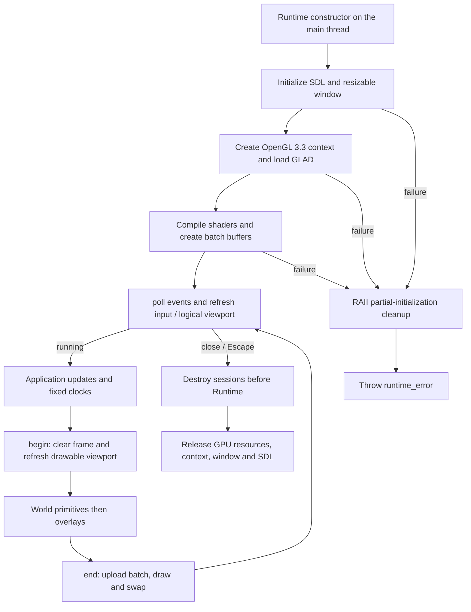

# Runtime and rendering

`Kinetra::Runtime` owns the SDL2/OpenGL backend and direct-session runner. Public headers contain no SDL, GLAD or raw OpenGL types.

## Table of contents

- [Lifecycle](#lifecycle)
- [Input and drawing](#input-and-drawing)
- [Sessions and timing](#sessions-and-timing)
- [External consumers](#external-consumers)
- [Verification and limits](#verification-and-limits)

[Directory guide](README.md) · [Project overview](../../README.md) · [Documentation index](../README.md)

## Lifecycle



Only one Runtime can exist at a time. Construction, calls and destruction belong on the main thread. Cleanup also handles failed initialization.

## Input and drawing

| Contract | Behavior |
| --- | --- |
| `poll(close_on_escape = true)` | Updates held/pressed keys (including left/right Ctrl), mouse, held/clicked button and wheel; returns false on close or optionally Escape |
| Focus loss | Clears held keyboard state |
| Camera viewport | Logical window pixels for picking; resize preserves center and zoom |
| OpenGL viewport | Drawable pixels, refreshed by `begin()` for high-DPI rendering |
| `circle`, `box`, `polygon`, `line` | Colored batched primitives between `begin` and `end` |
| Text / overlays | Header-only public helpers use primitive drawing and logical-pixel camera conversion |

Application renderers cull scene content before submitting primitives. `polygon` accepts at least three finite convex ordered world-space vertices; the caller owns convexity validation. Runtime triangulates polygons, circles and quads, uploads one dynamic vertex batch and draws/presents it. Circles adapt their segment count to drawable size (24–256 segments) and fade alpha across a one-pixel edge for antialiasing without multisample buffers. Adaptive VSync is requested, with standard VSync as fallback; unavailable synchronization is logged. Repeated identical window titles are cached to avoid redundant window-manager requests. Primitive arguments must be finite with positive dimensions. GLAD and backend implementation remain in [runtime.cpp](../../src/engine/runtime.cpp) and generated `src/glad.c`.

## Sessions and timing

A [Session](../../include/kinetra/session.h) provides `advance`, `render`, `title`, `request()` and `close_on_escape()`. `run_session(runtime, session, frame_limit)` measures wall-clock elapsed time, polls events, advances, and renders unless the session made a request; a `menu` or `exit` request ends the run. Zero frame limit means unlimited; negative limits throw. Hosting several applications, the request table and the launcher loop are in [launcher, sessions and overlays](launcher-overlays.md).

Applications own pause and resume and their `FixedClock` instances, so each selects its own update rate. `FixedClock` validates its step and caps the backlog; time beyond the cap is dropped, which keeps input responsive after a stall. `RateCounter` turns counted frames or updates into a per-second rate for statistics displays.

## External consumers

Headless integration is shown once in the [root README](../../README.md#using-kinetra). For runtime-only consumers, before adding Kinetra:

```cmake
set(KINETRA_BUILD_RUNTIME ON CACHE BOOL "" FORCE)
set(BUILD_TESTING OFF CACHE BOOL "" FORCE)
add_subdirectory(external/Kinetra)
target_link_libraries(my_app PRIVATE Kinetra::Simulation Kinetra::Runtime)
```

Source consumers use `add_subdirectory` and link the public targets; see the [README](../../README.md#using-kinetra).

Applications and the bundled launcher executable are built in [Kinetra-Lab](https://github.com/SMB-M87/Kinetra-Lab), which consumes a Kinetra source checkout. The core has no dependency on Lab.

## Verification and limits

[Runtime tests](../../tests/runtime_tests.cpp) cover window lifecycle, partial cleanup, resize, pixel output, camera transforms, focus, held/pressed input and quit. [External consumer fixture](../../tests/consumer/CMakeLists.txt) compile public simulation/runtime interfaces without any Lab source.

No texture system, pose interpolation, context sharing, multithreaded renderer or alternate backend is implemented. Software Mesa validates tested rendering contracts, not Artix desktop performance. See [development](../development.md) for commands.

Input exposes independent `right_clicked` and `right_mouse_down` fields. The click edge clears on each poll; held buttons clear on release or focus loss.
