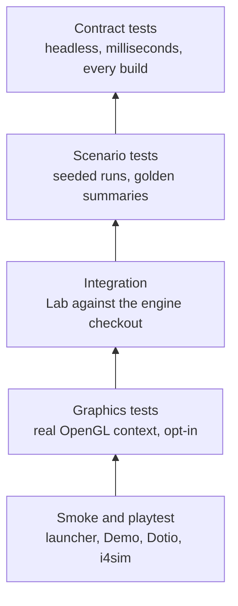

# Testing and verification

What to test, how to write tests, and which checks a change needs, locally and in CI. Build options, presets and graphics environments are described in [development](development.md).

## Table of contents

- [Test kinds](#test-kinds)
- [Rules for tests](#rules-for-tests)
- [Writing a doctest suite](#writing-a-doctest-suite)
- [Verification levels](#verification-levels)
- [Choosing targeted tests](#choosing-targeted-tests)
- [Continuous integration](#continuous-integration)
- [Reporting](#reporting)
- [Open points](#open-points)

[Directory guide](README.md) · [Project overview](../README.md) · [Documentation index](README.md) · [Agent rules](../AGENTS.md)

## Test kinds



The bottom of the pyramid runs on every build and catches most regressions. Each higher level is slower and runs when the change can affect it.

| Kind | Where | Proves |
| --- | --- | --- |
| Contract | `tests/*_tests.cpp` in Kinetra; `labs/*/tests` and `launcher/tests` in Lab | A public function or type honors its `///` contract, including edge cases and invalid input |
| Scenario | Application tests with a fixed seed | A whole simulation still behaves, checked through observable invariants or a golden summary |
| Consumer | `tests/consumer/` | Public headers and `Kinetra::` targets work for an outside project |
| Graphics | `KINETRA_TEST_GRAPHICS=ON`, CTest label `graphics` | Rendering, input adaptation and session transitions with a real context |
| Smoke / playtest | Manual or bounded `--frames` runs | Feel, visuals and performance, which software rendering cannot prove |

## Rules for tests

- Every behavior change comes with a test. A bug fix starts with a failing test that reproduces it.
- Test observable behavior and contracts, not internal counters. A test asserting `replan == 80` breaks on harmless refactors.
- Tests are deterministic: fixed seeds, fixed time steps, no wall-clock, no sleeps.
- One behavior per test case, named after the expected outcome. A failure must point to the broken behavior without a debugger.
- Keep default tests fast (seconds). Soak tests and benchmarks are registered separately or labelled, so they can be excluded.
- Never delete or weaken a test to make a change pass. If a test pins behavior that is intentionally changing, update it in the same commit and explain why in the design document.
- Characterization first: before refactoring code without tests, pin its current behavior.
- Test code follows the same conventions and warning rules as production code.

## Writing a doctest suite

New tests use [doctest](../third_party/doctest/README.md). [traffic_tests.cpp](../tests/traffic_tests.cpp) is the reference conversion of a former `main()` suite.

```cpp
#include <kinetra/traffic.h>

#include <doctest/doctest.h>

TEST_CASE("a new arrival does not preempt an existing grant") {
    kinetra::TrafficGate gate;
    // arrange, act ...
    CHECK(state.agent == 3u);              // continues on failure
    REQUIRE(state.waiting == 3u);          // stops this case on failure
    CHECK_THROWS_AS(gate.update(bad, {}), std::invalid_argument);
}
```

Register the executable with the helper from [KinetraTesting.cmake](../cmake/KinetraTesting.cmake). It links the shared `main()` and creates one CTest entry per case, named `<prefix>:<case name>`:

```cmake
kinetra_add_doctest(kinetra_traffic_tests PREFIX kinetra_traffic
    SOURCES tests/traffic_tests.cpp LIBRARIES Kinetra::Simulation)
```

To run one case:

```sh
ctest --preset dev -R 'kinetra_traffic:clear'   # or:
./build-dev/kinetra_traffic_tests --test-case='clear*'
```

- **Shared setup.** For setup that several cases need, use a small helper function (as `replay` does in the traffic tests) or doctest `SUBCASE`s. Do not use global mutable state.
- **Plain suites.** Every simulation suite is a doctest suite. Only the runtime-dependent launcher and graphics suites remain plain `main()` programs registered with `kinetra_add_test`.

## Verification levels

Choose the lowest level that covers every file in the diff (`git diff --name-only main...HEAD` plus uncommitted files). One file at a higher level lifts the whole change.

| Level | Trigger |
| --- | --- |
| **Docs** | Only Markdown, comments, skills, agent rules or tool documentation changed |
| **Targeted** | Source in one module changed; no public `include/kinetra/` header, no CMake, no new dependency |
| **Full** | Public header, CMake, dependency, more than one module, runtime/launcher behavior, or the final commit of a branch with code changes |

### Docs

```sh
python3 tools/check_docs.py                    # in Kinetra
python3 external/Kinetra/tools/check_docs.py   # in Kinetra-Lab
```

No configure, no build. This validates relative links, anchors and referenced files.

### Targeted

Reuse the `dev` build directory; it is configured once with `cmake --preset dev`.

```sh
cmake --build --preset dev --target <test targets>
ctest --preset dev -R '<module regex>'
```

### Full

Kinetra standalone:

```sh
cmake --workflow --preset ci
```

This is the same configuration as CI. For runtime or launcher changes, also run `cmake --workflow --preset graphics` and report the backend. For public header or target changes, also run the [external consumer](development.md#external-consumers).

Kinetra-Lab (engine plus applications), from the Lab root: `cmake --workflow --preset ci`, or `./build.sh`, which builds and tests Kinetra in `build-core` and Lab in `build`.

## Choosing targeted tests

| Changed area in Kinetra | Test targets / CTest regex |
| --- | --- |
| Math, shapes, collision, physics (`src/simulation/`) | `kinetra_behavior`, `kinetra_polygons`, `kinetra_sweeps`, `kinetra_translation_sweeps`, `kinetra_moving_contacts` |
| Navigation and weighted grids | `kinetra_navigation`, `kinetra_weighted_navigation` |
| Steering and avoidance | `kinetra_avoidance`, `kinetra_navigation` |
| Traffic admission | `kinetra_traffic` |
| Launcher menu and session host | `kinetra_launcher` (runtime build) |
| Runtime, rendering, text | Full level with graphics |

Lab keeps its own mapping in its [AGENTS.md](https://github.com/SMB-M87/Kinetra-Lab/blob/main/AGENTS.md).

## Continuous integration

[.github/workflows/ci.yml](../.github/workflows/ci.yml) runs on every pull request and every push to `main`. It uses a dated `archlinux:base-devel` image with packages from a fixed [Arch Linux Archive](https://archive.archlinux.org/) snapshot. The compiler, CMake and clang-format versions therefore match the Artix/Arch development environment, and they cannot change without a commit. Update the snapshot deliberately, in its own commit, and fix what the new toolchain reports in that commit.

| Step | Fails when |
| --- | --- |
| `clang-format --dry-run --Werror` on first-party sources | A file is not formatted |
| `python3 tools/check_docs.py` | A Markdown link or anchor is broken |
| `cmake --workflow --preset headless` | The simulation library or its tests need SDL2/OpenGL, or a headless test fails |
| `cmake --workflow --preset ci` | Kinetra has a compiler warning (`-Werror`), the build breaks, or a non-graphics test fails |
| External consumer with `CONSUMER_GRAPHICS=ON` | The public headers or targets no longer work for an outside project |

The workflow name `CI` and its job `checks` are a required status check on `main`, so they must keep these names. Graphics tests are compiled in CI but not run, because there is no GPU. The CI result does not replace the local graphics checks and playtests that the Full level requires for runtime changes.

## Reporting

Report each check as: command, result (passed / failed / not run), and the reason for anything not run. For graphics runs, also report the backend (desktop, Xvfb, SDL offscreen with software Mesa). Software rendering does not verify desktop feel or performance.

## Open points

- **Remaining plain suites.** Only the runtime-dependent launcher and graphics suites (`kinetra_launcher`, `kinetra_engine_graphics`) remain plain; they move to doctest in roadmap phase 3.
- **`kinetra_engine_graphics` fails under WSL2.** It fails with "Mouse input lost", both with SDL offscreen and with the WSLg display. Unchanged code shows the same result, so injected mouse events probably do not reach SDL (`sdl2-compat`) there. It needs a check on a real Linux desktop.
