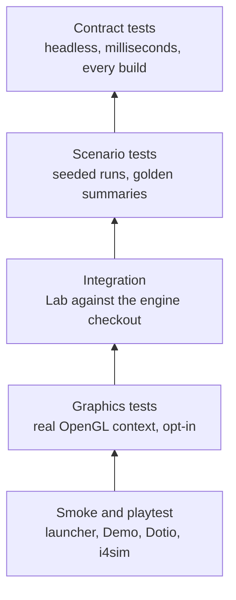

# Testing and verification

What to test, how to write tests, and which checks a change needs, locally and in CI. Build options, presets and graphics environments are described in [development](development.md).

## Table of contents

- [Test kinds](#test-kinds)
- [Rules for tests](#rules-for-tests)
- [Writing a doctest suite](#writing-a-doctest-suite)
- [Verification levels](#verification-levels)
- [Choosing targeted tests](#choosing-targeted-tests)
- [Continuous integration](#continuous-integration)
- [Reporting](#reporting)
- [Open points](#open-points)

[Project overview](../README.md) · [Documentation index](README.md) · [Agent rules](../AGENTS.md)

## Test kinds



The bottom of the pyramid runs on every build and catches most regressions. Each higher level is slower and runs when the change can affect it.

| Kind | Where | Proves |
| --- | --- | --- |
| Contract | `tests/*_tests.cpp` in Kinetra; `labs/*/tests` and `launcher/tests` in Lab | A public function or type honors its `///` contract, including edge cases and invalid input |
| Scenario | Application tests with a fixed seed | A whole simulation still behaves, checked through observable invariants or a golden summary |
| Consumer | `tests/consumer/` | Public headers and `Kinetra::` targets work for an outside project |
| Graphics | `KINETRA_TEST_GRAPHICS=ON`, CTest label `graphics` | Rendering, input adaptation and session transitions with a real context |
| Smoke / playtest | Manual or bounded `--frames` runs | Feel, visuals and performance, which software rendering cannot prove |

## Rules for tests

- Cover every affected scenario described in the [test plan](workflow.md#3-test-plan). Reuse existing tests that assert the relevant outcome and add focused cases for new behavior and for existing behavior at risk. Exercise the normal entry point where a new interaction could be wired incorrectly. A bug fix starts with a failing test that reproduces it.
- Show that the new critical cases detect a failure. Run them on the old behavior when possible, or temporarily remove or reverse the relevant condition and verify that each case fails on its intended assertion. Restore the intended implementation and rerun the affected tests. Record the case, the failure and the passing result in **Verification**.
- Every branch a contract names, such as a priority, an order, a restart condition or a rounding margin, gets a constructed case that fails when that branch alone is flipped or removed. Build the case so that no other branch or rule gives the same answer, and check it by mutation: change the branch, see the case fail, restore it. A random scene rarely reaches the branch.
  *Why:* #51's steering slack decided only within the float error of an extent, which random scenes never reach, and #68's priority case passed with the comparison flipped. The same gap came back in Kinetra-Lab#149 (the order of the end reasons, the retry wait after a new goal) and in #72, whose restart case passed with the goal rule removed because another rule ended the episode too. It was a review lesson from #51 and #68; the user made it a rule on 2026-11-27.
- Test observable behavior and contracts, not internal counters. A test asserting `replan == 80` breaks on harmless refactors.
- Tests are deterministic: fixed seeds, fixed time steps, no wall-clock, no sleeps.
- One behavior per test case, named after the expected outcome. A failure must point to the broken behavior without a debugger.
- Keep default tests fast (seconds). Soak tests and benchmarks are registered separately or labelled, so they can be excluded.
- Never delete or weaken a test to make a change pass. If a test pins behavior that is intentionally changing, update it in the same commit and explain why in the design document.
- Characterization first: before refactoring code without tests, pin its current behavior.
- Test code follows the same conventions and warning rules as production code.

## Writing a doctest suite

New tests use [doctest](../third_party/doctest/README.md). [traffic_tests.cpp](../tests/traffic_tests.cpp) is the reference suite.

```cpp
#include <kinetra/simulation/traffic.h>

#include <doctest/doctest.h>

TEST_CASE("a new arrival does not preempt an existing grant") {
    kinetra::TrafficGate gate;
    // arrange, act ...
    CHECK(state.agent == 3u);              // continues on failure
    REQUIRE(state.waiting == 3u);          // stops this case on failure
    CHECK_THROWS_AS(gate.update(bad, {}), std::invalid_argument);
}
```

Register the executable with the helper from [KinetraTesting.cmake](../cmake/KinetraTesting.cmake). It links the shared `main()` and creates one CTest entry per case, named `<prefix>:<case name>`:

```cmake
kinetra_add_doctest(kinetra_traffic_tests PREFIX kinetra_traffic
    SOURCES tests/traffic_tests.cpp LIBRARIES Kinetra::Simulation)
```

To run one case:

```sh
ctest --preset dev -R 'kinetra_traffic:clear'   # or:
./build-dev/kinetra_traffic_tests --test-case='clear*'
```

- **Shared setup.** For setup that several cases need, use a small helper function (as `replay` does in the traffic tests) or doctest `SUBCASE`s. Do not use global mutable state.
- **Labels and timeouts.** Every case gets the label `unit`; pass `LABELS graphics` for cases that need a window (the `dev` and `release` test presets exclude them; `graphics` and `ci` run them with software OpenGL) and `TIMEOUT <seconds>` for long cases. `kinetra_add_test` remains for a program that cannot use doctest; no Kinetra suite needs it.

## Verification levels

Choose the lowest level that covers every file in the diff against the actual pull request base (`git diff --name-only <base>...HEAD` plus uncommitted files). For a stacked step, include scenarios affected by changes in its relevant dependencies. One file at a higher level lifts the whole change.

| Level | Trigger |
| --- | --- |
| **Docs** | Only Markdown, comments, skills, agent rules or tool documentation changed |
| **Targeted** | Source in one module changed; no public `include/kinetra/` header, no CMake, no new dependency |
| **Full** | Public header, CMake, dependency, more than one module, runtime/launcher behavior, or the final commit of a branch with code changes |

### Docs

```sh
python3 tools/check_docs.py                    # in Kinetra
python3 external/Kinetra/tools/check_docs.py   # in Kinetra-Lab
```

No configure, no build. This validates relative links, anchors and referenced files.

### Targeted

Reuse the `dev` build directory; it is configured once with `cmake --preset dev`.

```sh
cmake --build --preset dev --target <test targets>
ctest --preset dev -R '<module regex>'
```

### Full

The pull request's CI is the Full level. Locally, an agent or developer runs only what makes the push worth CI's time.

**Locally**, before pushing: the [targeted](#targeted) builds and tests of every changed area, so CI does not become the compile loop. For runtime, launcher or presentation changes, the graphics cases of the changed area are quick feedback and optional, in seconds with the same backend as CI:

```sh
cmake --preset graphics && cmake --build --preset graphics --target <targets>
ctest --preset graphics -L graphics -R '<regex>'
```

When a change alters what a scene shows, the author also takes a screenshot of it with Lab's [capture tool](https://github.com/SMB-M87/Kinetra-Lab/blob/main/tools/capture/README.md), inspects the result and adds it to the pull request. The captures it makes stale are refreshed in the same pull request ([rule](../AGENTS.md#repository-documentation)).

**In CI**, on each pull request update, Ubuntu 24.04 LTS runs formatting, documentation links, the icon check, `headless` (builds without SDL2 and OpenGL), `ci` (warnings as errors, then every test, the graphics cases included, with SDL's offscreen driver and software Mesa), the [external consumer](development.md#external-consumers) and, in Lab, the smoke runs of every executable (`kinetra_smoke:*`, label `graphics`) and the native Windows build. A change is verified when the pull request's checks are green; until then, report it as pushed, not verified.

**Neither** proves desktop feel, a real GPU driver or performance: software rendering cannot. When a change depends on them, its design document names a playtest by the user as a check, which follows the merge.

*Why:* running `ci` and `headless` locally repeated exactly what the pipeline runs on every pull request update. The graphics run was the last check only a local machine did; since 2026-11-22 CI runs it on the same backend that local runs and cloud sessions use, so a local run only repeats it. Run `ci`, `headless`, `graphics` or `windows` locally only to reproduce a CI failure.

## Choosing targeted tests

| Changed area in Kinetra | Build targets | CTest regex |
| --- | --- | --- |
| Math, shapes, collision, physics (`physics.cpp`, `spatial_grid.cpp`, `collision_grid.cpp`) | `kinetra_tests kinetra_polygon_tests kinetra_sweep_tests kinetra_translation_sweep_tests kinetra_moving_contact_tests kinetra_contact_response_tests` | `^kinetra_(behavior\|polygons\|sweeps\|translation_sweeps\|moving_contacts\|contact_response)` |
| Navigation and weighted grids (`navigation.cpp`, `weighted_grid.cpp`) | `kinetra_navigation_tests kinetra_weighted_navigation_tests` | `^kinetra_(navigation\|weighted_navigation)` |
| Steering (`steering.cpp`, `priority_steering.cpp`) | `kinetra_tests kinetra_weighted_navigation_tests` | `^kinetra_(behavior\|weighted_navigation)` |
| Passing (`passing.cpp`, `passing_coordinator.cpp`) | `kinetra_weighted_navigation_tests kinetra_passing_coordinator_tests` | `^kinetra_(weighted_navigation\|passing_coordinator)` |
| Stall detection (`stall_detector.cpp`) | `kinetra_stall_detector_tests` | `^kinetra_stall_detector` |
| Avoidance (`avoidance.cpp`) | `kinetra_avoidance_tests` | `^kinetra_avoidance` |
| Traffic admission (`traffic.cpp`) | `kinetra_traffic_tests` | `^kinetra_traffic` |
| Runtime and launcher (`src/runtime/`) | Full level; locally, as quick feedback, `kinetra_engine_runtime_tests` in the `graphics` preset | `^kinetra_engine_graphics` (`ctest --preset graphics`) |

Runtime and launcher behavior is always Full level. While iterating on `settings_view.cpp` or `launcher.cpp`, the window-free suites `kinetra_settings_view` and `kinetra_launcher` give quick feedback in the `dev` build. The header-only helpers (`bitmap_text.h`, `camera.h`, `clock.h`, `timing.h`, `debug_view.h`, `help_view.h`) are public headers, so changing them is Full level; their window-free cases are in `kinetra_presentation` and `kinetra_behavior`. Build target and CTest prefix differ for some suites; the [test map](../tests/README.md#test-map) lists both.

Lab keeps its own mapping in its [AGENTS.md](https://github.com/SMB-M87/Kinetra-Lab/blob/main/AGENTS.md).

## Continuous integration

[.github/workflows/ci.yml](../.github/workflows/ci.yml) validates pull requests. The `linux` job runs in an Ubuntu 24.04 LTS container with the distribution's GCC, CMake, glibc and SDL2. It reports tool paths and versions and installs the build dependencies from the Ubuntu package archive. Ubuntu is the Linux reference for warnings and tests. A virtual environment installs clang-format from PyPI at the version pinned by `CLANG_FORMAT_VERSION`. Keep that version synchronized across both CI workflows and Kinetra's [cloud setup](../tools/README.md#cloud_setupsh).

| Step | Runs in | Fails when |
| --- | --- | --- |
| `clang-format --dry-run --Werror` on first-party sources | `linux` | A file is not formatted |
| `python3 tools/check_docs.py` | `linux`, or `changes` when it skips the build | A Markdown link or anchor is broken |
| `python3 tools/make_icon.py --check` | `linux` | An icon file does not match its generator |
| `cmake --workflow --preset headless` | `linux` | The simulation library or its tests need SDL2/OpenGL, or a headless test fails |
| `cmake --workflow --preset ci` | `linux` | A compiler warning, build failure or test failure, including the offscreen graphics cases |
| External consumer with `CONSUMER_GRAPHICS=ON` | `linux` | The public headers or targets no longer work for an outside project |

The required status `CI / checks` passes after the Linux job succeeds. For a pull request that changes only Markdown, `docs/` or `.agents/`, the `changes` job skips the Linux build, runs the docs check and supplies the result. Other changes and uncertain comparisons run the full build. The `ci` test preset sets `SDL_VIDEODRIVER=offscreen` and `LIBGL_ALWAYS_SOFTWARE=1`. Mesa's llvmpipe runs the graphics cases on the runner's CPU. Use a desktop playtest to evaluate interaction and performance.

Every job of `ci.yml` has a time limit (`timeout-minutes`), and so does each install step: 15 minutes for the apt install, 5 for the formatter install, 45 for a `linux` run, 10 for `changes` and `checks`, well above their usual duration; the Ubuntu step's 15 minutes also hold the mirror's 90 seconds and the fallback's install. A stalled download or a hung test then fails the run within minutes instead of after GitHub's default of six hours; re-run the job once the cause has passed. Inside the Ubuntu install step, the mirror's index update and package downloads (`apt-get install --download-only`, which runs no dpkg) have 90 seconds of the 15 minutes (`timeout`), where they took about ten seconds in the runs [measured](design/2026-11-26-ci-image-measurement.md#problem) on 2026-11-26, so a mirror that does not answer, or stalls a download, leaves the fallback time to install; the install from the downloaded packages gets no `timeout`, because a killed `apt-get install` can leave dpkg half-configured. Kinetra-Lab's [ci.yml](https://github.com/SMB-M87/Kinetra-Lab/blob/main/.github/workflows/ci.yml) and [release.yml](https://github.com/SMB-M87/Kinetra-Lab/blob/main/.github/workflows/release.yml) set limits for their own jobs and install steps.

The [Lab pointer workflow](../.github/workflows/lab-pointer.yml) synchronizes Kinetra-Lab after each merge to `main`, with an hourly catch-up. It opens a pointer-only Lab pull request and turns on auto-merge. Pull requests that change the workflow run a dry run. [Pointer tool](../tools/README.md#lab_pointersh)

## Reporting

Report each check as: command, result (passed / failed / not run), and the reason for anything not run. For graphics runs, also report the backend (desktop, Xvfb, SDL offscreen with software Mesa). Software rendering does not verify desktop feel or performance.

## Open points

- **`kinetra_engine_graphics` under WSL2, after the wheel fix.** Its first case failed under WSL2 at the injected mouse-input check. CI's Arch image failed the same check for a known reason: `sdl2-compat` returns an injected wheel event without its `wheel.y`, and the runtime now reads `wheel.preciseY` ([graphics tests in CI](design/2026-11-22-graphics-tests-in-ci.md)). WSL2 probably had the same cause, but no run there has confirmed it. It needs a run of `cmake --workflow --preset graphics` by the user under WSL2.
