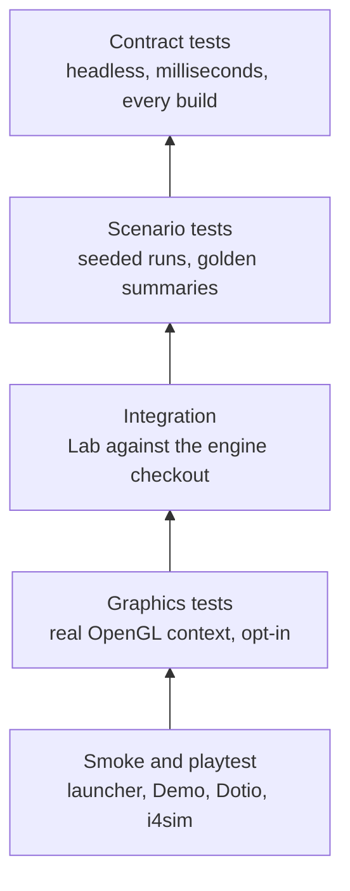

# Testing and verification

What to test, how tests are organized, and which checks to run for a given change. Build options and graphics environments are described in [development](development.md).

## Table of contents

- [Test kinds](#test-kinds)
- [Rules for tests](#rules-for-tests)
- [Verification levels](#verification-levels)
- [Choosing targeted tests](#choosing-targeted-tests)
- [Reporting](#reporting)
- [Open points](#open-points)

[Directory guide](README.md) · [Project overview](../README.md) · [Documentation index](README.md) · [Agent rules](../AGENTS.md)

## Test kinds



The bottom of the pyramid runs on every build and catches most regressions. Each higher level is slower and runs when the change can affect it.

| Kind | Where | Proves |
| --- | --- | --- |
| Contract | `tests/*_tests.cpp` in Kinetra; `labs/*/tests` and `launcher/tests` in Lab | A public function or type honors its `///` contract, including edge cases and invalid input |
| Scenario | Application tests with a fixed seed | A whole simulation still behaves, checked through observable invariants or a golden summary |
| Consumer | `tests/consumer/` | Public headers and `Kinetra::` targets work for an outside project |
| Graphics | `KINETRA_TEST_GRAPHICS=ON` | Rendering, input adaptation and session transitions with a real context |
| Smoke / playtest | Manual or bounded `--frames` runs | Feel, visuals and performance, which software rendering cannot prove |

## Rules for tests

- Every behavior change comes with a test. A bug fix starts with a failing test that reproduces it.
- Test observable behavior and contracts, not internal counters. A test asserting `replan == 80` breaks on harmless refactors.
- Tests are deterministic: fixed seeds, fixed time steps, no wall-clock, no sleeps.
- One behavior per test case, with a name that says what is expected. A failure must point to the broken behavior without a debugger.
- Keep default tests fast (seconds). Soak tests and benchmarks are registered separately or labelled, so they can be excluded.
- Never delete or weaken a test to make a change pass. If a test pins behavior that is intentionally changing, update it in the same commit and explain why in the design document.
- Characterization first: before refactoring code without tests, pin its current behavior.

Tests are currently plain `main()` programs with local `require` helpers. The planned migration to a vendored [doctest](https://github.com/doctest/doctest) gives named cases and per-case CTest selection; see the Lab quality roadmap. Until then, follow the style of the file you are editing.

## Verification levels

Choose the lowest level that covers every file in the diff (`git diff --name-only main...HEAD` plus uncommitted files). One file at a higher level lifts the whole change.

| Level | Trigger |
| --- | --- |
| **Docs** | Only Markdown, comments, skills, agent rules or tool documentation changed |
| **Targeted** | Source in one module changed; no public `include/kinetra/` header, no CMake, no new dependency |
| **Full** | Public header, CMake, dependency, more than one module, runtime/launcher behavior, or the final commit of a branch with code changes |

### Docs

```sh
python3 tools/check_docs.py            # in Kinetra
python3 external/Kinetra/tools/check_docs.py   # in Kinetra-Lab
```

No configure, no build. This validates relative links, anchors and referenced files.

### Targeted

Reuse the existing build directory. Configure only if it does not exist yet.

```sh
cmake --build build --target <test targets> -j2
ctest --test-dir build -R '<module regex>' --output-on-failure
```

### Full

Kinetra standalone:

```sh
cmake -S . -B build -DCMAKE_BUILD_TYPE=Release
cmake --build build -j2
ctest --test-dir build --output-on-failure
```

For runtime or launcher changes, also run the [graphics checks](development.md#graphics-execution). For public header or target changes, also run the [external consumer](development.md#external-consumers).

Kinetra-Lab (engine plus applications), from the Lab root: `./build.sh`. It builds and tests Kinetra in `build-core` and Lab in `build`.

## Choosing targeted tests

| Changed area in Kinetra | Test targets / CTest regex |
| --- | --- |
| Math, shapes, collision, physics (`src/simulation/`) | `kinetra_behavior`, `kinetra_polygons`, `kinetra_sweeps`, `kinetra_translation_sweeps`, `kinetra_moving_contacts` |
| Navigation and weighted grids | `kinetra_navigation`, `kinetra_weighted_navigation` |
| Steering and avoidance | `kinetra_avoidance`, `kinetra_navigation` |
| Traffic admission | `kinetra_traffic` |
| Launcher menu and session host | `kinetra_launcher` (runtime build) |
| Runtime, rendering, text | Full level with graphics |

Lab keeps its own mapping in its [AGENTS.md](https://github.com/SMB-M87/Kinetra-Lab/blob/main/AGENTS.md).

## Reporting

Report each check as: command, result (passed / failed / not run), and the reason for anything not run. For graphics runs, also report the backend used (desktop, Xvfb, SDL offscreen with software Mesa). Software rendering does not verify desktop feel or performance.

## Open points

- The doctest migration and the CI workflow per pull request are planned in the Lab quality roadmap.
- CTest labels (`unit`, `scenario`, `soak`, `graphics`) would make level selection simpler than regexes.
