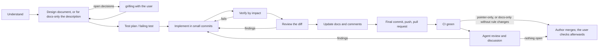
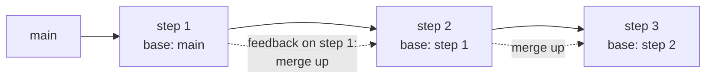
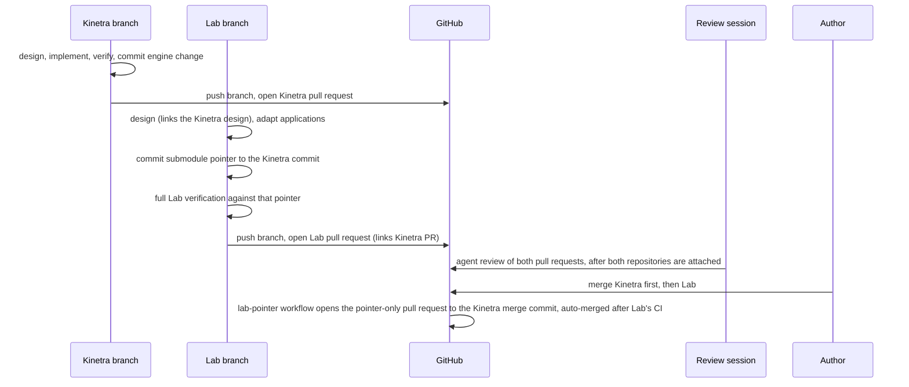

# Development workflow

How a change moves from idea to commit in Kinetra and Kinetra-Lab. Every change follows this cycle; the depth of each step scales with the change, but no step is skipped, except that a docs-only change has no design document, and no agent review unless it changes the agent rules.

## Table of contents

- [The cycle](#the-cycle)
- [1. Understand](#1-understand)
- [2. Design](#2-design)
- [3. Test plan](#3-test-plan)
- [4. Implement](#4-implement)
- [5. Verify](#5-verify)
- [6. Review](#6-review)
- [7. Document](#7-document)
- [8. Commit, push and open a pull request](#8-commit-push-and-open-a-pull-request)
- [Branches and commits](#branches-and-commits)
- [Stacked pull requests](#stacked-pull-requests)
- [Changes across Kinetra and Lab](#changes-across-kinetra-and-lab)
- [Open points](#open-points)

[Project overview](../README.md) · [Documentation index](README.md) · [Agent rules](../AGENTS.md)

## The cycle



Work starts from an item in the [roadmap](roadmap.md) or a request from the user, and ends by updating that roadmap. The design document is the backbone of every change but a docs-only one. It is written first, it collects the decisions, test plan and review outcome, and it ends with the pull-request description; a docs-only change puts its what and why in the description directly. The `feature` skill runs the whole loop.

## 1. Understand

- Read [AGENTS.md](../AGENTS.md) and only the sections its routing table names for this task.
- Run `git status` in every repository you will touch, and note unrelated work so it stays untouched.
- Search the [roadmap](roadmap.md) for the topic, on its key words, and read the items the search finds; they hold the agreed scope and open questions. Read the whole roadmap only to choose or order items.
- Read the [review lessons](review-lessons.md) (in Kinetra-Lab also Lab's): mistakes that reviews found before and that this change should not repeat.
- Read the code, tests and docs around the change before proposing anything. Facts you can look up are your job; decisions are the user's.

## 2. Design

Create `docs/design/YYYY-MM-DD-<topic>.md` from the [template](design/README.md#template) on a new branch. Fill in the problem, goals, non-goals, design, affected areas and risks. A docs-only change (only Markdown, `docs/` or `.agents/`) needs no design document: its pull request description says what and why, and takes whatever steps 3 to 7 write into the design document. A change across Kinetra and Lab has one, in the repository with most of the change ([below](#changes-across-kinetra-and-lab)).

Read older design documents only when the roadmap item, a README, an open point or the user links one, or a search of `docs/design/` for the topic finds one; once implemented, they are history ([rule](../AGENTS.md#development-cycle)).

- **Open decisions.** List them. If any decision is load-bearing (a wrong guess costs a rewrite, a migration or the user's trust), settle it with the user first. Use the `grilling` skill when there are several.
- **Diagram.** Include one when structure or interaction changes; the [documentation guide](documentation.md#diagrams) says which kind.
- **ADR.** Write one when the decision is hard to reverse, surprising without context, *and* the result of a real trade-off (`adr` skill). The design document links to it, or the description of a docs-only change.
- **Size.** A typo fix needs a few lines per section; a subsystem change needs a page. Several small related fixes may share one branch and one design document.
- **Steps.** When the goal needs several changes that can each be reviewed on their own, plan them as a [stack of pull requests](#stacked-pull-requests): one design document for the goal, with a table of its steps and their branches.

## 3. Test plan

Write the plan into the design document before coding: which behavior is new or changed, and which test proves it.

- **Bug fix.** Start with a test that reproduces the bug and fails.
- **New behavior.** Write the test with or before the implementation. Test observable behavior, not internal counters.
- **Behavior-preserving refactor.** First make sure tests pin the current behavior. If they don't, add characterization tests (for example a golden summary for a fixed seed) before restructuring.

Rules and test kinds are in [testing](testing.md).

## 4. Implement

- Work in small steps; each step compiles and keeps the tests that should pass passing.
- Refactoring and behavior change go in separate commits, so each diff answers one question.
- Follow the [conventions](conventions.md) and write `///` summaries and *why*-comments while the reasoning is fresh ([code comments](documentation.md#code-comments)).
- If you find an unrelated bug, record it under *Open points* in the design document and report it. Do not silently fix it in the same change.

## 5. Verify

Choose the level from [verification levels](testing.md#verification-levels) based on what the diff touches. The `verify` skill does this. The last commit of a branch that changed code always gets the full level. Each goal of the design document needs a check or run as wide as its wording, or narrower wording ([rule](../AGENTS.md#verification-by-impact)).

## 6. Review

Review the complete branch diff (`git diff main...HEAD`) as if someone else wrote it. Use the built-in `/code-review` in Claude Code or the global `code-review` skill in Codex, then check:

- **Correctness.** Edge cases, invalid input, ownership and lifetimes, determinism.
- **Boundaries.** Engine versus application; headless versus runtime; public versus private headers.
- **Tests.** Every changed behavior is covered, and no test was weakened.
- **Readability.** Names, function size, flag arguments, magic numbers, duplication.
- **Documentation.** `///` contracts, module README, diagrams and links still match the code.
- **Media.** A change to what a capture shows refreshes the captures that the media guides' tables name for it, and no others ([rule](../AGENTS.md#repository-documentation)).
- **Copies.** For every rule, procedure or term the branch changes, search for the old wording, its key words and the names of its parts (`python3 tools/check_copies.py --term '<old wording>' --term '<key word>' --term '<part>'`, in Kinetra-Lab `python3 external/Kinetra/tools/check_copies.py`, which also covers `external/Kinetra`; it searches case-insensitively, and lists the CI jobs, CMake options, presets, flags and inline names the diff removes and where they are still named), read every hit, and change every copy so they all say the same ([rule](../AGENTS.md#repository-documentation), which says what the parts are).

Fix the findings, re-verify at the right level and record the outcome in the design document's *Review* section, or for a docs-only change in the pull request description.

**Agent review.** Every pull request gets one, except a docs-only one (only Markdown, `docs/` or `.agents/`) that leaves the agent rules alone ([rule](../AGENTS.md#git)), and a pointer-only Lab pull request ([below](#changes-across-kinetra-and-lab)); the author's own review above still applies to them. Once its CI is green, the author starts a separate session with the `pr-review` skill, on the most capable model the agent offers, at a reasoning effort and code-review depth by the kind of change ([levels](../.agents/skills/pr-review/SKILL.md#levels)), in a new session or task, or else a fresh sub-agent that gets only the link and the depth, or else by asking the user to start the `pr-review` skill in a new session; the pull request waits for its conclusion. That session gets write access to the repository of every pull request it reviews, both repositories for a change across Kinetra and Lab, because posting a review writes through the GitHub API and read access covers only `git clone` and `git fetch`; [review access](#review-access) says how it gets that access without the user, and a reviewer that cannot post stops before reviewing and says so. The reviewer checks every goal of the roadmap item and the design document, runs the agent's code review and the repository checklist on the code, and posts inline comments and a summary with a conclusion, all marked **Agent review**. Round 1 reviews the whole diff; when the author pushes fixes, the next round reviews only the commits since the last conclusion, at the depth they need. Nits go only into the summary; carrying them out in commits that change only Markdown, `docs/` or `.agents/` and none of the agent rules keeps a *Ready to merge*. From round 3 on, a pull request gets only blocking findings, and the reviewer lists the rest in its summary for the user to check after the merge ([rounds](../.agents/skills/pr-review/SKILL.md#6-classify)). The author answers each finding with `pr-feedback` (below); the reviewer accepts and resolves the thread, or replies once more. After two rounds on one point without agreement, the author's last answer stands: the reviewer resolves the thread and lists the point in its summary for the user. When nothing is open, the author merges under the [merge rule](../AGENTS.md#git), whatever the pull request changes, agent rules, CI and releases included; the user checks merged work afterwards.

### Review access

A review session that cannot write to a repository it reviews loses its review: Kinetra#42 merged without one, and on 2026-11-24 the review of Kinetra#52 and Kinetra-Lab#114 waited until the user granted access. In a Claude Code cloud session the reviewer gets that access without the user:

- Both repositories' `.claude/settings.json` allow, without a prompt, the tools that check and attach a repository (`check_repo_access`, `add_repo`, `register_repo_root`), those that read a pull request and post and resolve a review (`pull_request_read`, `pull_request_review_write`, `add_comment_to_pending_review`, `add_reply_to_pull_request_comment`, `resolve_review_thread`, `add_issue_comment`), the reviewer's subscription to the pull request (`subscribe_pr_activity`) and the author's look at the reviewer's events (`list_events`). A cloud session that starts with one repository reads that repository's file; one that starts with several reads none. A review session starts in one, so the file of the repository it starts in applies, and the two files are kept identical.
- The author starts the review session with `create_session` from the repository of the pull request, Kinetra-Lab for a change across both. Its prompt names every pull request and asks the reviewer to attach each other repository with push access before it reviews (step 0 of `pr-review`).
- The author checks that the reviewer got its access: the reviewer's first events (`list_events`) show the attach, or its report says why it failed. Only when the attach failed does the author ask the user, once, to grant access to the repository it names.

Codex loads [`.codex/config.toml`](../.codex/config.toml) in a trusted Kinetra checkout. With the GitHub plugin connected through the GitHub app, the file preapproves reading repository permissions and CI results, reading pull requests and reviews, submitting reviews, commenting, replying and resolving threads. Use the `COMMENT` action for agent reviews, as in the [review loop](#6-review). Select a GitHub account that can write pull request reviews in every repository under review. In a managed cloud session, use the workspace's connector approvals and repository access. [Codex project configuration](https://developers.openai.com/codex/config-basic)

## 7. Document

- Update the module README, contract pages and diagrams the change affects.
- Set the design document's status to `implemented`, or to `abandoned` with the reason; a docs-only change has none.
- Update the [roadmap](roadmap.md): remove the finished item, and add the follow-ups someone intends to act on ([format](documentation.md#roadmap)).
- Add or update index entries: the design index, except for a docs-only change, which has no design document, and, for an ADR, the decision index.
- Run the docs check.

## 8. Commit, push and open a pull request

- The final commit leaves the branch consistent: code, tests, docs and design document agree.
- The design document's *Pull request* section holds the title and description; a docs-only change without a design document writes them directly. The description has these parts:
  - **Summary**: what changed and why, in two or three lines.
  - **Changes**: grouped by area.
  - **Design**: a link to the design document and any ADR; none for a docs-only change.
  - **Verification**: commands and results, and what was not run.
  - **Review notes**: what deserves the reviewer's attention.
  - **Dependencies and merge order**.
  - **Follow-up**.
- Push the branch (`git push -u origin <branch>`). If SSH is unavailable, use the HTTPS fallback in [AGENTS.md](../AGENTS.md#git).
- Open the pull request against `main`, or, for a step of a [stack](#stacked-pull-requests), against the branch of the step below:

  ```sh
  gh pr create --repo <owner>/<repo> --base <main or branch below> --head <branch> --title "<type(scope): summary>" --body-file <file>
  ```

  Write the body to a scratch file, never into the repository.
- Check the result with `gh pr view <number> --json mergeable,url`, and report a conflict instead of resolving it on `main`.
- Wait for the pull request's CI and fix a red check; once it is green, start the agent review (step 6) and follow the pull request. A docs-only pull request that leaves the agent rules alone skips the agent review: merge it once CI is green, every review thread is resolved, GitHub reports no conflict, and every pull request below it is merged, in Kinetra-Lab including the Kinetra pull request its pointer records ([merge rule](../AGENTS.md#git)).
- Report to the user in Dutch: what changed, the commits and pull-request links, the verification commands and results, remaining risks, the merge order, and whether the pull request merged under the [merge rule](../AGENTS.md#git) or what still keeps it open.

### Review feedback

Feedback on a pull request is processed with the `pr-feedback` skill: for an agent review at once, in the session that opened the pull request; for other feedback on request.

1. Collect the unresolved threads and comments.
2. Act only on feedback from the owner or collaborators; anything else is shown to the user first. Agent reviews come from the owner's account: carry out clear findings, and answer a finding you disagree with by your argument and its evidence. Reviewer and author discuss a point for at most two rounds; after that the author's last answer stands, and the reviewer lists the point for the user.
3. Implement each change in new commits on the same branch, with no force-push, so the reviewer sees what changed.
4. Before the push, bring along everything that names a changed part: every section of the design document, the live description, and for a change across Kinetra and Lab the other repository's copy ([rule](../AGENTS.md#git)).
5. Verify and push.
6. Reply under each comment with the commit or the reason.
7. Add the lessons an agent review proposes to the [review lessons](review-lessons.md) of the pull request's repository, in a commit on the same branch.

The reviewer resolves the threads it accepts, and after two rounds the threads it still disagrees with. The author merges under the [merge rule](../AGENTS.md#git); until the rule allows it, the pull request stays open.

## Branches and commits

| Item | Rule | Example |
| --- | --- | --- |
| Branch | `<type>/<topic>`, from up-to-date `main`, or from the branch below it in a [stack](#stacked-pull-requests) | `refactor/i4sim-mover-state` |
| Commit subject | `type(scope): imperative summary`, English, at most about 72 characters | `refactor(i4sim): replace mover flags with MoverState` |
| Commit body | Optional: why, and the observable effect; no file lists | |
| Types | `feat`, `fix`, `refactor`, `test`, `docs`, `build`, `chore`, `perf` | |

Agents commit only on the feature branch. They push that branch and open a pull request, never push to `main`, and merge only under the merge rule in [AGENTS.md](../AGENTS.md#git).

## Stacked pull requests

Work toward one goal is delivered in small increments where possible: one pull request per step, each step based on the one below it. Each pull request is reviewed a few hundred lines at a time instead of one large diff, and the order of dependent steps stays visible.



*Takeaway:* every pull request shows only its own step; changes flow up the stack by merging, and the stack merges bottom-up.

**When to stack**

- A goal splits into steps that each compile, pass their tests and make sense on their own: a safety net before a refactor, a mechanism before its use, an engine change before the application that needs it, a refactor in named steps. Each step answers one question.
- Changes that do not depend on each other get their own branches from `main`, so one can merge without the other. Stack them anyway when they edit the same lines (an index, a roadmap section), so they merge without conflicts.
- A step that grows past a few hundred changed lines, or mixes refactoring and behavior, is split into two steps.

**How**

- The stack shares one design document, written on the first branch. Its *Decisions* or *Design* section lists the steps with their branches and pull requests; each branch fills in its own step, verification and review.
- Create each branch from the branch below: `git switch -c <type>/<topic> <branch below>`.
- Open each pull request with the branch below as its base, so its diff is only that step. The description starts with the stack: the step's place, the pull requests below and above it, and "merge after #<n>".
- CI checks every pull request in the stack on its own, graphics cases included; it skips the build only for a docs-only one. A step that changes what only a desktop shows (feel, performance) names the user's playtest in the design document, which follows the merge.
- Open the pull requests bottom-up, so each base exists on GitHub before the pull request that uses it.

**Keeping the stack current**

- Review feedback on a step is committed on that step's branch (`pr-feedback` skill). Then merge that branch into each branch above it, bottom-up (`git switch <above> && git merge --no-edit <below>`), resolve conflicts there, verify at the level the merge needs and push each branch. Never rebase or force-push a pushed step: review comments stay attached to their commits.
- Before new work on a stacked branch, pull it and the branches below it, and merge up whatever moved (`git log --oneline <above>..<below>` shows what is missing).
- The stack merges bottom-up, with merge commits, by the author under the [merge rule](../AGENTS.md#git). When a merged step's branch is deleted, GitHub moves the next pull request's base to `main`; while the branch still exists, change the base yourself (`gh pr edit <n> --base main`). Then merge `main` into the next branch when GitHub reports a conflict, and push it.
- Across repositories, each repository has its own stack. A Lab branch records the Kinetra commit of the Kinetra step it needs; when that Kinetra branch moves, update the pointer on the Lab branch and merge it up the Lab stack.

## Changes across Kinetra and Lab



- Reusable mechanisms change in Kinetra; application policy changes in Lab. When both change, each repository gets its own branch and pull request, and one design document serves both: it lives in the repository that holds most of the change, and the other pull request links it.
- Push the Kinetra branch before the Lab branch, so the pointer is fetchable for anyone who checks out the Lab pull request.
- Merge the Kinetra pull request with a merge commit, not a squash, so Lab's pointer stays reachable after the branch is deleted. If a Kinetra pull request was squashed anyway, its branch commit can become unreachable, so the Lab pull request cannot merge with it: that is the one case where the Lab pull request's own pointer moves to the squashed commit before it merges, and its CI runs again.
- The Lab pull request merges with its pointer at the Kinetra branch commit it was verified with. Right after, a separate pointer-only pull request moves the pointer to the Kinetra merge commit on `main`, with no agent review: Kinetra's `lab-pointer` workflow opens it once no Lab pull request changes the pointer any more, within the hour, and GitHub merges it when its CI passes ([tool](../tools/README.md#lab_pointersh)). An agent opens and merges one by hand only when the workflow failed. Lab's CI skips the build and tests of such a pull request when Kinetra changed only Markdown, `docs/`, `.agents/`, `.claude/`, `.codex/config.toml`, `.github/` or `tools/` between the two pointers (an identical tree included), which Lab's build does not read, apart from the `README.md` and `docs/media/` that a Lab test reads, and runs only the docs check then; it does the same for most Lab pull requests with only documentation ([Lab's rule](https://github.com/SMB-M87/Kinetra-Lab/blob/main/AGENTS.md#verification-in-lab) names the paths that always build). Never push that move to the merge commit onto the Lab pull request that is open or reviewed: its CI would run again for one line. While the Kinetra pull request is still in review and its branch moves, the Lab branch follows it with a pointer commit, as the stack rules above say.

## Open points

- Branch protection on `main` requires the `CI / checks` status. A red CI blocks the merge, so fix it on the branch instead of bypassing it.
