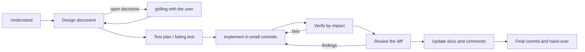
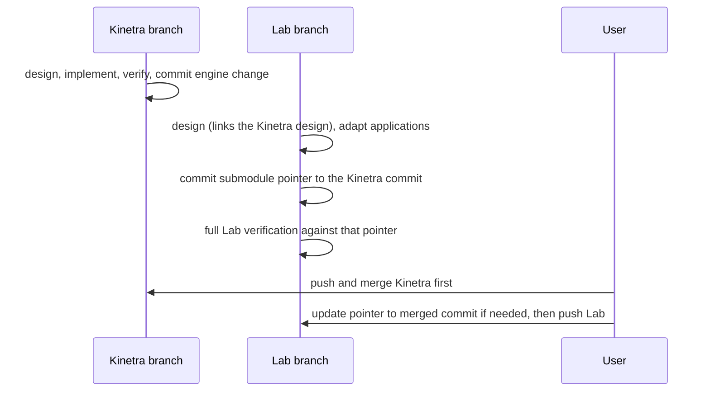

# Development workflow

How a change moves from idea to commit in Kinetra and Kinetra-Lab. Every change follows this cycle; the depth of each step scales with the change, but no step is skipped.

## Table of contents

- [The cycle](#the-cycle)
- [1. Understand](#1-understand)
- [2. Design](#2-design)
- [3. Test plan](#3-test-plan)
- [4. Implement](#4-implement)
- [5. Verify](#5-verify)
- [6. Review](#6-review)
- [7. Document](#7-document)
- [8. Commit and hand over](#8-commit-and-hand-over)
- [Branches and commits](#branches-and-commits)
- [Changes across Kinetra and Lab](#changes-across-kinetra-and-lab)
- [Open points](#open-points)

[Directory guide](README.md) · [Project overview](../README.md) · [Documentation index](README.md) · [Agent rules](../AGENTS.md)

## The cycle

The design document is the backbone. It is written first, it collects the decisions, test plan and review outcome, and it ends with the pull-request text for the user. The `feature` skill runs the whole loop.

## 1. Understand

- Read [AGENTS.md](../AGENTS.md) and only the pages its routing table points to for this task.
- Run `git status` in every repository you will touch, and note unrelated work so it stays untouched.
- Read the code, tests and docs around the change before proposing anything. Facts you can look up are your job; decisions are the user's.

## 2. Design

Create `docs/design/YYYY-MM-DD-<topic>.md` from the [template](design/README.md#template) on a new branch. Fill in the problem, goals, non-goals, design, affected areas and risks.

- **Open decisions.** List them. If any decision is load-bearing (a wrong guess costs a rewrite, a migration or the user's trust), settle it with the user first. Use the `grilling` skill when there are several.
- **Diagram.** Include one when structure or interaction changes; the [documentation guide](documentation.md#diagrams) says which kind.
- **ADR.** Write one when the decision is hard to reverse, surprising without context, *and* the result of a real trade-off (`adr` skill). The design document links to it.
- **Size.** A typo fix needs a few lines per section; a subsystem change needs a page. Several small related fixes may share one branch and one design document.

## 3. Test plan

Write the plan into the design document before coding: which behavior is new or changed, and which test proves it.

- **Bug fix.** Start with a test that reproduces the bug and fails.
- **New behavior.** Write the test with or before the implementation. Test observable behavior, not internal counters.
- **Behavior-preserving refactor.** First make sure tests pin the current behavior. If they don't, add characterization tests (for example a golden summary for a fixed seed) before restructuring.

Rules and test kinds are in [testing](testing.md).

## 4. Implement

- Work in small steps; each step compiles and keeps the tests that should pass passing.
- Refactoring and behavior change go in separate commits, so each diff answers one question.
- Follow the [conventions](conventions.md) and write `///` summaries and *why*-comments while the reasoning is fresh ([code comments](documentation.md#code-comments)).
- If you find an unrelated bug, record it under *Open points* in the design document and report it. Do not silently fix it in the same change.

## 5. Verify

Choose the level from [verification levels](testing.md#verification-levels) based on what the diff touches. The `verify` skill does this. The last commit of a branch that changed code always gets the full level.

## 6. Review

Review the complete branch diff (`git diff main...HEAD`) as if someone else wrote it. Use the built-in `/code-review` in Claude Code or the global `code-review` skill in Codex, then check:

- **Correctness.** Edge cases, invalid input, ownership and lifetimes, determinism.
- **Boundaries.** Engine versus application; headless versus runtime; public versus private headers.
- **Tests.** Every changed behavior is covered, and no test was weakened.
- **Readability.** Names, function size, flag arguments, magic numbers, duplication.
- **Documentation.** `///` contracts, module README, diagrams and links still match the code.

Fix the findings, re-verify at the right level and record the outcome in the design document's *Review* section.

## 7. Document

- Update the module README, contract pages and diagrams the change affects.
- Set the design document's status to `implemented`, or to `abandoned` with the reason.
- Add or update index entries: the design index and, for an ADR, the decision index.
- Run the docs check.

## 8. Commit and hand over

- The final commit leaves the branch consistent: code, tests, docs and design document agree.
- The design document's *Pull request* section holds a ready-to-paste title and description.
- Report to the user in Dutch: what changed, the commits, the verification commands and results, remaining risks, and what to push in which order.

## Branches and commits

| Item | Rule | Example |
| --- | --- | --- |
| Branch | `<type>/<topic>`, from up-to-date `main` | `refactor/i4sim-mover-state` |
| Commit subject | `type(scope): imperative summary`, English, at most about 72 characters | `refactor(i4sim): replace mover flags with MoverState` |
| Commit body | Optional: why, and the observable effect; no file lists | |
| Types | `feat`, `fix`, `refactor`, `test`, `docs`, `build`, `chore`, `perf` | |

Agents commit only on the feature branch and never push, open pull requests or merge; see [AGENTS.md](../AGENTS.md#git).

## Changes across Kinetra and Lab

- Reusable mechanisms change in Kinetra; application policy changes in Lab. When both change, each repository gets its own branch and design document. The Lab design document links to the Kinetra one.
- A Lab commit that points at an unpublished Kinetra commit cannot be built by others. The hand-over must say that Kinetra is pushed first.
- If Kinetra is merged with a squash, the pointer must be moved to the merged commit before Lab is published.

## Open points

- CI per pull request (headless build, tests, format and docs checks) is planned; see the Lab quality roadmap in `docs/design/` of Kinetra-Lab.
