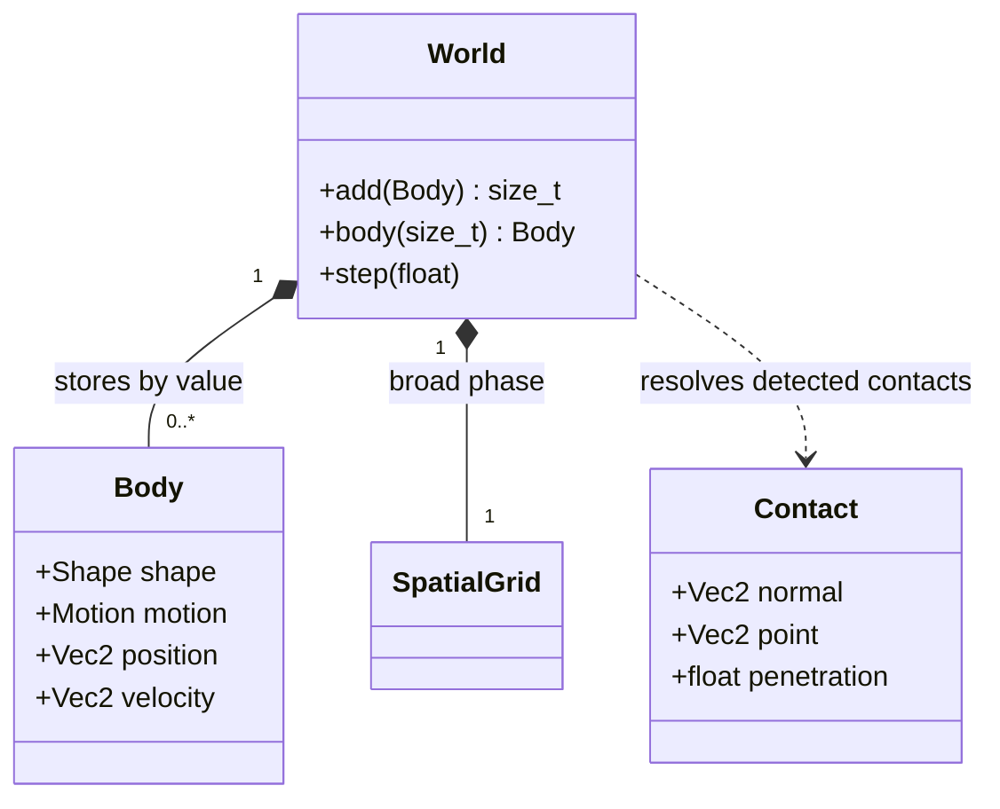

# Public Kinetra API

Consumers include these headers as `<kinetra/name.h>`. This is the engine's first-party public interface; backend types remain private.

## Table of contents

- [Header map](#header-map)
- [Implementation and contracts](#implementation-and-contracts)

[Parent guide](../README.md) · [Project overview](../../README.md) · [Documentation index](../../docs/README.md)

## Header map

| Headers | Responsibility | Linking |
| --- | --- | --- |
| [math.h](math.h) | Vectors, geometry and numeric helpers | Header-only |
| [physics.h](physics.h), [spatial_grid.h](spatial_grid.h), [collision_grid.h](collision_grid.h) | Circle/box/convex polygon bodies, contacts, convex translation sweeps and spatial queries | `Kinetra::Simulation` |
| [traffic.h](traffic.h) | Occupancy-aware FIFO admission for caller-defined conflict zones | `Kinetra::Simulation` |
| [avoidance.h](avoidance.h) | Reciprocal circle/axis-aligned rectangle velocity selection, acceleration limits and explicit infeasibility | `Kinetra::Simulation` |
| [navigation.h](navigation.h), [weighted_grid.h](weighted_grid.h), [steering.h](steering.h) | Paths, routes and local steering | `Kinetra::Simulation` |
| [engine.h](engine.h), [session.h](session.h) | Runtime, input, drawing and direct sessions | `Kinetra::Runtime` |
| [launcher.h](launcher.h) | Generic menu, session host and launcher loop | `Kinetra::Launcher` |
| [camera.h](camera.h), [timing.h](timing.h) | Coordinate transforms and fixed clock | Header-only |
| [bitmap_text.h](bitmap_text.h), [debug_view.h](debug_view.h), [help_view.h](help_view.h) | Text rendering and shared overlays | Header-only; drawing uses Runtime |

## Implementation and contracts

This UML-style excerpt describes `physics.h`, rather than the entire API. Bodies and the grid are owned values; contacts are collision results, not base classes. `body()` returns a reference to a stored body.

Compiled implementations live in [simulation](../../src/simulation/README.md) and [engine](../../src/engine/README.md). Runtime and Launcher are optional; simulation APIs remain headless.

Use the [subsystem contracts](../../docs/engine/README.md) for behavior and ownership, and the [external consumer](../../tests/consumer/README.md) for linking examples. Return to the [header guide](../README.md).
