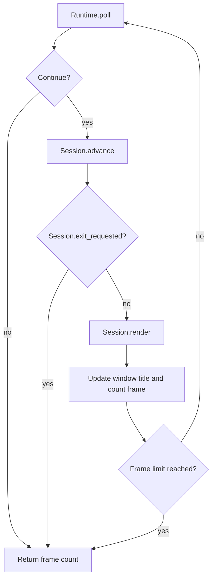

# Runtime and launcher implementation

This directory implements the optional SDL2/OpenGL runtime and the generic launcher. Public interfaces live in [include/kinetra](../../include/kinetra/README.md).

## Table of contents

- [Source map](#source-map)
- [Relationships](#relationships)

[Parent guide](../README.md) · [Project overview](../../README.md) · [Documentation index](../../docs/README.md)

## Source map

| File | Responsibility | Target |
| --- | --- | --- |
| [runtime.cpp](runtime.cpp) | Window and input lifecycle, backend resources and primitive rendering | `Kinetra::Runtime` |
| [session.cpp](session.cpp) | Direct session event and rendering loop | `Kinetra::Runtime` |
| [launcher.cpp](launcher.cpp) | Menu selection/layout, session hosting and launcher event loop | `Kinetra::Launcher` |

## Relationships

This is the direct `run_session` loop in `session.cpp`. The application owns session behavior; Runtime supplies input, camera and drawing. A zero frame limit runs until polling or the session requests exit.

Launcher links Runtime; Runtime does not link Simulation. SDL/OpenGL implementation details stay behind public engine interfaces. Application registration and the executable belong to Kinetra-Lab.

See the [runtime contract](../../docs/engine/runtime.md), [launcher contract](../../docs/engine/launcher-overlays.md) and [test guide](../../tests/README.md). Return to the [source map](../README.md).
