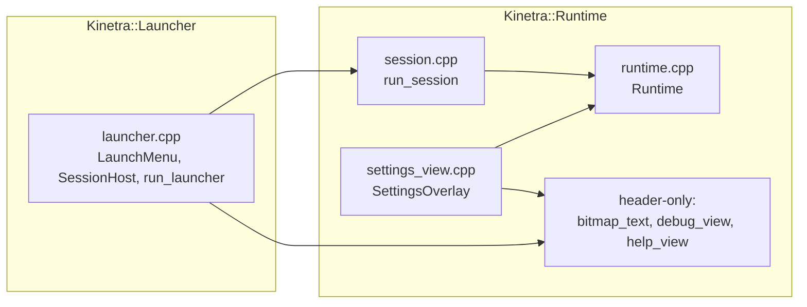
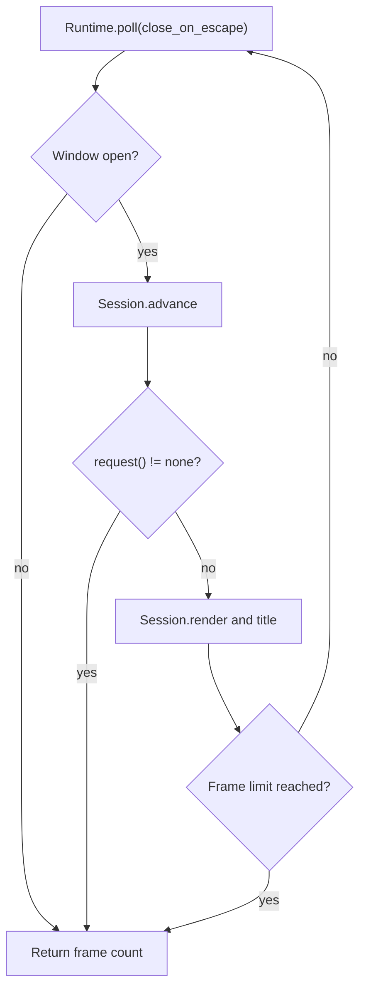

# Runtime and launcher

The optional interactive half of Kinetra: an SDL2/OpenGL 3.3 window with input and batched primitive drawing (`Kinetra::Runtime`), the loops that drive application sessions, the settings overlay, and the generic launcher (`Kinetra::Launcher`). Applications such as those in Kinetra-Lab use it to get a window, a menu and shared overlays without owning any backend code.

## Table of contents

- [Purpose and scope](#purpose-and-scope)
- [Concepts](#concepts)
- [Structure](#structure)
- [How it works](#how-it-works)
- [Invariants and contracts](#invariants-and-contracts)
- [Changing this module](#changing-this-module)
- [Tests](#tests)
- [Open points](#open-points)

[Project overview](../../README.md) · [Documentation index](../../docs/README.md)

## Purpose and scope

The runtime turns a window into input, a camera and colored primitives; the session loops turn an application into frames; the overlays and the launcher give every application the same menu, settings panel and debug controls.

Not here: simulation (headless, in [src/simulation](../simulation/README.md); Runtime does not link it), application rules and registration (Kinetra-Lab), textures, audio and alternate backends.

## Concepts

| Term | Meaning |
| --- | --- |
| Logical pixels | Window coordinates used for input, picking and overlays; independent of high-DPI framebuffers |
| Drawable pixels | Framebuffer size used for the OpenGL viewport |
| Session | Application behavior behind the window: advance, render, title, and a `SessionRequest` |
| Request | `none`, `menu` or `exit`, read by the host after every advance |
| Host | The loop that owns a session: `run_session` for one application, `run_launcher` with a `SessionHost` for many |
| Overlay | Screen-space panel that owns its layout, drawing and input capture; the application supplies content |

## Structure



*Takeaway:* everything draws through `Runtime`; the launcher builds on the session contract and the shared text and overlay helpers.

| File | Responsibility | Target |
| --- | --- | --- |
| [runtime.cpp](runtime.cpp) | Window and context lifecycle, input, primitive batching and presentation (`Runtime::Impl`) | `Kinetra::Runtime` |
| [session.cpp](session.cpp) | `run_session`: the loop for one directly launched session | `Kinetra::Runtime` |
| [settings_view.cpp](settings_view.cpp) | `SettingsOverlay`: rows, layout, picking and drawing | `Kinetra::Runtime` |
| [launcher.cpp](launcher.cpp) | `LaunchMenu`, `MenuLayout`, `SessionHost` and `run_launcher` | `Kinetra::Launcher` |
| [glad.c](../glad.c) | Generated OpenGL 3.3 loader; keep its generated contents ([provenance](../../include/glad/README.md)) | `Kinetra::Runtime` |

| Public header | Responsibility | Linking | Contract |
| --- | --- | --- | --- |
| [engine.h](../../include/kinetra/engine.h) | `Runtime`, `Input`, `Key`, `Color` | `Kinetra::Runtime` | [Runtime](../../docs/engine/runtime.md) |
| [session.h](../../include/kinetra/session.h) | `Session`, `SessionRequest`, `run_session` | `Kinetra::Runtime` | [Sessions and requests](../../docs/engine/launcher-overlays.md#sessions-and-requests) |
| [settings_view.h](../../include/kinetra/settings_view.h) | `SettingsOverlay` and its rows | `Kinetra::Runtime` | [Settings overlay](../../docs/engine/launcher-overlays.md#settings-overlay) |
| [launcher.h](../../include/kinetra/launcher.h) | `LaunchMenu`, `SessionHost`, `run_launcher` | `Kinetra::Launcher` | [Launcher](../../docs/engine/launcher-overlays.md#launcher) |
| [bitmap_text.h](../../include/kinetra/bitmap_text.h), [debug_view.h](../../include/kinetra/debug_view.h), [help_view.h](../../include/kinetra/help_view.h) | Glyphs and text, debug menu, help panel | Header-only; drawing calls need `Kinetra::Runtime` | [Debug menu, help and text](../../docs/engine/launcher-overlays.md#debug-menu-help-and-text) |
| [camera.h](../../include/kinetra/camera.h), [timing.h](../../include/kinetra/timing.h) | `Camera2D` and zoom, `FixedClock`, `RateCounter` | Header-only; usable headless | [Runtime](../../docs/engine/runtime.md), [presentation helpers](../../docs/engine/launcher-overlays.md#presentation-helpers) |

## How it works

**Direct sessions.** `run_session` polls, advances, checks the request, and only then renders:



*Takeaway:* a session that asks to leave is never drawn again, and without a launcher a menu request ends the run.

**Launcher.** `run_launcher` alternates between the menu and one hosted session; its state diagram and bindings are in the [launcher contract](../../docs/engine/launcher-overlays.md#launcher). Each frame it:
1. polls with the running session's Escape policy, or `escape_closes_menu` in the menu;
2. handles the bound menu key or a menu selection;
3. advances the session and acts on its request;
4. draws the session or the menu.

After a transition the clock restarts, so building a world does not count as simulated time. The title is refreshed on a transition and at most every 500 ms otherwise.

**Settings overlay.** `layout()` computes every row's position from the rows and their expanded state. `update()` takes that layout *before* applying the click, so the click hits what was drawn in the previous frame. `draw()` uses the same layout and the same click bands for its highlights. That shared layout is what keeps drawing and picking in step.

**Rendering.** `runtime.cpp` triangulates circles, boxes, polygons and lines into one dynamic vertex batch per frame and draws it in `end()`. Circles adapt their segment count to their size on screen and fade over a one-pixel edge for antialiasing. The [runtime contract](../../docs/engine/runtime.md) lists the limits.

## Invariants and contracts

- One `Runtime` at a time, created, used and destroyed on the main thread. Sessions are destroyed before the Runtime.
- Public headers expose no SDL, GLAD or OpenGL types; Runtime does not link Simulation.
- A host reads `request()` after every advance and before render; a session never sees a frame after its `menu` or `exit` request.
- `run_launcher` starts a session only from the menu, after the previous one was destroyed, so two sessions never exist at once (Dotio's world is a singleton). `SessionHost::start` itself keeps the old session until the factory succeeds, so a throwing factory leaves the old session and camera untouched.
- Overlay positions are in logical panel pixels, scaled by a factor that depends only on the viewport.
- Borrowed pointers (overlay flags, debug options) must outlive the overlay's `update` and `draw` calls.

## Changing this module

- **A new overlay row kind:** add an alternative to `SettingsRow`, give it a height in `SettingsOverlay::layout()` and a click and draw branch, then add a layout case to `settings_view_tests.cpp`. Lab's settings screenshots depend on the existing coordinates; keep them.
- **A new glyph:** add it to `glyph()` in `bitmap_text.h` and a case to `presentation_tests.cpp`.
- **A new host rule** (for example another request): change both `run_session` and `run_launcher`, the table in the [launcher contract](../../docs/engine/launcher-overlays.md#sessions-and-requests), and add graphics cases to `runtime_tests.cpp`. A change to `Session` breaks every application; record it in an ADR.
- **A new key:** add it to `Key` in `engine.h` and to the SDL mapping in `runtime.cpp`, and to the key loop in `runtime_tests.cpp`.

## Tests

| Suite | Covers | Needs a window |
| --- | --- | --- |
| `kinetra_launcher` | Menu paging and configuration, `SessionHost` transitions, debug actions | No |
| `kinetra_settings_view` | Overlay layout, rows, capture and actions | No |
| `kinetra_presentation` | Glyph table, zoom stepping, rate counter | No |
| `kinetra_engine_graphics` | Input, rendering, resize, `run_session` and `run_launcher` requests and bindings | Yes (`KINETRA_TEST_GRAPHICS`) |

```sh
cmake --workflow --preset dev        # window-free suites
cmake --workflow --preset graphics   # adds the graphics suite (software OpenGL, offscreen SDL)
```

The [external consumer](../../tests/README.md#external-consumer) links the public API from outside the repository.

## Open points

- `kinetra_engine_graphics` fails under WSL2 at the injected mouse-input check ([testing](../../docs/testing.md#open-points)); the session and launcher cases still run there.
- The LAUNCHER button stays visible when an application runs without a launcher, where it ends the program.
